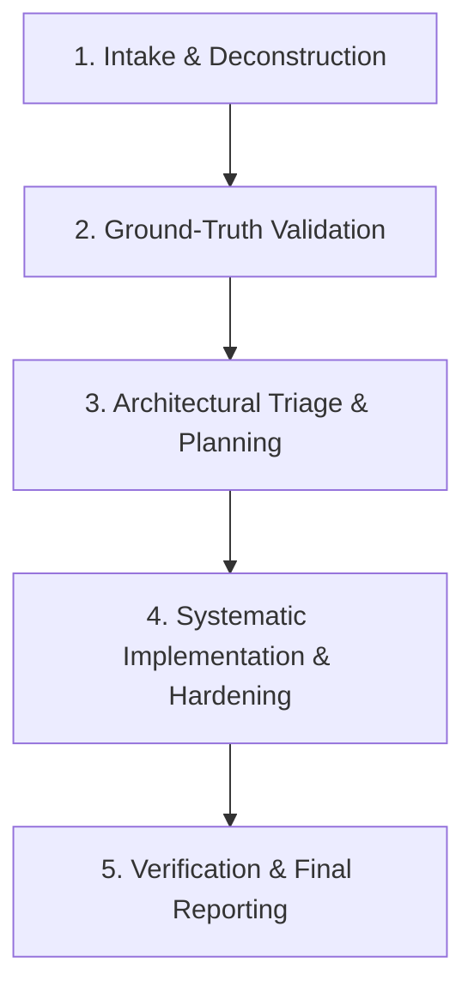

# Audit & Remediate Review Findings Workflow

Use this skill when presented with a list of critique items, review findings, or potential bugs flagged by an external AI, reviewer, or audit tool. The goal is to rigorously verify every claim against the ground-truth codebase, filter out hallucinations/false positives, and implement robust, production-grade fixes for all valid issues.

---

## The 5-Phase Execution Protocol



---

### Phase 1: Intake & Deconstruction

1. **Extract & Number Findings**: Break unstructured or multi-bullet feedback into discrete, numbered finding items ($F_1, F_2, \dots, F_n$).
2. **Identify Target Subsystems & Invariants**:
   - Relevant files (schemas, services, controllers, DTOs, tests).
   - Invariants asserted (multi-tenancy, data integrity, sanitization/PII, validation, RBAC, error handling, performance/indexing).

---

### Phase 2: Ground-Truth Validation (Fact-Checking)

Inspect the actual source files and git status using read/grep tools. **Never assume the reviewer is correct.** Classify each finding into one of four states:

1. **`VALID (Unfixed)`**:
   - The finding accurately describes a real vulnerability, bug, invariant violation, unhandled edge case, or missing contract in the current codebase.
   - *Action*: Mark for immediate remediation.
2. **`INVALID (False Positive / Misconception)`**:
   - The finding misinterprets the architecture, hallucinated code that doesn't exist, contradicts documented project specs/rules, or assumes constraints not applicable to the MVP.
   - *Action*: Record clear factual refutation citing actual code lines and architectural context.
3. **`ALREADY FIXED`**:
   - The issue was already addressed in existing code or previous commits.
   - *Action*: Cite the existing implementation and test coverage.
4. **`SPECULATIVE / OUT OF SCOPE`**:
   - Premature optimizations, speculative generalizations, or non-critical refactors that violate the lean MVP scope or `AGENTS.md` rules.
   - *Action*: Document why it is omitted or deferred.

---

### Phase 3: Architectural Triage & Remediation Planning

Group all `VALID` findings by architectural dependency layers and execute in order from the deepest database layer up to the API and test layers:

```
[Layer 1: Database & Persistence] -> schema.prisma, migrations, indexes, compound unique constraints, multi-tenant keys
         ↓
[Layer 2: DTOs & Validation]       -> Zod schemas, .strict(), string/int parsing regexes, range bounds, UUID coercion
         ↓
[Layer 3: Services & Domain Logic] -> @InjectPrisma(), cycle-safe sanitization, regex precision, P2025 handling, deterministic sorting
         ↓
[Layer 4: Controllers & API]       -> Explicit return types, parameter guards, status codes, route decorators
         ↓
[Layer 5: Tests & Verification]    -> Unit tests, edge cases, table-driven specs, NestJS DI module integration tests
```

---

### Phase 4: Systematic Implementation & Common Pitfalls

When implementing fixes, apply these standard patterns and defensive invariants:

#### 1. Database & Prisma Multi-Tenancy
- **Compound Keys**: Always enforce `business_id` in compound unique constraints (`@@unique([business_id, ...])`) and upserts to prevent cross-tenant collisions.
- **Targeted Indexes**: When filtering JSON paths or specific query dimensions (`rating`, `reason`, `action_type`), create explicit B-Tree compound indexes on `(business_id, column, created_at)`.
- Run `pnpm --filter <pkg> db:generate` immediately after modifying Prisma schemas.

#### 2. Wire Boundary & DTO Validation
- **Strict Parsing**: Apply `.strict()` on Zod schemas (`SubmitFeedbackSchema`, `ListActionsQuerySchema`) to reject un-whitelisted query/body parameters.
- **Strict Integers**: Avoid `z.coerce.number()` which accepts whitespace or floats. Use strict integer regex `/^[1-9]\d*$/` or `z.preprocess()` with bounds check.
- **UUID Validation**: Validate foreign keys (`messageId`, `conversationId`, `promptVersionId`) as UUIDs where appropriate to prevent malformed queries from reaching Prisma.

#### 3. Data Sanitization & Security
- **Circular Reference Protection**: In recursive data sanitizers, track visited objects using `WeakSet<object>`.
- **Bounded Recursion & Payloads**: Impose `MAX_SANITIZATION_DEPTH` (e.g. 8) and truncate unbounded strings / error messages (`MAX_STRING_LENGTH = 10_000`, `MAX_ERROR_MESSAGE_LENGTH = 2_048`).
- **Precision Sensitive Keys**:
  - Distinguish payment card expiry (`card_expiry`, `ccexp`, `exp_month`) from benign timestamps (`reservation_ttl_minutes`, `session_expiration`, `cache_expiration_days`).
  - Whitelist benign vocabulary (`secretariat`, `secretary`, `tokenizer`, `tokens_input`, `tokens_output`).
- **PAN Redaction**: Use Luhn-algorithm validation for credit card numbers found in free text to avoid redacting random 16-digit order numbers.

#### 4. Deterministic Ordering & Pagination
- **Tie-Breakers**: When paginating or computing streaks with `orderBy: [{ created_at: "desc" }]`, always append `{ id: "desc" }` to prevent skipping rows with identical timestamps.
- **Cursor Error Handling**: Catch Prisma known request error `P2025` (cursor not found) and map to a 400 Bad Request with `{ error: { code: "invalid_cursor" } }`.

#### 5. Dependency Injection
- Never rely on raw constructor fallbacks (`prismaClient ?? prisma`). Use the project token decorator: `@Optional() @InjectPrisma() prismaClient?: PrismaClient`.

---

### Phase 5: Verification & Reporting Gate

Before completing, execute all verification gates:

1. **Unit & Spec Tests**:
   ```bash
   pnpm --filter @app/api test
   ```
2. **Full Workspace Quality Gate**:
   ```bash
   pnpm fix && pnpm check:full
   ```
   *Must pass cleanly with zero lint, format, typecheck, or test failures.*
3. **Knowledge Graph Update**:
   ```bash
   graphify update .
   ```
4. **Final Deliverable Format**:
   Produce a structured report containing:
   - **Triage Matrix**: Table listing Finding #, Summary, Validity (`VALID` / `INVALID` / `ALREADY FIXED`), and Justification/Action.
   - **Remediation Details**: Clear bulleted breakdown of code changes organized by subsystem.
   - **Verification Results**: Test execution metrics and pass status.
