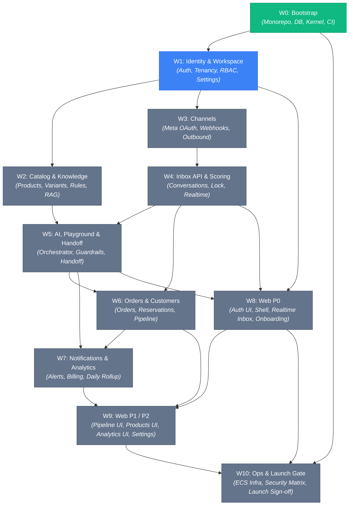
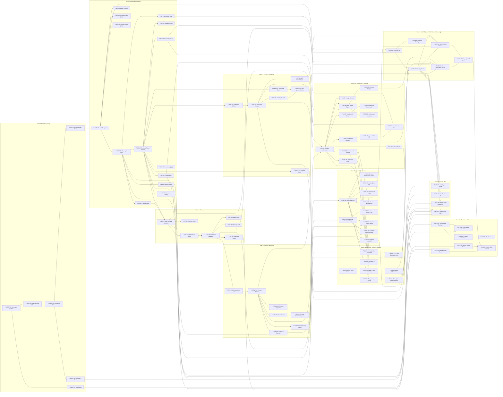

# Backlog Dependency Graph & Architectural Flow

This document provides a comprehensive view of task dependencies, execution order, parallel execution lanes, and dependency rationales across all 11 waves (W0–W10) of Phase 1 MVP.

---

## 1. High-Level Wave Progression

---

## 2. Complete Task Dependency Graph

---

## 3. Parallel Execution Lanes

While the serial `CURSOR.md` path executes tasks topologically, multiple independent sub-trees can be executed in parallel once their dependencies are satisfied:

| Lane       | Focus Area         | Entry Task  | Unlocking Dependency     | Independent Path                                         |
| ---------- | ------------------ | ----------- | ------------------------ | -------------------------------------------------------- |
| **Lane A** | Knowledge & RAG    | `T-KNOW-01` | `T-BIZ-01`               | `T-KNOW-01` -> `T-KNOW-02` -> `T-KNOW-03`                |
| **Lane B** | Catalog Management | `T-CAT-01`  | `T-BIZ-01`               | `T-CAT-01` -> `T-CAT-02` -> `T-CAT-03` -> `T-CAT-04`     |
| **Lane C** | Meta Channels      | `T-INT-01`  | `T-BIZ-01`, `T-BIZ-06`   | `T-INT-01` -> `T-INT-02` -> `T-INT-03` -> `T-INT-04..07` |
| **Lane D** | Customer CRM       | `T-CUST-01` | `T-INT-03`               | `T-CUST-01` -> `T-CUST-02` -> `T-CUST-03` -> `T-CUST-04` |
| **Lane E** | Production Infra   | `T-OPS-01`  | `T-BOOT-04`              | `T-OPS-01` -> `T-OPS-02` -> `T-OPS-03` -> `T-OPS-06`     |
| **Lane F** | Frontend Web P0    | `T-WEB-01`  | `T-AUTH-01`, `T-AUTH-03` | `T-WEB-01` -> `T-WEB-05`                                 |

---

## 4. Detailed Dependency Rationales

| Dependent Task | Required Dependency                            | Architectural & Technical Rationale                                                                 |
| -------------- | ---------------------------------------------- | --------------------------------------------------------------------------------------------------- |
| `T-AUTH-02`    | `T-AUTH-01`                                    | Guards require active JWT session extraction and user resolution from auth endpoints.               |
| `T-AUTH-03`    | `T-AUTH-02`                                    | Invitation acceptance creates workspace memberships that must satisfy TenancyGuard checks.          |
| `T-BIZ-01`     | `T-AUTH-02`                                    | Provisioning a business workspace assigns active Owner role which requires RBAC guards.             |
| `T-AI-10`      | `T-BIZ-01`                                     | AI agent configuration attaches to the seeded AI agent and settings created with workspace.         |
| `T-CAT-01`     | `T-BIZ-01`                                     | Categories must be strictly scoped to an existing tenant business workspace.                        |
| `T-CAT-02`     | `T-CAT-01`                                     | Products and variants require category hierarchy for classification and catalog organization.       |
| `T-KNOW-03`    | `T-KNOW-02`, `T-CAT-04`                        | Vector search worker indexes chunks from both knowledge documents and catalog products.             |
| `T-INT-01`     | `T-BIZ-01`, `T-BIZ-06`                         | Channel accounts connect to tenant business and check feature flags (`whatsapp_enabled`).           |
| `T-INT-02`     | `T-INT-01`                                     | Webhook verification requires matching incoming account ID to stored channel accounts.              |
| `T-INT-03`     | `T-INT-02`                                     | Inbound normalization parses raw webhook events saved in `integration_events`.                      |
| `T-CONV-01`    | `T-INT-03`                                     | Inbox conversation listing presents threads generated by normalized inbound messages.               |
| `T-CONV-04`    | `T-CONV-03`                                    | Concurrency locking wraps state machine transitions during turn processing.                         |
| `T-AI-01`      | `T-KNOW-03`, `T-CAT-02`, `T-CONV-04`           | AI orchestrator executes tool calls querying vector RAG, checks variant stock, and holds turn lock. |
| `T-HAND-01`    | `T-AI-01`                                      | Handoff triggers intercept orchestrator output and trigger human escalation with briefing.          |
| `T-ORD-01`     | `T-CONV-02`                                    | Order drafting and confirmation link directly to active conversation threads.                       |
| `T-HAND-02`    | `T-HAND-01`, `T-ORD-01`                        | Purchase handoff flow collects customer details, reserves stock, and creates pending order.         |
| `T-NOTIF-01`   | `T-HAND-01`, `T-LEAD-01`                       | Notification dispatcher triggers on handoffs and hot lead discoveries.                              |
| `T-BILL-02`    | `T-BILL-01`, `T-AI-01`                         | Usage metering records token counts and messages from AI orchestrator against plan limits.          |
| `T-ANL-01`     | `T-ORD-01`, `T-HAND-01`                        | Daily analytics aggregates GMV from orders and resolution rates from handoffs.                      |
| `T-WEB-01`     | `T-AUTH-01`, `T-AUTH-03`                       | Web authentication UI calls register, login, and invite acceptance API endpoints.                   |
| `T-WEB-02`     | `T-WEB-01`, `T-BILL-03`, `T-NOTIF-02`          | App shell mounts navigation, tenant switcher, usage widget, and notification popover.               |
| `T-WEB-03`     | `T-WEB-02`, `T-CONV-02`, `T-ORD-01`, `T-AI-08` | Realtime inbox provides thread actions, draft approvals, suggest triggers, and order drawer.        |
| `T-WEB-06`     | `T-WEB-03`, `T-WEB-04`                         | Playwright E2E suite tests user journey from signup to inbox takeover and order confirmation.       |
| `T-OPS-07`     | All required tasks                             | Final launch gate sign-off verifies 100% of Must functional requirements are complete.              |
