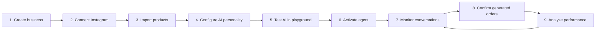
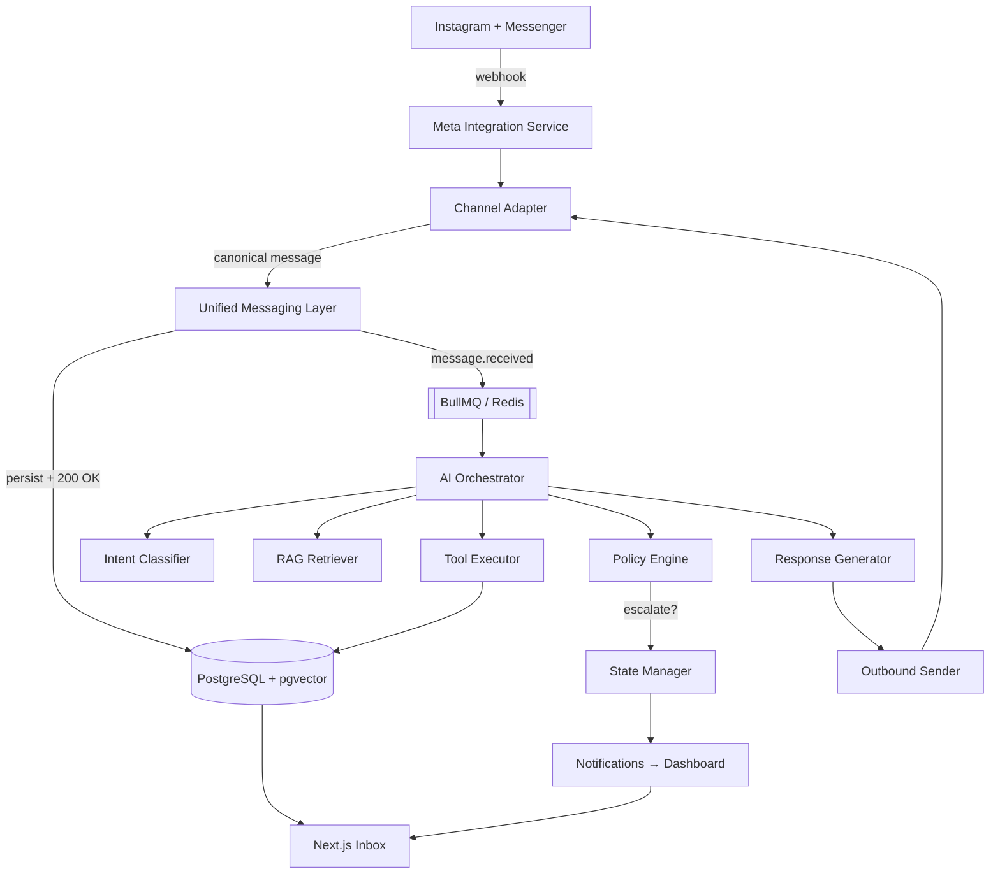

### 5.2 Explicit state machine, not implicit prompt behaviour

A conversation has exactly one `status` at any time, and transitions are logged. Escalation, handoff, and takeover are **state transitions executed by code**, not decisions improvised inside a prompt. Canonical definition: `docs/10_engineering/14_SYSTEM_DESIGN.md`.

### 5.3 Human closes the sale (MVP)

No payment provider is integrated in MVP. Purchase intent produces an order in `PENDING_CONFIRMATION` with `payment_status = NOT_COMPLETED`, moves the conversation to `HUMAN_REQUIRED`, sets `ai_enabled = false`, and notifies staff in the dashboard. Canonical flow: `docs/00_product/06_AI_HUMAN_HANDOFF_RULES.md`.

### 5.4 Fifteen defined human-required triggers

Escalation is enumerated, prioritised (`critical` / `high` / `normal`), and always carries a staff briefing (`handoff_context`). All fifteen triggers ship in MVP. Canonical list: `docs/00_product/06_AI_HUMAN_HANDOFF_RULES.md`.

### 5.5 Multi-tenant from line one

Every tenant-scoped table carries `business_id`. There is no "single-tenant now, multi-tenant later" phase. Enforcement lives in the application layer. Postgres RLS is **off** in MVP (`17` OQ-70). Canonical rules: `docs/10_engineering/17_SECURITY_DESIGN.md`.

### 5.6 Modular monolith, not microservices

One deployable NestJS application with hard internal module boundaries. Modules communicate through services and domain events, never through each other's database tables. Rationale and extraction path: `docs/10_engineering/10_ARCHITECTURE.md`.

### 5.7 Observability of AI is a product feature

`ai_actions` (what the AI did), `ai_decision_traces` (why it decided), `ai_usage` (what it cost), `ai_feedback` (what staff thought), `ai_evaluations` (conversation quality), and versioned `ai_prompts` all ship in MVP. A merchant must be able to ask "why did the AI transfer this conversation?" and get an answer. Canonical design: `docs/10_engineering/15_AI_ARCHITECTURE.md`.

### 5.8 Triage over transcript

The operator surface answers three questions — _who is talking to my business, how likely are they to buy, and what should I do next_ — and is judged against them. It is not a feed of every AI conversation. Concretely: the inbox sorts by sales priority rather than recency, notifications fire on only four situations, and a correctly working AI produces a **quiet** dashboard. A design that implies the owner should read everything turns a labour-saving product into a labour-creating one. Canonical: `docs/20_design/22_UX_FLOWS.md`.

### 5.9 Official Meta APIs only

MVP ships **Instagram + Messenger** through official Meta APIs. **WhatsApp** (Cloud API) is **Phase 2** — same stack, same adapter pattern, not a rewrite. Unofficial WhatsApp automation is prohibited at every phase: it risks banning the merchant's business number. Rationale: `docs/10_engineering/16_INTEGRATION_DESIGN.md`; decision record: Option C in Brain Dump `# Integration Architecture`.

### 5.10 Async by default at the channel boundary

Webhooks persist and return `200` immediately; all AI work runs in BullMQ jobs with idempotency keys and a per-conversation Redis lock. Canonical design: `docs/10_engineering/16_INTEGRATION_DESIGN.md`.

### 5.11 Context-rich, not clutter-rich

The operator UI is **information-rich without being visually cluttered**. Western SaaS hierarchy and restraint combine with Tunisian/MENA trust patterns (DT, local support, transparent usage, visible AI activity). The latest generated dashboard is the visual north star; target ~20% less visual noise than a typical dense dashboard while surfacing decision-critical context. Never confuse information density with visual density. Canonical: `docs/20_design/20_DESIGN_SYSTEM.md`.

---

## 6. Market and customer

### 6.1 Initial market

**Tunisia.** Chosen for:

- Strong social-commerce adoption (buying happens in DMs, not on websites)
- High density of Instagram/Facebook-first businesses
- Low automation adoption → low competitive pressure, high perceived value
- Language advantage: Tunisian Arabic + French code-switching is a barrier for global entrants

### 6.2 Expansion path

MENA: Morocco → Algeria → Egypt → Saudi Arabia → UAE. Each expansion is primarily a **language, currency, and delivery-rules** problem, not an architecture problem — which is why `business_rules`, `currency`, and `default_language` are tenant-level fields from day one.

### 6.3 First vertical

**Fashion ecommerce.** Chosen for:

- High message volume per merchant
- Highly repetitive questions (size, colour, availability, delivery)
- Visual products that map naturally to `product_images`
- Easy ROI measurement (a hoodie sold is a hoodie sold)

Vertical-specific consequence: the catalog model is **variant-first** (`size`, `color` as variant attributes, with price and stock on the variant). The AI searches **variants**, not parent products alone. See `docs/10_engineering/12_DATABASE_DESIGN.md`.

### 6.4 Ideal customer profile

| Attribute             | Value                                        |
| --------------------- | -------------------------------------------- |
| Company size          | 1–20 employees                               |
| Primary sales channel | Instagram DM, Facebook Messenger             |
| Message volume        | High enough that replies are a bottleneck    |
| Sales team            | None dedicated; the owner or 1–2 staff reply |
| Payment               | Cash on delivery dominant                    |
| Technical skill       | Low; onboarding must not require developers  |

### 6.5 Buyer vs user

- **Buyer / economic decision-maker:** the business owner. Cares about lost sales, response time, and revenue attribution.
- **Daily users:** owner, admin, and employees working the inbox. Care about speed, clarity of handoff, and not being embarrassed by the AI.
- **End customer:** the shopper in the DM thread. Never sees the product UI; only experiences message quality and response time.

---

## 7. Core user journey

The merchant-side journey the whole product is organised around:

Steps 1–6 are **onboarding** and are gated: the AI cannot go live until at least one priced **variant** exists, minimum business rules are set (inside step 4), a channel is connected, a playground test has passed, and the owner has acknowledged the handoff workflow. Messenger is connectable in step 2; WhatsApp is Phase 2. Canonical screens: `docs/20_design/22_UX_FLOWS.md`; activation gates: `docs/00_product/01_PRODUCT_REQUIREMENTS.md`.

Steps 7–9 are the **daily loop**, and the daily loop is where retention is won or lost. The single most important screen in the product is the **Inbox with a prioritised handoff queue**.

---

## 8. End-to-end system picture

A single inbound customer message, from provider to reply. This is orientation only; the authoritative sequence lives in `docs/10_engineering/14_SYSTEM_DESIGN.md`.

Three properties of this picture are load-bearing:

1. **The webhook never waits for the LLM.** Persist, acknowledge, enqueue.
2. **Facts flow from the database through tools into the prompt** — never the reverse.
3. **The state manager, not the model, owns conversation status.**

---

## 9. Technology summary

Full justification and version policy: `docs/10_engineering/11_TECH_STACK.md`.

| Layer                     | Choice                                                                                               |
| ------------------------- | ---------------------------------------------------------------------------------------------------- |
| Backend language          | TypeScript                                                                                           |
| Backend framework         | NestJS (modular monolith)                                                                            |
| API style                 | REST under `/api/v1`                                                                                 |
| Database                  | PostgreSQL + `pgvector`                                                                              |
| Cache / locks / queues    | Redis                                                                                                |
| Job processing            | BullMQ                                                                                               |
| Frontend                  | Next.js                                                                                              |
| Realtime                  | WebSocket (Socket.IO) via NestJS gateway, Redis adapter for fan-out                                  |
| Containerisation          | Docker                                                                                               |
| Cloud                     | **AWS ECS Fargate from day one** — three services. Canonical: `docs/10_engineering/18_DEPLOYMENT.md` |
| AI — customer reply       | Google **`gemini-3.5-flash`** (Arabizi); fallback `gpt-5.6-terra`, then `claude-sonnet-5`            |
| AI — classifier / summary | OpenAI **`gpt-5.6-luna`**                                                                            |
| AI — embeddings           | OpenAI **`text-embedding-3-small`**                                                                  |
| Channels (MVP)            | Meta official APIs: Instagram Messaging API + Messenger Platform API (WhatsApp Cloud API → Phase 2)  |

---
