# 03 — MVP Scope

| Field           | Value                                                                                                                              |
| --------------- | ---------------------------------------------------------------------------------------------------------------------------------- |
| Document ID     | `03_MVP_SCOPE`                                                                                                                     |
| Status          | Approved (Phase 1 baseline)                                                                                                        |
| Owner           | Product                                                                                                                            |
| Audience        | Everyone. This is the document that settles arguments about whether to build something.                                            |
| Depends on      | `00_PROJECT_OVERVIEW.md`, `01_PRODUCT_REQUIREMENTS.md`, `02_USER_STORIES.md`                                                       |
| Consumed by     | `04_ROADMAP.md`, `30_execution/30_TASKS.md`, `30_execution/31_IMPLEMENTATION_PLAN.md`, `30_execution/32_FEATURE_SPECIFICATIONS.md` |
| Upstream source | `docs/AI_Sales_Agent_Brain_Dump.md` → `# MVP` (authoritative)                                                                      |

---

## 1. Purpose

This document draws a hard line around Phase 1. It exists to answer one question repeatedly and identically: **"is this in the MVP?"**

It is deliberately opinionated about exclusions. A scope document that only lists what to build is half a document — most scope failures come from things nobody decided to exclude, not from things nobody decided to include.

Rules of use:

- If something appears in §5 (**In scope**), build it.
- If something appears in §6 (**Out of scope**), do not build it, do not build "a small version of it", and do not leave a hook for it unless §7 says so.
- If something appears in neither, it is **out** by default, and adding it requires the change process in §9.

---

## 2. What the MVP is testing

The MVP is not "version one of the product". It is an experiment with a falsifiable thesis. Everything in scope earns its place by serving one of these hypotheses.

| #      | Hypothesis                                                                                                                          | Falsified if                                                                               | Measured by                                                         |
| ------ | ----------------------------------------------------------------------------------------------------------------------------------- | ------------------------------------------------------------------------------------------ | ------------------------------------------------------------------- |
| **H1** | An AI can hold a grounded sales conversation in Tunisian Arabic and French well enough that merchants let it talk to real customers | Merchants keep the AI in `approval_required` mode indefinitely, or disable it after launch | Share of tenants on `auto_send`; AI accuracy and hallucination rate |
| **H2** | Handing a qualified buyer to a human converts, even without automated payment                                                       | Pending orders pile up unconfirmed, or confirmation rates are near zero                    | **Handoff → confirmed conversion** (primary MVP metric)             |
| **H3** | Merchants will do the setup work (connect a channel, load a catalog, state their rules)                                             | Signups stall before AI activation                                                         | Activation-gate completion funnel                                   |
| **H4** | A triage-first operator surface makes the AI's output usable rather than another inbox to watch                                     | Merchants ignore the dashboard and keep working in the native Instagram app                | Daily active operator sessions; time from handoff to human response |

H2 is the one that matters most. It is the reason the product can exist before payment integrations, and if it fails, no amount of AI quality saves the model.

**Scope test:** for any proposed feature, ask which hypothesis it tests. If the answer is "none, but users will want it", it belongs in `04_ROADMAP.md`.

---

## 3. MVP in one sentence

> A Tunisian fashion merchant connects Instagram and Messenger, loads a catalog and their business rules, activates an AI that answers customers in their own language using only real data, and works a triage-ordered command center where the AI hands over qualified buyers as pending orders that staff confirm — with four numbers proving whether it worked.

---

## 4. Scope boundary at a glance

```mermaid
flowchart TB
    subgraph IN["IN — Phase 1 MVP"]
        direction TB
        A["Auth, workspace, roles, onboarding"]
        LP["Public landing page (/)"]
        B["Variant-first catalog + CSV import"]
        C["Business rules + knowledge base + RAG"]
        D["Meta: Instagram + Messenger (official APIs)"]
        E["AI orchestrator: intents, tools, grounding, guardrails"]
        F["15 handoff triggers + purchase handoff"]
        G["Sales command center: triage, lead scoring, realtime, suggestions"]
        H["Orders: pending → confirmed, stock reservations"]
        I["Notifications, 4 KPIs, billing + AI budget"]
        J["AI observability: actions, traces, usage, feedback, evaluations"]
        ID["Identity resolution + playground + simple ECS"]
    end

    subgraph OUT["OUT — deferred with a named home"]
        direction TB
        K["Payments, checkout, refunds automation → Phase 4"]
        L["WhatsApp Cloud API → Phase 2"]
        M["Rich WhatsApp types, template authoring → Phase 3"]
        N["Shopify / WooCommerce sync → Phase 2"]
        KG["Knowledge graph, context compression → post-MVP"]
        O["Advanced analytics, CSAT, cost dashboards → Phase 4"]
        P["Multi-agent, voice, mobile app, ERP, marketing automation → Phase 5+"]
    end

    IN --> Q["Launch gate: §10"]
```

---

## 5. In scope

Each row names the canonical requirement IDs rather than restating behaviour. Requirement detail: `01_PRODUCT_REQUIREMENTS.md`. Acceptance criteria: `02_USER_STORIES.md`.

### 5.1 Identity, workspace, onboarding

| Capability                                 | Requirements                     | Notes on depth                                                            |
| ------------------------------------------ | -------------------------------- | ------------------------------------------------------------------------- |
| Public landing page & commercial presence  | FR-AUTH-013                      | Commercial page at `/` with Derja chat demo, 4-KPI ROI, Meta review legal |
| Email registration, login, refresh, logout | FR-AUTH-001 → 005, 009, 010      | Google OAuth is `S`, not a launch blocker                                 |
| Password reset                             | FR-AUTH-008                      | `S`                                                                       |
| Business creation with seeded defaults     | FR-BIZ-001 → 003                 | Seeds AI agent, settings, prompt references, starter rules                |
| Team invitations, roles, removal           | FR-BIZ-010 → 014, FR-AUTH-011    | Three fixed roles only (Employee = Agent in UI); no custom roles          |
| Resumable onboarding checklist             | FR-BIZ-020 → 023                 | Six merchant steps; policies live in personality step                     |
| AI Playground                              | FR-BIZ-026, FR-AI-030, FR-AI-031 | Required to satisfy activation gate G4; canned scenarios + free-form      |
| Activation gates enforced in API           | FR-BIZ-024, FR-BIZ-025           | Canonical gates: `01_PRODUCT_REQUIREMENTS.md` §14                         |

### 5.2 Catalog and knowledge

| Capability                                                         | Requirements            | Notes on depth                                                                                      |
| ------------------------------------------------------------------ | ----------------------- | --------------------------------------------------------------------------------------------------- |
| Variant-first product CRUD with images                             | FR-CAT-001 → 013        | Price and stock live on variants; AI searches variants; single-SKU products get one default variant |
| Category tree                                                      | FR-CAT-003              | Simple parent/child, no merchandising rules                                                         |
| CSV import with row-level validation and preview                   | FR-CAT-020 → 027        | The primary catalog-loading path for MVP                                                            |
| Business rules: delivery, payment, returns, hours, discount policy | FR-KNOW-001 → 010       | Versioned with effective dates; conflicts escalate rather than resolve                              |
| Knowledge documents with chunking and embedding                    | FR-KNOW-011 → 014       | Text paste; file and crawl ingestion are out                                                        |
| Re-embedding on catalog and knowledge writes                       | FR-CAT-011, FR-KNOW-012 | Staleness is a correctness bug, not a nicety                                                        |

### 5.3 Channels

**MVP ships Instagram + Messenger only**, through official Meta APIs. WhatsApp (Cloud API) is **Phase 2**. Unofficial WhatsApp automation is prohibited (`00_PROJECT_OVERVIEW.md` §5.9). Adapter stub and canonical `whatsapp` channel enum ship in MVP so Phase 2 is incremental.

| Capability                                               | Requirements           | Notes on depth                                                     |
| -------------------------------------------------------- | ---------------------- | ------------------------------------------------------------------ |
| Meta Integration Service: OAuth, tokens, webhook routing | FR-INT-001, 002, 004   | Single Meta app; MVP routes `page` and `instagram` webhook objects |
| Two adapters: Instagram, Messenger                       | FR-INT-010             | Thin translators; WhatsApp adapter folder stub only                |
| WhatsApp adapter stub (not connectable)                  | Hook in §7             | Interface + folder layout; behind `feature_flags.whatsapp_enabled` |
| Channel health, error surfacing, disconnect              | FR-INT-005, 006, 012   | Token expiry visible, not silent                                   |
| Signed webhooks, fast ack, idempotent ingestion          | FR-INT-007 → 009       | Persist and return `200` before AI work                            |
| Outbound with backoff and dead-lettering                 | FR-INT-011, FR-INT-031 | Per-channel throttling                                             |
| Inbound image storage and display                        | FR-INT-013             | Not interpreted by AI                                              |
| Prohibition on unofficial WhatsApp automation            | FR-INT-032             | Applies at every phase                                             |

### 5.4 AI

| Capability                                         | Requirements                             | Notes on depth                                                                                    |
| -------------------------------------------------- | ---------------------------------------- | ------------------------------------------------------------------------------------------------- |
| One configurable agent per business                | FR-AI-001 → 007                          | Multi-agent is out                                                                                |
| Three reply modes with `approval_required` default | FR-AI-010 → 015                          | `draft_only` is `S`                                                                               |
| Grounding and restriction guarantees               | FR-AI-020 → 024                          | Non-negotiable; see `05_AI_BEHAVIOR_SPECIFICATION.md`                                             |
| Model fallback, timeout escalation                 | FR-AI-028, 029                           | Degraded replies are never sent                                                                   |
| Prompt versioning with per-message traceability    | FR-AI-025 → 027                          | Platform defaults seeded, merchant override allowed                                               |
| AI Playground + conversation evaluations           | FR-AI-030 → 032, FR-OBS-011              | Simulator before go-live; `ai_evaluations` persisted                                              |
| AI suggestions during human handling               | FR-AI-016 → 020b                         | Draft-only; suppressed on complaints                                                              |
| Full 12-intent taxonomy and tool set               | Per `05_AI_BEHAVIOR_SPECIFICATION.md`    | Tools: search, recommend, inventory, reserve, delivery, history, pending order, handoff, transfer |
| Conversation summarization on handoff and takeover | FR-CONV-019                              | Template fallback when the model fails                                                            |
| Rule-based recommendations                         | Per Brain Dump `# Recommendation Engine` | Embedding similarity + rules; no ML model                                                         |

### 5.5 Sales command center

The operator surface ships in full, not as a basic inbox. Canonical design: `20_design/22_UX_FLOWS.md`.

| Capability                                                   | Requirements                   | Notes on depth                                                        |
| ------------------------------------------------------------ | ------------------------------ | --------------------------------------------------------------------- |
| Three-pane layout                                            | FR-CONV-030, 039 → 041         | List, thread, customer context with actions                           |
| Sales-priority triage ordering                               | FR-CONV-031, FR-LEAD-009       | Two-tier: escalations by priority and wait, then leads by temperature |
| "Needs me" default view and filters                          | FR-CONV-032, FR-CONV-002       | Not "all conversations"                                               |
| Unified inbox with channel filters                           | FR-CONV-035, 036               | No per-channel pages, ever                                            |
| Lead scoring, deterministic and explainable                  | FR-LEAD-001 → 009              | No LLM in the scoring path; never shown as a probability              |
| Realtime updates with polling fallback                       | FR-RT-001 → 006                | Socket is an accelerator; REST remains the truth                      |
| Human control: takeover, pause, resume, assign, notes, close | FR-CONV-011 → 016, FR-CONV-043 | Server state authoritative                                            |
| Escalation explainability in the UI                          | FR-CONV-020, FR-OBS-003        | Briefing for all staff; raw decision trace Owner/Admin only           |
| Read-only sales pipeline                                     | FR-CONV-050 → 053              | Projection only; drag-to-advance is out                               |
| Conversation timeline                                        | FR-CONV-040                    | Derived; no new storage                                               |

### 5.6 Commerce

| Capability                                       | Requirements      | Notes on depth                                                |
| ------------------------------------------------ | ----------------- | ------------------------------------------------------------- |
| All 15 `HUMAN_REQUIRED` triggers                 | FR-HAND-001 → 007 | Canonical: `06_AI_HUMAN_HANDOFF_RULES.md`                     |
| Purchase handoff pipeline                        | FR-HAND-008 → 010 | Intent → collect → reserve → pending order → handoff → notify |
| Orders: pending, confirmed, cancelled, completed | FR-ORD-001 → 009  | Four statuses only                                            |
