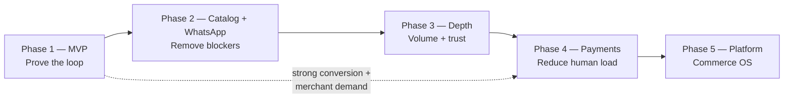

# 04 — Roadmap

| Field           | Value                                                                             |
| --------------- | --------------------------------------------------------------------------------- |
| Document ID     | `04_ROADMAP`                                                                      |
| Status          | Approved (Phase 1 committed; Phases 2–5 directional)                              |
| Owner           | Product / Founder                                                                 |
| Audience        | Product, engineering, design, investors, AI coding agents                         |
| Depends on      | `00_PROJECT_OVERVIEW.md`, `01_PRODUCT_REQUIREMENTS.md`, `03_MVP_SCOPE.md`         |
| Consumed by     | `30_execution/31_IMPLEMENTATION_PLAN.md`, `40_project_management/40_DECISIONS.md` |
| Upstream source | `docs/AI_Sales_Agent_Brain_Dump.md` → `# Roadmap` (authoritative)                 |

---

## 1. Purpose

This document is the **home for everything the MVP excluded**. `03_MVP_SCOPE.md` §6 defers roughly thirty-five capabilities; every one of them lands in a phase here, with the evidence that should trigger building it.

It answers three questions:

1. **What comes after launch, and in what order?**
2. **What evidence justifies starting each phase?**
3. **What would make us reorder?**

It is **not** a delivery schedule. Dates belong in `30_execution/31_IMPLEMENTATION_PLAN.md`. Phases here are sequenced by _evidence_, not by calendar.

---

## 2. Roadmap philosophy

### 2.1 Outcome phases, not feature batches

Each phase names a **goal and an exit signal**. A phase is finished when its metric moves, not when its feature list is checked off. Features that do not serve the phase goal are deferred even if they are easy.

### 2.2 Sequencing rule

> **Build the thing that is currently blocking merchants from getting value, not the thing that is most interesting to build.**

This is why Phase 2 is catalog import and WhatsApp — the two most common "I can't use this yet" objections — rather than smarter AI. Recommendation sophistication is more fun and less valuable.

### 2.3 Restraint list

Do **not** add multi-agent, fine-tuning, voice, or heavy ML recommendations until metrics justify them. Each is a permanent increase in configuration surface, evaluation cost, and failure modes. The bar is evidence, not enthusiasm.

### 2.4 Phase gates

A phase does not start until the previous phase's exit criteria are met. The one exception is a **reordering trigger** (§10), which is a deliberate, recorded decision — not drift.

---

## 3. Phase overview

| Phase                                   | Goal                                                     | Headline capability                                                                     | Exit signal                                                                                                               |
| --------------------------------------- | -------------------------------------------------------- | --------------------------------------------------------------------------------------- | ------------------------------------------------------------------------------------------------------------------------- |
| **1 — AI sales assistant (MVP)**        | Prove AI generates qualified buyers and measurable sales | Instagram + Messenger, purchase handoff, sales command center, 4 KPIs, AI observability | 10 paying businesses, 1,000 conversations, measurable handoff → confirmed conversion                                      |
| **2 — Catalog connectivity + WhatsApp** | Remove the two biggest post-launch blockers              | Shopify/Woo sync, CSV hardening, **WhatsApp Cloud API**                                 | Time-to-first-AI-reply < 1 day; ≥50% merchants connect a catalog source; WhatsApp adoption among WhatsApp-first merchants |
| **3 — Channels & inventory depth**      | More volume, trustworthy stock                           | Two-way inventory sync, richer WhatsApp message types, better recommendations           | 3× message volume; inventory conflict rate down                                                                           |
| **4 — Payments & sales automation**     | Reduce human load while keeping trust                    | Payment links, `auto_send` default, lifecycle automation, advanced analytics            | Human messages per confirmed order down; CSAT stable                                                                      |
| **5 — AI commerce OS**                  | Platform for social commerce in MENA                     | Multi-location, teams/shifts, partner API, marketplace templates                        | Platform revenue from non-core surfaces                                                                                   |

The dotted line is the one sanctioned shortcut: strong Phase 1 conversion plus loud merchant demand can pull payments forward (§10).

---

## 4. Phase 1 — AI sales assistant (MVP)

**Status:** committed. Full scope: `03_MVP_SCOPE.md`.

### 4.1 Goal

Prove that an AI can qualify buyers in Tunisian Arabic and French, and that handing those buyers to a human converts into confirmed orders.

### 4.2 Ships

Instagram + Messenger via official Meta APIs, variant-first catalog with CSV import, business rules and knowledge base, AI orchestrator with grounding guarantees, all fifteen handoff triggers, purchase handoff to pending order, sales command center with lead-scored triage and realtime, orders with stock reservations, four KPIs, AI observability (actions, traces, usage, feedback, evaluations, prompt versions), customer identity resolution (including manual merge), AI Playground, usage limits with monthly AI budget, **simple ECS Fargate** production.

### 4.3 Success metrics

| Metric                         | Target                                                                 |
| ------------------------------ | ---------------------------------------------------------------------- |
| Paying businesses              | 10                                                                     |
| Conversations handled          | 1,000                                                                  |
| Handoff → confirmed conversion | Measured and reported per business                                     |
| AI-attributed confirmed orders | Primary KPI, trending up                                               |
| Activation funnel              | Share of signups that connect a channel, add products, and activate AI |
| MRR and retention              | Tracked internally; not merchant-dashboard tiles                       |

### 4.4 Exit criteria

The launch gate in `03_MVP_SCOPE.md` §10, plus the four hypotheses in §2 of that document showing signal rather than falsification. Specifically: merchants moving from `approval_required` to `auto_send` (H1), pending orders being confirmed rather than abandoned (H2), signups reaching activation (H3), and operators using the dashboard rather than the native apps (H4).

### 4.5 What Phase 1 deliberately does not answer

Whether merchants will pay _more_ for automation, whether WhatsApp is mandatory, and whether recommendations improve conversion. Those are Phase 2 and 3 questions and must not be pre-answered with speculative building.

### 4.6 Infrastructure in Phase 1

Docker Compose locally. Production is **AWS ECS Fargate from day one**. Canonical choices (region, VPC, sizing, DNS, pipeline): `docs/10_engineering/18_DEPLOYMENT.md`.

---

## 5. Phase 2 — Catalog connectivity + WhatsApp

### 5.1 Goal

Remove the two objections that will dominate post-launch feedback: _"how do I get my products in?"_ and _"my customers are on WhatsApp."_

### 5.2 Why these two together

Both are **adoption blockers**, not enhancements. A merchant who cannot load a catalog never reaches the AI. A merchant whose customers live on WhatsApp cannot use the product at all. Neither is solved by making the AI smarter.

Catalog import is stated in the Brain Dump as the higher priority of the two: _merchant catalog import beats recommendation sophistication_. WhatsApp joins this phase because deferring it further risks losing the segment of the market that never used Instagram for selling.

### 5.3 Ships

| Capability                                                 | Detail                                                                                                                         | Requirements                 |
| ---------------------------------------------------------- | ------------------------------------------------------------------------------------------------------------------------------ | ---------------------------- |
| **WhatsApp Cloud API**                                     | Basic messaging, 24-hour service window, template sync and send, per-conversation metering, connection flow with prerequisites | FR-INT-014, FR-INT-020 → 030 |
| **Shopify catalog sync**                                   | Read-first: products, variants, images                                                                                         | New — spec at phase start    |
| **WooCommerce catalog sync**                               | Read-first                                                                                                                     | New                          |
| **CSV import hardening**                                   | Normalized variants and images, better error recovery                                                                          | Extends FR-CAT-020 → 027     |
| **Scheduled refresh + reindex**                            | Keep synced catalogs and embeddings current                                                                                    | Extends FR-KNOW-014          |
| Google Sheets import                                       | Lower value than Shopify; include only if capacity remains                                                                     | —                            |
| Conversation snooze, prompt editing UI, ownership transfer | Small deferred items from `03_MVP_SCOPE.md` §6.4                                                                               | FR-CONV-018 and others       |
| Unsupervised fuzzy customer merge                          | Confident auto-link + manual merge already ship in MVP                                                                         | —                            |
| Shadow mode as a standing practice                         | `ai_shadow_mode` used continuously for evaluation                                                                              | —                            |

### 5.4 WhatsApp entry conditions

WhatsApp work starts when **either** is true:

- Merchant interviews show a material share of the pipeline is WhatsApp-first, or
- Phase 1 merchants request it unprompted and it appears in churn or lost-deal reasons

The adapter stub, canonical `whatsapp` channel enum, and feature flag already ship in MVP (`03_MVP_SCOPE.md` §7), so this is an incremental build rather than a re-architecture.

### 5.5 Success metrics

| Metric                                             | Target                                                           |
| -------------------------------------------------- | ---------------------------------------------------------------- |
| Median time-to-first-AI-reply after signup         | < 1 day                                                          |
| Merchants connecting Shopify/Woo or completing CSV | ≥ 50% of new merchants (not manual one-by-one entry)             |
| WhatsApp connect rate                              | ≥ 30% of merchants who declare WhatsApp as their primary channel |
| Catalog-related support contacts                   | Down materially from Phase 1 baseline                            |

### 5.6 Risks

| Risk                                                                | Mitigation                                                                                    |
| ------------------------------------------------------------------- | --------------------------------------------------------------------------------------------- |
| WhatsApp business verification blocks merchants for days            | Prerequisites stated upfront; activation never depends on WhatsApp (FR-INT-022)               |
| WhatsApp per-conversation cost erodes margin                        | Metered separately from day one (FR-INT-030); review per-channel margin before public pricing |
| Shopify/Woo data models do not map cleanly to variant-first catalog | Read-first sync only; no write-back until mapping is proven                                   |
| Sync introduces stale-price bugs                                    | Scheduled reindex plus the existing rule that price comes from a tool call, not an embedding  |

---

## 6. Phase 3 — Channels & inventory depth

### 6.1 Goal
