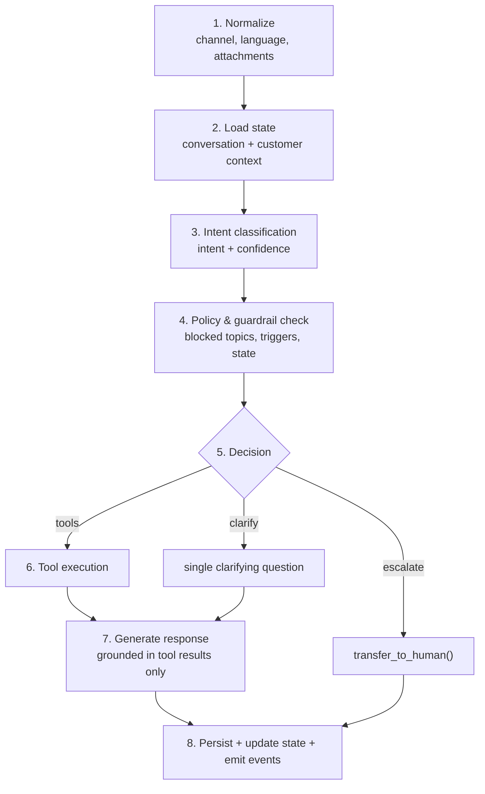

# 05 — AI Behavior Specification

| Field           | Value                                                                                                                                                                  |
| --------------- | ---------------------------------------------------------------------------------------------------------------------------------------------------------------------- |
| Document ID     | `05_AI_BEHAVIOR_SPECIFICATION`                                                                                                                                         |
| Status          | Approved — canonical for AI behaviour                                                                                                                                  |
| Owner           | AI Systems / Product                                                                                                                                                   |
| Audience        | Backend engineers, AI engineers, QA, AI coding agents                                                                                                                  |
| Depends on      | `01_PRODUCT_REQUIREMENTS.md`, `03_MVP_SCOPE.md`                                                                                                                        |
| Consumed by     | `06_AI_HUMAN_HANDOFF_RULES.md`, `10_engineering/15_AI_ARCHITECTURE.md`, `30_execution/32_FEATURE_SPECIFICATIONS.md`                                                    |
| Upstream source | `docs/AI_Sales_Agent_Brain_Dump.md` → `# AI Agent`, `# AI Decision Engine`, `# AI Architecture`, `# AI Agents (per business)`, `# Memory`, `# AI Evaluation Framework` |

---

## 1. Purpose and scope

This document is **canonical for what the AI does, says, and refuses to say**. When any other document describes AI behaviour, it defers to this one.

**In scope:** the decision pipeline, intent taxonomy, tool contracts, grounding rules, context priority, memory layers, restrictions, output constraints, reply modes, behaviour by lifecycle stage and conversation state, failure behaviour, and the observability every turn must emit.

**Out of scope, and where it lives instead:**

| Topic                                                              | Canonical location                     |
| ------------------------------------------------------------------ | -------------------------------------- |
| The 15 `HUMAN_REQUIRED` triggers, priorities, staff briefing       | `06_AI_HUMAN_HANDOFF_RULES.md`         |
| Orchestrator component design, model routing, RAG, grounding check | `10_engineering/15_AI_ARCHITECTURE.md` |
| Table columns and indexes                                          | `10_engineering/12_DATABASE_DESIGN.md` |
| Endpoint shapes                                                    | `10_engineering/13_API_DESIGN.md`      |
| Inbox presentation of AI state                                     | `20_design/22_UX_FLOWS.md`             |
| Requirement IDs and priorities                                     | `01_PRODUCT_REQUIREMENTS.md` §11       |

**One brain across all channels.** The same agent, catalog, rules, and memory serve every connected channel. Channel is a transport detail handled by the adapter layer, never a reason for different reasoning. MVP connects Instagram and Messenger; WhatsApp joins in Phase 2 on the same contract.

---

## 2. The four laws

Everything below is an elaboration of these four invariants. If an implementation detail ever conflicts with one of them, the law wins and the detail is a bug.

### Law 1 — Grounding

> Every commerce fact in an outbound message must originate from a tool result or a stored business rule **retrieved in the same turn**.

Prices, stock levels, delivery fees, return windows, payment methods, discounts, and policies are never produced from the model's parametric knowledge. Not "usually". Never. A model that knows what a hoodie typically costs is a liability, not an asset.

### Law 2 — No unauthorised commitment

> The AI never commits the business to something the business has not authorised.

No invented discounts, no refund approvals, no promises about unavailable products, no payment guarantees, no delivery dates outside the configured rules.

### Law 3 — Escalate rather than improvise

> Uncertainty resolves to a human, never to a guess.

Empty tool results, conflicting sources, low classifier confidence, and unmodelled situations all route to a human. A handoff is a successful outcome, not a failure.

### Law 4 — Every turn is explainable

> A staff member must always be able to ask "why did the AI do that?" and get a real answer.

Intent, confidence, rules checked, tools called, and the resulting decision are recorded for every turn, before the reply is delivered.

---

## 3. Agent identity and configuration

Each business configures exactly **one** primary sales agent in MVP (FR-AI-001). Multiple agents and per-channel agents are Phase 5.

### 3.1 Merchant-configurable

| Setting                                  | Effect on behaviour                                       | Requirement |
| ---------------------------------------- | --------------------------------------------------------- | ----------- |
| `name`                                   | How the agent introduces itself                           | FR-AI-002   |
| `personality`                            | Short persona description injected into the system prompt | FR-AI-002   |
| `language`                               | Default reply language: `ar` / `fr` / `en`                | FR-AI-002   |
| `tone`                                   | Friendly, professional, etc.                              | FR-AI-002   |
| `greeting_template`, `fallback_template` | First contact and no-answer fallbacks                     | FR-AI-002   |
| `sales_strategy`                         | Upsell aggressiveness, cross-sell on/off                  | FR-AI-003   |
| `confidence_threshold`                   | Escalation threshold, default **0.65**                    | FR-AI-004   |
| `blocked_topics[]`                       | Subjects the AI refuses and escalates                     | FR-AI-005   |
| `custom_system_append`                   | Merchant text appended to the system prompt               | FR-AI-005   |
| `reply_mode`                             | `auto_send` / `approval_required` / `draft_only`          | FR-AI-010   |
| `enabled`                                | Global on/off for the business                            | FR-AI-006   |

Configuration changes take effect on the **next conversation turn**, with no redeploy (FR-AI-007).

### 3.2 What configuration can never do

Merchant configuration adjusts _style and strategy_. It can never weaken the four laws. Specifically, `custom_system_append` and `personality` cannot:

- Authorise the AI to state prices or stock from memory
- Authorise discounts outside `business_rules`
- Suppress an escalation trigger
- Instruct the AI to approve refunds or promise payment outcomes

The Policy Engine enforces this **after** generation, so a merchant cannot prompt their way around a guardrail.

---

## 4. Language behaviour

The target market is Tunisia, where a single conversation routinely mixes Tunisian Arabic (often in Latin script), French, and occasional English.

| Rule                   | Behaviour                                                                                                                                            |
| ---------------------- | ---------------------------------------------------------------------------------------------------------------------------------------------------- |
| **Default**            | Reply in the business `language` setting                                                                                                             |
| **Customer override**  | If the customer clearly writes in another supported language, match them (FR-AI-022)                                                                 |
| **Code-switching**     | Mirror the customer's mix rather than forcing a single language; a customer writing _"famma black hoodie size M?"_ gets a reply in the same register |
| **Script**             | Reply in the script the customer used. Latin-script Tunisian Arabic gets a Latin-script reply, not a sudden switch to Arabic script                  |
| **Ambiguity**          | On a genuinely unclear language signal, use the business default rather than guessing                                                                |
| **Untranslated facts** | Product names, SKUs, and sizes are reproduced exactly as stored, never translated                                                                    |

Language detection happens in **Normalize** (§5, stage 1) and is recorded on the message. It is not re-derived during generation.

---

## 5. The decision pipeline

Every inbound customer message follows this fixed pipeline. It must be implemented **explicitly as code**, not as ad-hoc prompt logic. The stages exist so that each one can be tested, logged, and reasoned about independently.

### 5.1 Stage contracts

| #   | Stage                        | Input                               | Output                                                                          | On failure                                                                                                                   |
| --- | ---------------------------- | ----------------------------------- | ------------------------------------------------------------------------------- | ---------------------------------------------------------------------------------------------------------------------------- |
| 1   | **Normalize**                | Raw provider payload                | Canonical message: channel, text, language, attachments, provider timestamp     | Malformed payload → persist raw, escalate `integration_error`                                                                |
| 2   | **Load state**               | `conversation_id`                   | Conversation state, customer record, lifecycle stage, open orders, active rules | DB unavailable → do not ack the webhook; let the provider retry                                                              |
| 3   | **Intent classification**    | Normalized message + recent context | One of 12 intents + confidence 0–1                                              | Classifier **outage** → `unknown` + safe catalog tools only (`15` §5–6). Successful low confidence → clarification ladder §7 |
| 4   | **Policy & guardrail check** | Intent, state, customer, rules      | Allowed / escalate / blocked                                                    | Any trigger match short-circuits to escalation                                                                               |
| 5   | **Decision**                 | All of the above                    | Tool plan, escalation, or clarification                                         | —                                                                                                                            |
| 6   | **Tool execution**           | Tool plan                           | Structured results                                                              | Tool error → retry once, then state uncertainty or escalate                                                                  |
| 7   | **Generate response**        | Grounded facts + prompt stack       | Draft outbound message                                                          | Model failure → fallback model, then `ai_timeout` escalation                                                                 |
| 8   | **Persist**                  | Message, state, trace               | Stored message, updated state, emitted events                                   | Must be transactional with state update                                                                                      |

### 5.2 Ordering guarantees
