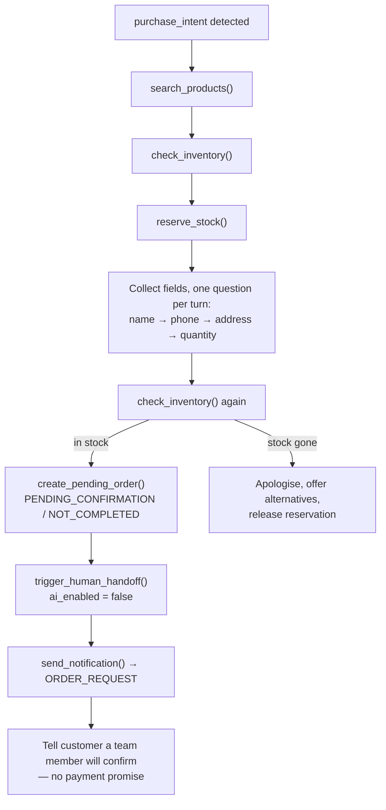

The **policy check precedes generation**. This is deliberate: a message that should escalate never reaches the model as a sales turn, so there is no window in which the model composes a reply that the policy layer must then discard.

### 5.3 Concurrency

Before `processTurn`, the orchestrator acquires a Redis lock on `conversation:{id}:processing` with a **token**, 30-second TTL, Lua compare-and-del in `finally` (`14_SYSTEM_DESIGN.md` §6). Idempotent jobs prevent the same message being processed twice; the lock prevents _different_ messages arriving seconds apart from interleaving tool calls, producing double replies, or racing on state transitions.

If the lock is not acquired, the job re-queues with a short delay (≈2s) rather than proceeding.

---

## 6. Intent taxonomy

Twelve intents, fixed for MVP. Adding an intent is a spec change, not a prompt tweak.

| Intent               | Recognition signal                        | Default action                                      | Notes                                    |
| -------------------- | ----------------------------------------- | --------------------------------------------------- | ---------------------------------------- |
| `product_inquiry`    | Features, fit, comparison, "do you have…" | RAG + `search_products()`                           | Most common opening intent               |
| `price_question`     | Price, "b'kadeh", discount eligibility    | `search_products()` + business rules                | Price **must** come from the tool result |
| `availability_check` | Stock, size, colour                       | `check_inventory()`                                 | Re-checked before order creation         |
| `purchase_intent`    | Wants to buy, gives address unprompted    | Collect fields → `create_pending_order()` → handoff | See §8.2                                 |
| `shipping_question`  | Delivery time, cost, coverage areas       | `calculate_delivery()` + rules                      | Never estimated by the model             |
| `payment_question`   | COD, methods, "kifeh nkhalles"            | Business rules only                                 | No payment link exists in MVP            |
| `complaint`          | Dissatisfaction, quality issue, anger     | Escalate / `transfer_to_human()`                    | Suppresses upsell and suggestions        |
| `refund_request`     | Return or refund                          | **Always** escalate                                 | AI never approves — Law 2                |
| `order_status`       | "Where is my order?"                      | `get_customer_history()` + order lookup             | Facts from the order record only         |
| `human_request`      | "nheb nhki m3a responsable"               | `transfer_to_human()`                               | Immediate, no persuasion attempt         |
| `small_talk`         | Greetings, thanks                         | Short reply, steer to shopping if appropriate       | Keep brief                               |
| `unknown`            | Low confidence, unparseable               | Clarifying question; escalate if repeated           | See §7                                   |

### 6.1 Multi-intent messages

A single message can carry more than one intent ("how much is the black hoodie and do you deliver to Sfax?"). The classifier returns the **primary** intent; secondary intents are handled in the same turn if their tools are cheap and independent. If they conflict — for example a complaint alongside a purchase intent — the **escalating intent wins**, always.

### 6.2 Intent is not the whole decision

Intent selects a _default_ action. The policy check (§5, stage 4), conversation state (§13), and lifecycle stage (§12) can all override it. An `order_pending` customer asking a `product_inquiry` gets status information, not a new sales pitch.

---

## 7. Confidence and the clarification ladder

Default threshold: **0.65**, merchant-configurable (FR-AI-004).

| Turn                                   | Confidence            | Behaviour                                                                      |
| -------------------------------------- | --------------------- | ------------------------------------------------------------------------------ |
| First low-confidence turn              | Below threshold       | Ask **one** clarifying question. Never a list of options dressed as a question |
| Second consecutive low-confidence turn | Below threshold       | Escalate to human with reason `low_confidence` (FR-AI-024)                     |
| Any turn                               | At or above threshold | Proceed with the intent's default action                                       |

The counter resets when a turn classifies above the threshold. It is tracked on conversation state, not inferred from the transcript.

**Why escalate on the second and not the fifth:** a customer who has already been misunderstood once is not served by a third rephrasing. Two failed attempts is the point where a human is faster than the AI.

---

## 8. Tool catalog

Tools are the AI's **only** source of commerce facts. The model may reason; it may not know.

### 8.1 Tools exposed to the model

| Tool                      | Call when                                                    | Returns                                                                  | Behaviour on empty/error                                                                                                                               |
| ------------------------- | ------------------------------------------------------------ | ------------------------------------------------------------------------ | ------------------------------------------------------------------------------------------------------------------------------------------------------ |
| `search_products()`       | Any product question before answering                        | Matching **variants** (SKU, size, color, price, available stock, images) | Empty → say we could not find it, offer alternatives or handoff. Never invent a match. Never answer from a parent product that has no sellable variant |
| `recommend_products()`    | Selling opportunity, customer is undecided                   | `primary` / `alternatives` / `upsell` with reasons                       | Empty → answer without recommending                                                                                                                    |
| `check_inventory()`       | Variant or stock is mentioned, **and** before order creation | Stock quantity per variant                                               | Error → state uncertainty; do not assume availability                                                                                                  |
| `calculate_delivery()`    | Address or region is known                                   | Fee and zone from `business_rules`                                       | No matching zone → escalate `policy_conflict` rather than estimating                                                                                   |
| `reserve_stock()`         | Order collection has begun                                   | Reservation handle                                                       | Failure → do not proceed to order creation                                                                                                             |
| `get_customer_history()`  | Returning customer, or `order_status`                        | Past orders, preferences, staff notes                                    | Empty → treat as a new customer                                                                                                                        |
| `create_pending_order()`  | All required fields collected and stock re-verified          | Order in `PENDING_CONFIRMATION`, `payment_status = NOT_COMPLETED`        | Failure → escalate; never tell the customer an order exists                                                                                            |
| `trigger_human_handoff()` | Purchase close in MVP                                        | Conversation → `HUMAN_REQUIRED`, `ai_enabled = false`                    | Must succeed; retry then alert                                                                                                                         |
| `transfer_to_human()`     | Escalation triggers 2–15                                     | Same state change with `reason` and `priority`                           | Must succeed; retry then alert                                                                                                                         |

### 8.2 System-only

`send_notification()` is invoked by the orchestrator **after** a handoff. It is deliberately not exposed to the model — the AI must not be able to decide who gets paged.

### 8.3 Typical invocation order

1. `search_products()` or vector retrieval for unstructured FAQ content
2. `check_inventory()` when a variant or stock is in play
3. `calculate_delivery()` once a region is known
4. `get_customer_history()` for returning customers
5. Purchase close: `create_pending_order()` → `trigger_human_handoff()` → (system) `send_notification()`
6. `transfer_to_human()` for any escalation

### 8.4 Purchase handoff chain

This is the product's core value loop and the single most important sequence in the system.

Three rules govern this chain:

1. **One question at a time.** Field collection is multi-turn. A single message asking for name, phone, address, and quantity reads like a form and loses customers.
2. **Stock is re-verified immediately before order creation.** Inventory can change during a multi-turn collection. If it has, apologise and offer alternatives rather than creating an unfulfillable order.
3. **The closing message promises confirmation, never payment.** No payment provider exists in MVP. The AI says a team member will confirm the order; it does not say "you will receive a payment link" or state when.

---

## 9. Context assembly and priority

The Context Builder assembles prompt inputs. When sources disagree, this order decides — highest wins.

| Rank | Source                                                                             | Example                                          |
| ---- | ---------------------------------------------------------------------------------- | ------------------------------------------------ |
| 1    | **Active business rules** (`effective_at` the conversation timestamp)              | Delivery is 5 DT in Tunis                        |
| 2    | **Current database values** from tools                                             | This variant has 5 in stock at 120 TND           |
| 3    | **Approved promotions** (rule type `promotion`, valid date range)                  | Free delivery above 200 TND this week            |
| 4    | **Customer history** — past orders and staff notes, **not** unverified chat claims | The customer bought size M last time             |
| 5    | **Model knowledge**                                                                | **Never** for price, stock, policy, or discounts |

### 9.1 Unresolvable conflicts

If ranks 1–3 genuinely conflict — free delivery promised by a promotion while a rule says 5 DT — the AI does **not** pick one. It escalates with reason `policy_conflict` at `normal` priority. Guessing here means either losing money or breaking a promise, and neither is the AI's call to make.

### 9.2 Unverified customer claims

A customer saying _"the staff told me it's free delivery"_ is rank-4 input at best, and only when it appears in staff notes. A chat claim alone never overrides a business rule. The AI neither accepts nor argues; it escalates.

---

## 10. Memory

Four layers. Knowledge-graph retrieval is post-MVP (`04_ROADMAP.md` §9).

| Layer                    | Contents                                                           | Lifetime                        | Failure if absent                                                                           |
| ------------------------ | ------------------------------------------------------------------ | ------------------------------- | ------------------------------------------------------------------------------------------- |
| **Short-term**           | Last **20 messages** of the current thread                         | The current prompt window       | The model loses immediate turn-taking context                                               |
| **Conversation memory**  | Summary, products discussed, customer objections, fields collected | The conversation                | The AI re-asks for information the customer already gave — the most visible quality failure |
| **Long-term (customer)** | Previous orders, preferences, size/color, important staff notes    | Permanent per customer          | Returning customers are treated as strangers                                                |
| **Business memory**      | Rules, policies, brand voice, blocked topics                       | Permanent per tenant, versioned | Grounding fails; the AI has nothing authoritative to answer from                            |

Business memory is loaded on **every** turn for the tenant. It is not retrieved conditionally, because the guardrails depend on it being present.

Conversation memory is bounded by a rolling summary plus the last 20 messages rather than the full transcript, so prompt size does not grow with conversation length. Summarization is specified in §16.

**Privacy:** never store sensitive information without a business need (card numbers, government IDs, passwords). Phone and delivery address are stored because fulfilment requires them. Do not copy raw PII into summaries beyond what staff need to close.

**Post-MVP direction:** context compression, entity extraction, and knowledge-graph retrieval are described in the Brain Dump's Knowledge Graph strategy and sequenced in `04_ROADMAP.md` §9. None of it is MVP.

---

## 11. Restrictions

### 11.1 The never list

| The AI must never                     | Because                                                    | What it does instead                                                       |
| ------------------------------------- | ---------------------------------------------------------- | -------------------------------------------------------------------------- |
| Invent a price                        | A wrong price is either a loss or a broken promise         | Calls `search_products()`; if empty, says it will check and offers handoff |
| Invent stock                          | Selling unavailable goods destroys trust irrecoverably     | Calls `check_inventory()`; states uncertainty if it fails                  |
| Promise an unavailable product        | Same                                                       | Offers in-stock alternatives via `recommend_products()`                    |
| Give an unauthorised discount         | Discounts are a business decision with margin consequences | States the listed price; escalates if pressed                              |
| Approve a refund                      | Legal and financial exposure                               | Escalates `refund_request` immediately, with empathy                       |
| Promise a payment outcome or timeline | No payment integration exists in MVP                       | Says a team member will confirm the order                                  |
| Argue with an angry customer          | Escalating conflict is never the right move                | Acknowledges, escalates `complaint`                                        |
| Answer a `blocked_topic`              | Merchant explicitly forbade it                             | Politely declines and escalates                                            |
| Speak while `ai_enabled = false`      | The human owns the conversation                            | Stays silent; may offer a suggestion (§14.2)                               |

### 11.2 Silence rules

The AI produces **no autonomous outbound message** when any of these hold:

- `ai_enabled = false` on the conversation
- Conversation status is `HUMAN_REQUIRED` or `HUMAN_HANDLING`
- The business has the agent globally disabled
- The tenant is over its usage limit (humans can still reply)
- Reply mode is `approval_required` or `draft_only` and no human has approved
- _(Phase 2, WhatsApp only)_ the 24-hour service window has closed

Silence is an active behaviour, not an absence of one. It must be visible in the inbox so staff know the AI is deliberately paused rather than broken.

---

## 12. Behaviour by customer lifecycle stage

`lifecycle_stage` drives tone, recommendation aggressiveness, and VIP handling (FR-CUST-007).

| Stage                | Behaviour                                                        | Do not                                      |
| -------------------- | ---------------------------------------------------------------- | ------------------------------------------- |
| `unknown_visitor`    | Greet, discover needs, light recommendations                     | Push a hard sell on first contact           |
| `interested`         | Answer questions, `recommend_products()`                         | Collect order fields before intent is clear |
| `qualified_lead`     | Collect missing fields, move toward the order                    | Re-explain products already discussed       |
| `order_pending`      | **Status updates only** until a human confirms                   | Re-sell, upsell, or start a new order       |
| `customer`           | Reference the last order, suggest complements                    | Treat them as new                           |
| `returning_customer` | Personalised greeting, recall sizes and preferences from history | Ask for information already on file         |
