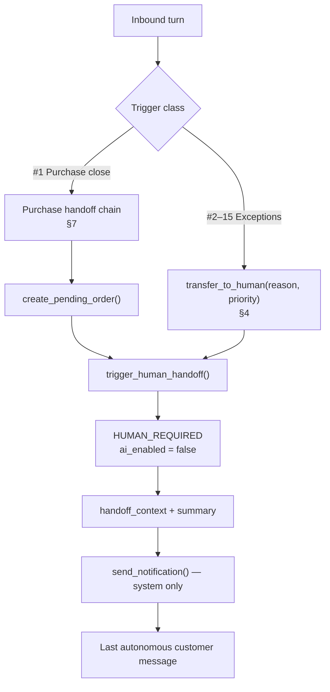

# 06 — AI Human Handoff Rules

| Field           | Value                                                                                                                                                  |
| --------------- | ------------------------------------------------------------------------------------------------------------------------------------------------------ |
| Document ID     | `06_AI_HUMAN_HANDOFF_RULES`                                                                                                                            |
| Status          | Approved — canonical for escalation and purchase handoff                                                                                               |
| Owner           | Product / AI Systems                                                                                                                                   |
| Audience        | Backend engineers, AI engineers, QA, frontend, AI coding agents                                                                                        |
| Depends on      | `01_PRODUCT_REQUIREMENTS.md`, `05_AI_BEHAVIOR_SPECIFICATION.md`, `03_MVP_SCOPE.md`                                                                     |
| Consumed by     | `10_engineering/14_SYSTEM_DESIGN.md`, `10_engineering/15_AI_ARCHITECTURE.md`, `30_execution/32_FEATURE_SPECIFICATIONS.md`                              |
| Upstream source | `docs/AI_Sales_Agent_Brain_Dump.md` → `# Human Required State Rules`, `# AI Sales Handoff & Human Checkout Completion`, `# Conversation State Machine` |

---

## 1. Purpose and scope

This document is **canonical for when the AI must stop, how it stops, what the human receives, and how the sale is closed in MVP**. When any other document describes escalation, purchase handoff, takeover, or resume, it defers to this one.

A handoff is a **successful outcome**, not a failure. The product thesis is: the AI handles ~80–90% of the conversation; a human closes the transaction (and the exceptions). That split is the MVP, not a workaround.

**In scope:** the fifteen `HUMAN_REQUIRED` triggers, priorities, detection rules, `handoff_context` schema, behaviour while paused, purchase-handoff pipeline, takeover and resume, notifications tied to handoff, conversion timestamps, and failure paths that terminate in a human.

**Out of scope, and where it lives instead:**

| Topic                                                 | Canonical location                     |
| ----------------------------------------------------- | -------------------------------------- |
| Intents, tools, grounding, silence rules, suggestions | `05_AI_BEHAVIOR_SPECIFICATION.md`      |
| Requirement IDs and priorities                        | `01_PRODUCT_REQUIREMENTS.md` §11       |
| Full conversation state machine, jobs, locks          | `10_engineering/14_SYSTEM_DESIGN.md`   |
| Inbox presentation of briefing and controls           | `20_design/22_UX_FLOWS.md`             |
| Order table columns and reservation schema            | `10_engineering/12_DATABASE_DESIGN.md` |

---

## 2. The handoff invariant

> The AI never improvises an escalation, and never continues autonomously after one.

Concretely:

1. Escalation is **enumerated**. Only the reasons in §4 may set `HUMAN_REQUIRED`. Adding a reason is a spec change, not a prompt tweak.
2. Escalation is **code**. The Policy Engine (or the purchase tool chain) executes the state transition. The model may request `transfer_to_human()`; it cannot set `ai_enabled` itself.
3. Escalation is **briefed**. Every handoff persists `escalation_reason`, `handoff_priority`, and `handoff_context` before the AI's last autonomous message is delivered.
4. Escalation is **silent thereafter**. `ai_enabled = false`. No autonomous outbound. Suggestions may still be drafted on demand except on complaint and refund threads (`05` §14.2).

If an implementation ever lets the model "decide to keep talking" after a trigger matched, that is a bug, not a personality setting.

---

## 3. Two pipelines

There are two ways into `HUMAN_REQUIRED`. They share the same destination state and briefing contract. They do not share the same tools.

| Pipeline           | Tool                                                     | When           | Order record                                                                       |
| ------------------ | -------------------------------------------------------- | -------------- | ---------------------------------------------------------------------------------- |
| **Purchase close** | `trigger_human_handoff()` after `create_pending_order()` | Trigger #1     | Always: `PENDING_CONFIRMATION`, `payment_status = NOT_COMPLETED`                   |
| **Exception**      | `transfer_to_human(reason, priority)`                    | Triggers #2–15 | Only if one already exists; do not create an order to "have something to hand off" |

`send_notification()` is **system-only**. The model cannot choose who is paged (`05` §8.2).

`ai_timeout` is not a sixteenth product trigger. It is a dedicated `escalation_reason` that uses the **exception pipeline** with `critical` priority, counted with integration failures for operations and separately in analytics. See §4.15.

---

## 4. Complete trigger set

All fifteen ship in MVP (FR-HAND-001). Detection runs in the **policy check, before generation** (`05` §5.2), except #1, which is the _successful end_ of a multi-turn collection, not a short-circuit of the first buying message.

When two triggers match in one turn, **the higher priority wins**. Equal priority: the more specific commercial/legal reason wins over `low_confidence`. The losing reason is recorded in `handoff_context.also_matched[]` so staff are not blind to it.

| #   | Situation                                    | `escalation_reason`   | Priority   | Pipeline  |
| --- | -------------------------------------------- | --------------------- | ---------- | --------- |
| 1   | Purchase completion (no auto payment)        | `purchase_handoff`    | `high`     | Purchase  |
| 2   | Payment issues                               | `payment_issue`       | `critical` | Exception |
| 3   | Refund requests                              | `refund_request`      | `critical` | Exception |
| 4   | Returns / exchanges                          | `return_exchange`     | `high`     | Exception |
| 5   | Complaints / negative sentiment              | `complaint`           | `critical` | Exception |
| 6   | Low AI confidence (after one clarify)        | `low_confidence`      | `normal`   | Exception |
| 7   | Customer requests human                      | `human_request`       | `high`     | Exception |
| 8   | Negotiation / discount with no matching rule | `negotiation`         | `high`     | Exception |
| 9   | Custom / out-of-catalog order                | `custom_order`        | `high`     | Exception |
| 10  | VIP / high-LTV customer (when flag on)       | `vip_customer`        | `critical` | Exception |
| 11  | Bulk / large quantity                        | `bulk_order`          | `high`     | Exception |
| 12  | Legal / sensitive                            | `legal_sensitive`     | `critical` | Exception |
| 13  | Inventory conflict                           | `inventory_conflict`  | `high`     | Exception |
| 14  | Conflicting business rules                   | `policy_conflict`     | `normal`   | Exception |
| 15  | Integration / tool failure                   | `integration_failure` | `critical` | Exception |

### 4.1 `purchase_handoff` — purchase completion

**Detect:** classified `purchase_intent` **and** required fields complete **and** stock re-verified **and** pending order created. Not on the first "nheb nechri" — that starts collection (`ORDER_INTENT_DETECTED`). See §7.

**Do:** last AI message tells the customer a team member will confirm. No payment promise, no discount, no delivery date outside rules (FR-HAND-008).

**Do not:** create the order if stock failed the re-check (FR-HAND-009); that is either alternatives or #13.

### 4.2 `payment_issue` — payment problems

MVP has **no payment provider**. This trigger is not "checkout failed." It is the customer reporting a payment problem the AI cannot resolve: claimed they already paid, dispute over amount, refusal of COD after intent, "I sent a virement, where is my order?", screenshot of a transfer the AI cannot verify.

**Detect:** `payment_question` or `purchase_intent` plus a claim or dispute the tools cannot confirm. A normal "kifeh nkhalles?" answered from `business_rules` is **not** this trigger.

**Do:** acknowledge, do not confirm or deny that money was received, escalate immediately.

### 4.3 `refund_request` — refunds

**Detect:** intent `refund_request`, or clear language of wanting money back / cancelling a paid or delivered order for reimbursement.

**Do:** empathy, then human. The AI **never** approves, denies, or quotes a refund amount (FR-HAND-007, Law 2). Suggestions suppressed for the rest of the thread.

### 4.4 `return_exchange` — returns and exchanges

**Detect:** wants to send an item back or swap size/colour, without (or in addition to) asking for money back. If both return and refund are present, `#3` wins (higher priority).

**Do:** capture the order reference if known via `get_customer_history()`, escalate. Do not promise a return will be accepted unless a business rule states a window **and** the request is clearly inside it **and** no exception is required — even then, a size exchange on a worn item is judgement: escalate.

### 4.5 `complaint` — anger and dissatisfaction

**Detect:** intent `complaint`, or negative sentiment strong enough that continuing a sales script would make it worse (insults, "arnaque", quality accusations, delivery rage).

**Do:** short acknowledgement, no argument, no upsell, no recommendation (FR-HAND-007). Suggestions suppressed. Priority `critical` so it interrupts.

### 4.6 `low_confidence` — clarification exhausted

**Detect:** classifier confidence below `confidence_threshold` (default 0.65) on the **second consecutive** low-confidence turn (`05` §7). The first such turn asks one clarifying question and does **not** hand off.

**Do:** escalate `normal`. This is the quietest exception; it must not page like a refund.

### 4.7 `human_request` — customer asks for a person

**Detect:** intent `human_request` ("nheb nhki m3a responsable", "give me a human", "parler à quelqu'un").

**Do:** immediate transfer, high priority, polite confirmation that someone will come. **No persuasion attempt** to stay with the AI. The last message is a handoff, not a retention script.

### 4.8 `negotiation` — unauthorised discount

**Detect:** customer asks for a price below list, a "prix ami", or a discount, and **no** active `business_rules` promotion covers it. Default in MVP: the AI may mention **no** discounts.

**Do:** state the listed price from the tool result; if they insist, escalate `high`. Do not invent a percentage "to close."

If a dated promotion **does** apply, this is not a handoff — it is a grounded answer from rank 3 of the context priority (`05` §9). If the promotion and a delivery rule conflict, that is #14, not #8.

### 4.9 `custom_order` — not in the catalog

**Detect:** the customer wants something `search_products()` cannot match, and they insist on a custom / made-to-order / out-of-range size the catalog does not carry — not a simple "we don't have that colour, here are alternatives."

**Do:** capture the request in the briefing; escalate `high`. Do not quote a custom price.

### 4.10 `vip_customer` — optional auto-handoff

**Detect:** customer `lifecycle_stage = vip` **or** a `vip` tag, **and** `feature_flags.vip_auto_handoff = true` for the business.

Default of that flag is **`false`**. When false, VIP only changes tone (`05` §12): priority language, never argue — it does **not** force a handoff. When true, the next inbound escalates `critical` even if the content is ordinary.

VIP is a **manual tag** in MVP (FR-CUST-008), not an automatic LTV model.

### 4.11 `bulk_order` — large quantity

**Detect:** requested quantity or implied cart size exceeds the business bulk threshold.

**Default threshold (assumption until a rule exists):** quantity **≥ 5** of a single variant, **or** estimated line total **≥ 500 DT**. Merchants override via `business_rules` of type `bulk_threshold`. Recorded as OQ-35.

**Do:** do not apply an unpublished wholesale price. Capture quantity in the briefing; escalate `high`.

### 4.12 `legal_sensitive` — legal and sensitive topics

**Detect:** legal threats, lawyer/police, defamation, harassment, data-deletion / GDPR demands beyond a normal profile edit, accusations that require a company position.

**Do:** no opinion, no admission of liability, no joke. Escalate `critical` immediately. Blocked-topics list (`ai_settings.blocked_topics`) also lands here when matched.

### 4.13 `inventory_conflict` — stock cannot honour the promise
