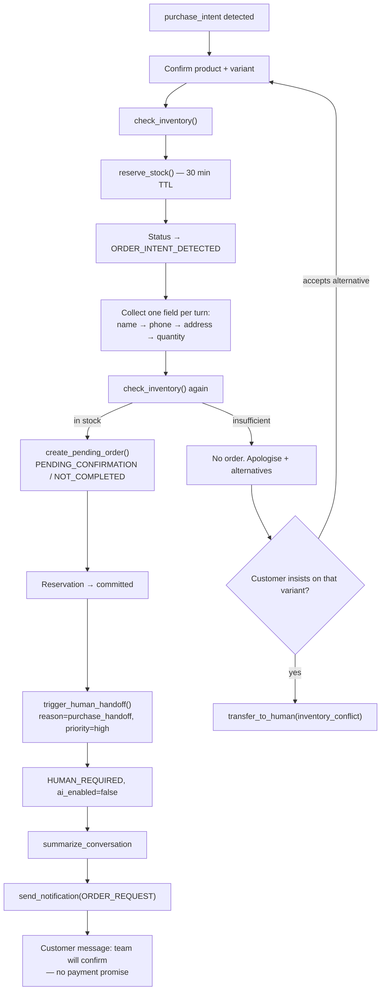

**Detect:** reservation failure; stock re-check fails at order creation; two conversations contend for the last unit and this one lost; customer insists on the specific unavailable variant after alternatives were offered (US-E-04).

**Do:** no pending order. Apologise, offer in-stock alternatives when they exist. If they refuse alternatives, escalate `high` with the variant and the stock figure from the tool (never from memory).

A clean "out of stock, customer accepts an alternative" is **not** a handoff.

### 4.14 `policy_conflict` — rules disagree

**Detect:** context-priority ranks 1–3 genuinely conflict (e.g. promotion says free delivery, zone rule says 5 DT, cart is under the promo threshold but the customer cites the promo). Unverified chat claims vs a rule are **not** a conflict — they escalate only if the customer insists after the AI states the rule; prefer #8 or a `human_request` rather than inventing a new reason.

**Do:** do not pick a winner. Escalate `normal` with both sources named in the briefing (`05` §9.1).

### 4.15 `integration_failure` — tools or models down

**Detect:** tool error after one retry; all LLM providers failed; webhook/persist succeeded but the turn cannot complete safely. **`ai_timeout`:** LLM exceeded 15s, one retry, still failing (`05` §19). Store `escalation_reason = ai_timeout` (not a silent alias) so analytics can split timeouts from provider outages; same priority and pipeline as #15.

**Do:** do not send a degraded or guessed reply (FR-AI-029). Optional one-time "we'll reply shortly" per thread if no models remain; then human.

---

## 5. Priority

| Level      | Meaning                                                                 | Inbox                                 | Notifications                                                            |
| ---------- | ----------------------------------------------------------------------- | ------------------------------------- | ------------------------------------------------------------------------ |
| `critical` | Harm, money already in dispute, VIP auto-handoff, legal, system failure | First among `HUMAN_REQUIRED`          | Interrupts (FR-NOTIF-014)                                                |
| `high`     | Sale ready, human requested, bulk, negotiation, returns, inventory      | After all critical, oldest wait first | Accumulates in the bell                                                  |
| `normal`   | Low confidence, policy conflict                                         | After high                            | Bell only; respects working hours when configured (FR-NOTIF-015, Should) |

Inbox sort for the human-required tier: `handoff_priority` descending, then `handoff_at` ascending (oldest first) (FR-CONV-003). Lead score does **not** reorder this tier.

---

## 6. Staff briefing — `handoff_context`

Every handoff persists this JSONB on the conversation (FR-HAND-003). The summary job fills `summary` and copies it in; if the LLM summary fails, a **template fallback** still produces a briefing. A handoff is never blocked by summarization (`05` §16).

### 6.1 Schema

```json
{
  "schema_version": 1,
  "customer": {
    "id": "uuid",
    "name": "Aymen",
    "phone": "+216xxxxxxxx",
    "channel": "instagram",
    "lifecycle_stage": "qualified_lead"
  },
  "summary": "Customer wants Black Hoodie size M. Address Tunis. Waiting on confirmation.",
  "intent": "purchase_intent",
  "confidence": 0.92,
  "products_discussed": [
    {
      "product_id": "uuid",
      "variant_id": "uuid",
      "name": "Black Hoodie M",
      "sku": "HOODIE-BLK-M",
      "price": 120,
      "currency": "TND"
    }
  ],
  "collected_fields": ["name", "phone", "address", "quantity"],
  "missing_fields": [],
  "ai_recommendation": "Confirm COD; delivery 5 DT Tunis per business rules.",
  "escalation_reason": "purchase_handoff",
  "handoff_priority": "high",
  "also_matched": [],
  "pending_order": {
    "id": "uuid",
    "amount": 125,
    "currency": "TND",
    "item_count": 1
  },
  "action_required": "Confirm the order with the customer (payment and delivery).",
  "decision_trace_id": "uuid"
}
```

`pending_order` is **null** on exception handoffs with no order. `action_required` is mandatory and written for a staff member with thirty seconds.

### 6.2 `action_required` by reason (defaults)

| Reason                               | Default action required                                                                  |
| ------------------------------------ | ---------------------------------------------------------------------------------------- |
| `purchase_handoff`                   | Confirm payment and delivery; mark order `CONFIRMED` or `CANCELLED`                      |
| `payment_issue`                      | Verify whether payment was received; do not let the AI's last message stand as a receipt |
| `refund_request`                     | Decide the refund; AI has not approved or denied                                         |
| `return_exchange`                    | Decide return/exchange against the return window                                         |
| `complaint`                          | Respond personally; do not upsell                                                        |
| `low_confidence`                     | Read the last customer message and reply; AI could not classify twice                    |
| `human_request`                      | Customer asked for a person — reply as a person                                          |
| `negotiation`                        | Approve or refuse the discount; listed price is in the briefing                          |
| `custom_order`                       | Accept, refuse, or quote; nothing was priced by the AI                                   |
| `vip_customer`                       | Priority handling; treat as relationship-critical                                        |
| `bulk_order`                         | Confirm quantity and price; no wholesale figure was quoted                               |
| `legal_sensitive`                    | Owner/Admin only; do not improvise a legal position                                      |
| `inventory_conflict`                 | Resolve stock; customer may still want the original variant                              |
| `policy_conflict`                    | Pick which rule wins; both are named in the summary                                      |
| `integration_failure` / `ai_timeout` | Reply manually; the AI could not complete the turn                                       |

### 6.3 Summary shape

Copied onto `conversations.summary` (FR-CONV-019):

```
Customer wants:       Black Hoodie size M
Concern:              Delivery time to Sfax
AI already collected: Name, phone, address (Tunis)
Reason for handoff:   Payment confirmation (pending order #1042)
Products discussed:   Black Hoodie M (120 DT), Navy Cap
AI recommendation:    Confirm COD; offer express only if in business rules
```

Regenerate if **more than 10** new messages arrive before a human opens the thread.

Staff must also see **why** the AI escalated, from the decision trace plus this briefing (FR-CONV-020).

---

## 7. Purchase handoff pipeline (MVP)

This is the product's core value loop. Payments are Phase 4; humans close.

### 7.1 Sequence



### 7.2 Collection rules

- Confirm **variant** before collecting identity (US-E-01).
- **One question per turn.** Name, phone, address, quantity — not a form.
- Phone: Tunisian formats accepted; unparseable → ask once with a hint, then escalate `low_confidence` or continue collection if the rest is usable (US-E-01).
- Write validated fields to the customer record as they arrive.
- Reservation: `reserve_stock(variant_id, quantity, conversation_id)` when buying intent is confirmed on a variant; default expiry **30 minutes**; available stock subtracts active reservations (FR-ORD-010–012). On order create: `committed`. On cancel, abandon, or expiry: `released`.

### 7.3 Order record

Created only after the second inventory check succeeds (FR-HAND-009, FR-ORD-001, FR-ORD-002):

- `status = PENDING_CONFIRMATION`
- `payment_status = NOT_COMPLETED`
- Customer snapshot (name, phone, address)
- Line items with variant, quantity, unit price from the tool/DB — not from the transcript
- Total, currency (DT / `TND`)
- Source conversation, creator = AI
- Idempotent by idempotency key (FR-ORD-007)

If `create_pending_order()` fails after retries: exception pipeline `#15`. **Never** tell the customer an order exists.

### 7.4 Last customer message

Allowed: a team member will confirm the order.

Forbidden: payment links, "you will receive a payment request", invented COD timing, discounts, "your card will be charged."

### 7.5 After handoff — staff close

- Confirm from the conversation in **one action** (FR-HAND-010): order → `CONFIRMED`, `order_confirmed_at` set, conversation → `ORDER_CONFIRMED`.
- Cancel releases the reservation (FR-ORD-008).
- Offline payment: staff mark `payment_status = COMPLETED` (FR-ORD-006). Not a gateway callback.
- First human open or Take over records `handoff_completed_at` **once** (FR-HAND-006).

**Resume AI is blocked** while any order on the conversation remains `PENDING_CONFIRMATION` (US-D-07). Confirm or cancel first.

---

## 8. Behaviour during `HUMAN_REQUIRED` and `HUMAN_HANDLING`

| Rule                                  | Detail                                                                                                                         |
| ------------------------------------- | ------------------------------------------------------------------------------------------------------------------------------ |
| `ai_enabled = false`                  | No autonomous replies (FR-HAND-004)                                                                                            |
| In-flight AI job                      | Must not send after takeover (US-D-06)                                                                                         |
| Suggestions                           | Allowed as drafts except complaint and refund threads                                                                          |
| Upsell                                | Never on complaint (FR-HAND-007)                                                                                               |
| Refund / payment confirmation         | Never by AI                                                                                                                    |
| New inbound                           | Persisted, list bumps, AI stays silent                                                                                         |
| Stronger trigger while already paused | If new priority is higher, bump `handoff_priority`, update briefing, notify per §10; do **not** nest a second `HUMAN_REQUIRED` |
| Already `HUMAN_HANDLING`              | Stay there; append to briefing / internal note; do not bounce back to `HUMAN_REQUIRED`                                         |

Silence is visible in the inbox: staff must see that the AI is paused, not broken (`05` §11.2).

---

## 9. Takeover, assign, resume

Executed by the **state machine**, not the prompt.

| Action                             | Effect                                                                                                                                           |
| ---------------------------------- | ------------------------------------------------------------------------------------------------------------------------------------------------ |
| **Take over** (explicit)           | `ai_enabled = false`; if `HUMAN_REQUIRED` → `HUMAN_HANDLING`; assign to actor if unassigned; `handoff_completed_at` if unset; summary if missing |
| **Send message** without Take over | Same pause; if `HUMAN_REQUIRED` → `HUMAN_HANDLING` (US-D-06)                                                                                     |
| **Assign**                         | Record on `conversation_assignments`; does not by itself pause or resume AI                                                                      |
| **Resume AI**                      | `ai_enabled = true`, status `AI_ACTIVE`, **only if** no `PENDING_CONFIRMATION` order and staff clicked Resume — never automatic from the queue   |
| **Close**                          | Any member with `inbox.write` (`13`) → `RESOLVED`; blocked while `PENDING_CONFIRMATION` unless they cancel the order first                       |

Auto-close: no messages for **30 days**, and no `PENDING_CONFIRMATION` order (including `HUMAN_REQUIRED` with no pending order). The **7-day stale-handoff warning** is Phase 2 — do not implement it in MVP (OQ-09).

---

## 10. Notifications

Handoff notifications are in-app only in MVP (FR-HAND-011 is Phase 4). Volume is an inverse quality signal.

### 10.1 Types produced by this document

| Event                                                              | `notifications.type` | Priority         | Recipients                    |
| ------------------------------------------------------------------ | -------------------- | ---------------- | ----------------------------- |
| Pending order created                                              | `ORDER_REQUEST`      | `high`           | Owner, Admin, assignee if set |
| Complaint / refund / angry (`06` family)                           | `HANDOFF`            | trigger priority | Same                          |
| Low confidence, policy_conflict, integration_failure, `ai_timeout` | `ESCALATION`         | trigger priority | Same                          |

Four types only (`12` `NotificationType`). Confirming an order is a **status**, not a fifth bell type (`14_SYSTEM_DESIGN.md`). `notify_handoff` skips `purchase_handoff` — `ORDER_REQUEST` already covers it. FR-NOTIF-010’s “order request or payment confirmation” is that same `ORDER_REQUEST` family, not `ORDER_CONFIRMED`.

`HOT_LEAD` is **not** a handoff. It is scored separately. Do not conflate a hot AI-handled conversation with `HUMAN_REQUIRED`.

`ORDER_REQUEST` is the single most important notification in the product.

### 10.2 Anti-spam (FR-NOTIF-010–014)

- At most **one notification per conversation per trigger type per hour**.
- `critical` interrupts; `high` / `normal` accumulate in the centre.
- Never notify on routine AI replies or inbound that needs no human.
- Click opens the conversation with the order in context when present.

Example `ORDER_REQUEST` copy:

```
New Order Request

Customer: Aymen
Product: Black Hoodie
Amount: 120 DT
Status: Waiting for confirmation

[Open conversation]
```

---

## 11. State machine (handoff-relevant)

Full enum and transitions: `docs/10_engineering/14_SYSTEM_DESIGN.md`. The paths that matter here:

```
NEW → AI_ACTIVE → ORDER_INTENT_DETECTED → HUMAN_REQUIRED → HUMAN_HANDLING → ORDER_CONFIRMED → RESOLVED

AI_ACTIVE → HUMAN_REQUIRED → HUMAN_HANDLING → RESOLVED
```

| From                    | To                      | Trigger                                                                                                          |
| ----------------------- | ----------------------- | ---------------------------------------------------------------------------------------------------------------- |
| `AI_ACTIVE`             | `ORDER_INTENT_DETECTED` | `purchase_intent` and collection started                                                                         |
| `ORDER_INTENT_DETECTED` | `HUMAN_REQUIRED`        | `create_pending_order()` + `trigger_human_handoff()`                                                             |
| `AI_ACTIVE`             | `HUMAN_REQUIRED`        | `transfer_to_human()` for #2–15                                                                                  |
| `ORDER_INTENT_DETECTED` | `HUMAN_REQUIRED`        | Exception mid-collection (complaint, human request, inventory conflict, …) — **no** order unless already created |
| `HUMAN_REQUIRED`        | `HUMAN_HANDLING`        | Take over or first human outbound                                                                                |
| `HUMAN_REQUIRED`        | `ORDER_CONFIRMED`       | Staff confirm without chatting (`14`)                                                                            |
| `HUMAN_HANDLING`        | `ORDER_CONFIRMED`       | Staff confirm order                                                                                              |
| `HUMAN_HANDLING`        | `AI_ACTIVE`             | Resume AI, no open pending confirmation                                                                          |
| `*`                     | `RESOLVED`              | Close, or 30-day inactivity without pending order                                                                |

`ORDER_INTENT_DETECTED` is a **real status**, not a flag on `AI_ACTIVE`. Collection is visible in the inbox as "AI gathering order details," not as a generic active chat.

---

## 12. Conversion tracking

| Timestamp              | When it is set                | Used for              |
| ---------------------- | ----------------------------- | --------------------- |
| `handoff_at`           | Enter `HUMAN_REQUIRED`        | Wait time, inbox sort |
| `handoff_completed_at` | First human open or Take over | Time-to-human         |
| `order_confirmed_at`   | Order → `CONFIRMED`           | Conversion KPI        |

Primary MVP conversion metric: **confirmed orders ÷ AI-created pending orders** (`01` §15). Attribution: created by the AI tool chain, regardless of which human confirmed.

A conversation that escalates twice counts as two handoffs in the **Human handoffs** KPI. Manual takeover that never passed through `HUMAN_REQUIRED` does **not** count.

---

## 13. Idempotency and concurrency

- Duplicate inbound must not run a second handoff or a second order (global idempotency on messages and orders).
- Conversation processing lock (`05` §5.3) serialises turns so two tools cannot create two pending orders on one thread.
- Concurrent conversations on the last unit: exactly one `reserve_stock` succeeds (US-E-02). The loser gets alternatives or `#13`.
- `trigger_human_handoff()` / `transfer_to_human()` on a conversation already in `HUMAN_REQUIRED` or `HUMAN_HANDLING`: update briefing and possibly priority; do not emit a duplicate state transition; notify only if anti-spam allows.

---

## 14. Observability

Every handoff writes:

| Record               | Content                                                                                         |
| -------------------- | ----------------------------------------------------------------------------------------------- |
| `ai_actions`         | `action_type = handoff`, reason, priority                                                       |
| `ai_decision_traces` | intent, confidence, `rules_checked`, `decision: handoff`, reason, priority, `prompt_version_id` |
| Conversation row     | `escalation_reason`, `handoff_priority`, `handoff_context`, `handoff_at`, `ai_enabled = false`  |

Staff question _"Why did AI transfer this?"_ is answered from the trace + briefing, not from the model's last sentence.

---

## 15. Worked examples

### 15.1 Happy purchase

Customer: _"nheb nechri el black hoodie M"_ → collection → stock OK → order 120 DT → `purchase_handoff` / `high` → `ORDER_REQUEST` → staff confirms. Conversion counts.

### 15.2 Stock lost during collection

Reservation expired or another sale took the unit. Re-check fails. No order. Alternatives offered. Customer: _"non, je veux celle-là."_ → `inventory_conflict` / `high`.

### 15.3 Refund on an AI-active thread

_"the hoodie is damaged, I want my money back."_ Policy check short-circuits **before** generation. `refund_request` / `critical`. Empathy + human. Suggestions off.

### 15.4 Human request during collection

Status is `ORDER_INTENT_DETECTED`, name collected, no order yet. _"nheb nhki m3a responsable."_ → `human_request` / `high`, **no** pending order. Briefing lists missing fields. Staff may complete the order manually (FR-ORD-003).

### 15.5 VIP with flag off

Tagged VIP, `vip_auto_handoff = false`, asks a size question. No handoff. Tone rules only. Flag on → same message would be `vip_customer` / `critical`.

---

## 16. Requirements traceability

| Section                 | Requirements                                                         |
| ----------------------- | -------------------------------------------------------------------- |
| §4 Fifteen triggers     | FR-HAND-001, FR-HAND-002                                             |
| §6 Briefing and summary | FR-HAND-003, FR-CONV-019, FR-CONV-020                                |
| §8 Pause AI             | FR-HAND-004, FR-HAND-007, FR-AI-017                                  |
| §10 Notifications       | FR-HAND-005, FR-NOTIF-001–005, FR-NOTIF-010–014                      |
| §7 Purchase pipeline    | FR-HAND-008, FR-HAND-009, FR-ORD-001–002, FR-ORD-007, FR-ORD-010–012 |
| §7.5 Staff close        | FR-HAND-010, FR-HAND-006, FR-ORD-004–006, FR-ORD-008                 |
| §4.10 VIP               | FR-CUST-008                                                          |
| Phase 4 staff channels  | FR-HAND-011, FR-NOTIF-007                                            |

---

## 17. Open questions

| #     | Question                                                                     | Working answer                                                                                                                        | Owner     | Revisit                   |
| ----- | ---------------------------------------------------------------------------- | ------------------------------------------------------------------------------------------------------------------------------------- | --------- | ------------------------- |
| OQ-09 | 30-day auto-close on `HUMAN_REQUIRED` with no pending order?                 | **Yes** at 30 days if no pending order. 7-day stale warning = Phase 2.                                                                | Product   | Phase 2                   |
| OQ-35 | Bulk threshold default (qty ≥ 5 or ≥ 500 DT)?                                | Ship as defaults; override via `business_rules`. Tune from confirmed wholesale chats.                                                 | Product   | After 1,000 conversations |
| OQ-36 | Should `ai_timeout` roll up into `integration_failure` in the KPI breakdown? | Separate reason in storage; KPI filter can group them. Prefer split so timeouts are visible.                                          | Analytics | Launch                    |
| OQ-37 | If a VIP is also complaining, one notification or two types?                 | One `ESCALATION` at `critical`; `also_matched` includes `vip_customer`. Anti-spam wins.                                               | Product   | Launch                    |
| OQ-38 | May Employees confirm orders, or only Owner/Admin?                           | Employees can confirm (FR-HAND-010 is staff). Legal/sensitive threads should be Owner/Admin-first in the UI, not a hard block in MVP. | Product   | Permission matrix export  |

---

## 18. References

- `docs/AI_Sales_Agent_Brain_Dump.md` → `# Human Required State Rules`, `# AI Sales Handoff & Human Checkout Completion`, `# Conversation State Machine`, `# Conversation Summarization`, `# Orders`
- `docs/00_product/05_AI_BEHAVIOR_SPECIFICATION.md` — pipeline, tools, silence, suggestions
- `docs/00_product/01_PRODUCT_REQUIREMENTS.md` §11, §15
- `docs/00_product/02_USER_STORIES.md` Epic E, US-D-06, US-D-07, US-H-04
- `docs/10_engineering/14_SYSTEM_DESIGN.md` — transitions, jobs, notification mapping
- `docs/10_engineering/13_API_DESIGN.md` — `inbox.write` close / confirm
