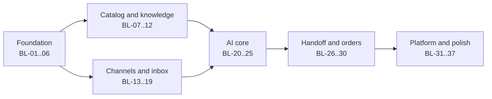

# 03. Prioritised Product Backlog

The backlog turns user stories into deliverable items. Each item has a MoSCoW priority, a T-shirt size (S = under 1 day, M = 1 to 3 days, L = 3 to 5 days, XL = more than 5 days, split before starting), the story it serves, and the phase owner who is expected to lead it.

Sizes are initial estimates. The team validates them at sprint planning; they are not commitments until then.

## Related artefacts

| Artefact | Where |
|---|---|
| Functional requirements (274 FRs with priority and verification) | [06-functional-requirements.md](06-functional-requirements.md) |
| Stakeholders | [07-stakeholders.md](07-stakeholders.md) |
| Detailed task cards (phases, waves, parent and leaf tasks, dependency graph, runner) | [`/backlog`](../../backlog/README.md), imported from `aymnart/ai-sales-manager` and authored by Aymen. Its relative links to `docs/` point to the source repository's documents. |

The items below (BL-xx) are the course-level view; the task cards in `/backlog` are the fine-grained implementation board.

## 1. MoSCoW summary

| Priority | Meaning | Items |
|---|---|---|
| **Must** | The MVP hypotheses H1 to H4 cannot be tested without it | BL-01 to BL-30 |
| **Should** | Valuable, launch is possible without it | BL-31 to BL-34 |
| **Could** | Only if a sprint has slack | BL-35 to BL-37 |
| **Won't (this phase)** | Explicitly excluded, with a later phase | see section 5 |

## 2. Backlog

### Foundation (Sprint 1)

| ID | Item | Stories | Pri | Size | Lead |
|---|---|---|---|---|---|
| BL-01 | Monorepo, CI pipeline (lint, types, tests, build), Docker Compose with Postgres and Redis | NFR-OPS-06 | M | M | Moataz |
| BL-02 | Database schema and migrations for tenancy, users, roles | US-A-01, A-02 | M | L | Moataz |
| BL-03 | Authentication: register, sign in, sessions, password reset | US-A-01 | M | L | Moataz |
| BL-04 | Workspace creation, roles (Owner, Admin, Employee), permission guard | US-A-02, A-03 | M | L | Moataz |
| BL-05 | Tenant isolation middleware and tenancy test suite | NFR-SEC-04 | M | M | Moataz, Asma |
| BL-06 | Design system tokens, app shell, i18n scaffolding, RTL support | NFR-UX, NFR-I18N | M | L | Aymen |

### Catalog and knowledge (Sprint 2)

| ID | Item | Stories | Pri | Size | Lead |
|---|---|---|---|---|---|
| BL-07 | Product, variant and image CRUD with stock | US-B-01 | M | L | Moataz |
| BL-08 | CSV import: validate, preview, confirm | US-B-02 | M | L | Moataz |
| BL-09 | Business rules: delivery, payment, returns, discount policy | US-B-04, B-05 | M | M | Moataz |
| BL-10 | Knowledge documents and embedding index job | US-B-03 | M | L | Moataz |
| BL-11 | Catalog, rules and knowledge screens | US-B-01..B-05 | M | L | Aymen |
| BL-12 | Invitation flow (API and UI) | US-A-03 | M | M | Moataz, Aymen |

### Channels and inbox (Sprint 3)

| ID | Item | Stories | Pri | Size | Lead |
|---|---|---|---|---|---|
| BL-13 | Meta webhook: verify signature, persist, acknowledge, enqueue | US-C-02 | M | L | Moataz |
| BL-14 | Unified messaging adapter and customer identity resolution | US-C-03, F-01 | M | L | Moataz |
| BL-15 | Channel connect (OAuth) and health | US-C-01 | M | L | Moataz |
| BL-16 | Conversation service and state machine | US-D-01, D-04, D-05 | M | L | Moataz |
| BL-17 | Inbox API with priority ordering and pagination | US-D-01 | M | M | Moataz |
| BL-18 | Realtime gateway (Socket.IO rooms, reconnect) | US-D-02 | M | M | Moataz |
| BL-19 | Three-pane inbox UI | US-D-01..D-03 | M | XL (split) | Aymen |

### AI core (Sprint 4)

| ID | Item | Stories | Pri | Size | Lead |
|---|---|---|---|---|---|
| BL-20 | LLM gateway with provider fallback | US-D-08 | M | M | Moataz |
| BL-21 | Intent classifier (rules first, LLM second) | US-D-09 | M | L | Moataz |
| BL-22 | Tools: catalog search, stock check, policy lookup | US-D-07 | M | L | Moataz |
| BL-23 | Orchestrator `processTurn` with caps and conversation lock | US-D-07 | M | XL (split) | Moataz |
| BL-24 | Guardrails and reply modes (auto, approval, draft) | US-D-06, D-07 | M | L | Moataz |
| BL-25 | Playground (no side effects) | US-A-05 | M | M | Moataz, Aymen |

### Handoff and orders (Sprint 5)

| ID | Item | Stories | Pri | Size | Lead |
|---|---|---|---|---|---|
| BL-26 | Stock reservation with expiry job | US-E-02 | M | L | Moataz |
| BL-27 | Purchase collection pipeline and pending order creation | US-E-01, E-03, E-04 | M | XL (split) | Moataz |
| BL-28 | 15 handoff triggers, briefing and summary | US-D-03, E-08 | M | L | Moataz |
| BL-29 | Order confirm and cancel, takeover and resume | US-D-04, D-05, E-06, E-07 | M | L | Moataz, Aymen |
| BL-30 | Activation gates G1 to G5 and onboarding checklist | US-A-04 | M | M | Moataz, Aymen |

### Platform and polish (Sprint 6)

| ID | Item | Stories | Pri | Size | Lead |
|---|---|---|---|---|---|
| BL-31 | Notifications (in-app) for handoffs and order requests | US-E-05 | S | M | Moataz |
| BL-32 | KPI rollups and dashboard (four counters) | US-G-01 | S | L | Moataz, Aymen |
| BL-33 | Usage metering and plan limits | US-G-02, G-03 | S | M | Moataz |
| BL-34 | Customer profile, tags, notes, merge, export | US-F-02..F-05 | S | L | Moataz, Aymen |
| BL-35 | Lead scoring with hot-lead alerts | US-D-01 | C | M | Moataz |
| BL-36 | Website chat widget | US-C-03 | C | M | Aymen |
| BL-37 | AI cost view | US-G-04 | C | S | Aymen |

### Cross-cutting (every sprint)

| ID | Item | Pri | Lead |
|---|---|---|---|
| BL-X1 | Unit and integration tests per feature; coverage target 60% or more | M | Asma with each owner |
| BL-X2 | Endpoint tests for every route (success, validation, auth, tenancy) | M | Asma |
| BL-X3 | End-to-end tests for core journeys | M | Asma |
| BL-X4 | Performance smoke and load tests; static analysis scan | M | Asma, Moataz |
| BL-X5 | Refactor and optimization report with before/after metrics | M | Moataz |
| BL-X6 | AI usage log and ethics reflection | M | Aymen, whole team |
| BL-X7 | API documentation (OpenAPI), README, user guide | M | Moataz, Aymen |

## 3. Dependency order

## 4. Definition of Ready

An item can enter a sprint when it has: a linked story with acceptance criteria, a size of L or smaller, its dependencies done or scheduled in the same sprint, and a named owner.

## 5. Won't (this phase)

| Item | Later phase |
|---|---|
| Payment gateways and automated checkout | Phase 4 |
| WhatsApp channel and templates | Phase 2 and 3 |
| Shopify, WooCommerce, Google Sheets sync | Phase 2 |
| Advanced analytics, exports, segmentation | Phase 4 |
| Marketing automation, voice AI, native mobile app, ERP | Phase 5 |
