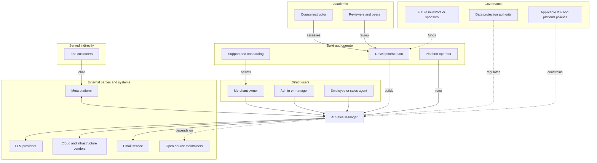
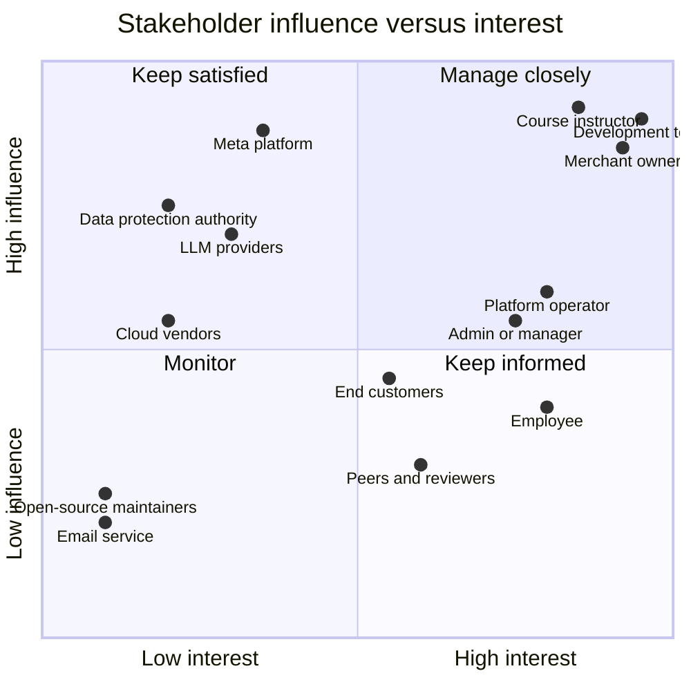

# 07. Stakeholders

A stakeholder is anyone who affects the system or is affected by it: people who use it, pay for it, build it, operate it, regulate it, or depend on it. Naming them all is a requirements activity, because each one brings needs, constraints or risks that would otherwise be missed.

This register expands the short list in the [proposal](01-project-proposal.md). Actors that appear in the use-case diagrams are marked **(actor)**.

## 1. Stakeholder map

## 2. Influence and interest

The placement is a judgement made for planning. It tells the team where to spend effort; it is not a measurement.

## 3. Register

### 3.1 Direct users

| # | Stakeholder | Role in the system | Needs and expectations | Concerns and risks | Impact on requirements |
|---|---|---|---|---|---|
| S1 | **Merchant owner** (actor) | Owns the workspace; configures catalog and rules, connects channels, activates the AI, reads the KPIs | More sales for less chat work; control over what the AI says; to see whether it pays off; to set up in under 20 minutes | The AI invents a price or discount; losing customers; a data leak; cost of AI usage; being unable to take over | Activation gates; approval mode by default; four KPIs; usage limits; playground; no discounting without a rule |
| S2 | **Admin or manager** (actor) | Runs daily operations: catalog, rules, team, channels | Easy bulk edits (CSV); clear permissions; ability to invite colleagues | Mistakes by staff; unclear who changed what | Roles and permissions; audit log; CSV import with preview |
| S3 | **Employee or sales agent** (actor) | Works conversations that need a human; confirms orders | A prioritised inbox; full context on one screen; one-click confirm; works on a phone | Alert fatigue; the AI talking while they reply; a stale screen | Triage ordering; takeover and resume; realtime updates; briefing; mobile layout at 375 px |
| S4 | **Business accountant or finance contact** | Reads confirmed orders and totals (indirect user of exports) | Correct totals and records | Orders that change after the fact; missing data | Order snapshots; immutable history; export (Should) |

### 3.2 Served indirectly

| # | Stakeholder | Role | Needs | Concerns | Impact |
|---|---|---|---|---|---|
| S5 | **End customer** (actor) | Writes on Instagram, Messenger or the website widget; may place an order | Fast, correct answers in French, Arabic, Derja or Arabizi; honest stock information; a human when needed; privacy of phone and address | Wrong information; being trapped by a bot; spam; personal data misuse | Grounded answers; 15 handoff triggers; data minimisation and erasure; right-to-left support |
| S6 | **Delivery or logistics partner** | Receives confirmed orders from the merchant (outside the system in Phase 1) | Complete address and phone on the order | Incomplete details | Required fields in order collection |
| S7 | **Shop supplier or stock source** | Not an actor in Phase 1 | Accurate stock to restock | None direct | Inventory ledger supports later integration |

### 3.3 Building and operating

| # | Stakeholder | Role | Needs | Concerns | Impact |
|---|---|---|---|---|---|
| S8 | **Development team**: Rayen (requirements, design), Aymen (frontend, ethics), Moataz (backend, optimization), Asma (testing) | Build, test and document the system | Clear scope, stable interfaces, a short feedback loop, fair workload | Scope creep; blocked dependencies; uneven contribution; deadline | Methodology, backlog, module boundaries, definition of done, risk register |
| S9 | **Platform operator** (actor, the team in production) | Deploys, monitors, responds to incidents | Observability; safe deploys; runbooks; cost control | Outages; runaway AI cost; dead-letter queues | Structured logs, alarms, health endpoints, usage caps, forward-only migrations |
| S10 | **Support and onboarding staff** | Help merchants set up | Clear error messages, a checklist, audit trail | Merchant confusion | Onboarding checklist; messages that say what to do next |
| S11 | **Future maintainers** | Extend the system after the course | Readable docs and tests, decision records | Undocumented decisions | ADRs, design documents, test suite |

### 3.4 Academic

| # | Stakeholder | Role | Needs | Concerns | Impact |
|---|---|---|---|---|---|
| S12 | **Course instructor and graders** | Assess the project | Evidence for each rubric item: requirements, UML, tests, metrics, ethics, demo | Plagiarism or AI misuse; unverifiable claims | Traceability; AI usage log; honest commit history; real measurements |
| S13 | **Reviewers and peers** | Review documents and code | Reviewable pull requests | Unclear changes | Small PRs, PR template, conventions |

### 3.5 External parties and systems

| # | Stakeholder | Role | Needs | Constraints they impose | Impact |
|---|---|---|---|---|---|
| S14 | **Meta platform** (actor) | Delivers webhooks, accepts outbound messages, grants permissions through app review | Signature-verified, policy-compliant integration | App review, permission scopes, rate limits, message windows, policy changes | Webhook verification, adapter layer, demo path through the widget |
| S15 | **LLM providers** (actor): Groq, OrcaRouter, Vercel AI Gateway | Generate text and embeddings | Valid API usage within quotas | Quotas, latency, outages, price and model changes, data-handling terms | Provider interface with fallback; PII minimised in prompts; usage metering |
| S16 | **Cloud and infrastructure vendors**: AWS, managed Postgres, Redis, object storage, secrets manager | Host and store | Standard use | Cost, regional availability, shared responsibility | Deployment design, backups, secret store |
| S17 | **Email service provider** | Sends invitations and password resets | Valid sender domain | Deliverability | Transactional email abstraction |
| S18 | **Open-source maintainers** (libraries and frameworks) | Provide the stack | Licence compliance | Vulnerabilities, abandoned packages | Dependency scanning in CI; licence review |
| S19 | **Scheduler** (actor, system) | Triggers timed jobs | Reliable cron | Missed or doubled runs | Idempotent jobs with deterministic ids |

### 3.6 Governance

| # | Stakeholder | Role | Needs | Constraints | Impact |
|---|---|---|---|---|---|
| S20 | **Data protection authority** (in Tunisia, the national personal data protection body) | Regulates personal data handling | Lawful basis, purpose limitation, security, data-subject rights | Obligations on collecting phone numbers and addresses | PII redaction in logs, erasure support, retention rules, audit |
| S21 | **Applicable law and platform policies**: consumer protection, e-commerce rules, Meta platform terms | Set boundaries on selling, messaging and advertising | Honest pricing, no deceptive practice | Cannot promise what the shop has not agreed; no unsolicited bulk messaging | No discount or delivery promises by the AI; no marketing broadcasts in Phase 1 |
| S22 | **Future investors or sponsors** | Would fund growth | Evidence the thesis works | Needs measurable results | Four KPIs, hypotheses H1 to H4 |

## 4. Conflicts between stakeholders

Stakeholders want things that pull against each other. Making the trade-offs explicit is part of the design.

| Conflict | Between | Resolution in this project |
|---|---|---|
| Fast automation versus safe answers | Owner (more automation) and customer (correct information) | Facts only through tools; guardrails; approval mode first; owner opts into auto-send |
| Autonomy versus control | Owner and employee | Takeover and resume; the AI cannot resume over a pending order |
| Rich data versus privacy | Merchant (customer context) and end customer or regulator (minimal data) | Collect only what an order needs; redact PII in logs and prompts; support erasure |
| Features versus deadline | Merchant wishes and development team | MoSCoW, explicit out-of-scope list, change control |
| Quality evidence versus time | Instructor and development team | Definition of done includes tests; measurements taken from the first sprint |
| Provider flexibility versus consistency | Operator (cost, availability) and owner (stable voice) | Fallback order is configuration; golden set re-run on model change |

## 5. Engagement plan

| Stakeholder group | How they take part | When |
|---|---|---|
| Merchant owner, admin, employee | Represented by the product owner; validate stories and the playground with a real or role-played shop | Sprint reviews |
| End customers | Represented by golden-set conversations in French, Arabic, Derja and Arabizi, written with native speakers | Sprint 4 onward |
| Instructor | Reads deliverables against the rubric; milestone reviews | Per course calendar |
| Peers | Review pull requests and documents | Every sprint |
| Meta, LLM and cloud providers | Not engaged directly; their constraints are tracked as risks | Reviewed at retrospectives |
| Data protection and legal | Compliance checklist reviewed by the team; no direct engagement | Before the demo |

## 6. Responsibilities inside the team

| Member | Stakeholder responsibilities |
|---|---|
| Rayen | Maintains this register; owns requirements and traceability |
| Aymen | Voice of the operator user (S1 to S3) in UI decisions; ethics review of AI behaviour toward customers (S5) |
| Moataz | Voice of the platform operator (S9) and external integrations (S14 to S16) |
| Asma | Voice of the instructor and reviewers (S12, S13): evidence that claims are tested |

## 7. Review

This register is a living document. Update it when a new third party is added, when scope changes, or at every retrospective.

| Date | Change | By |
|---|---|---|
| | | |
