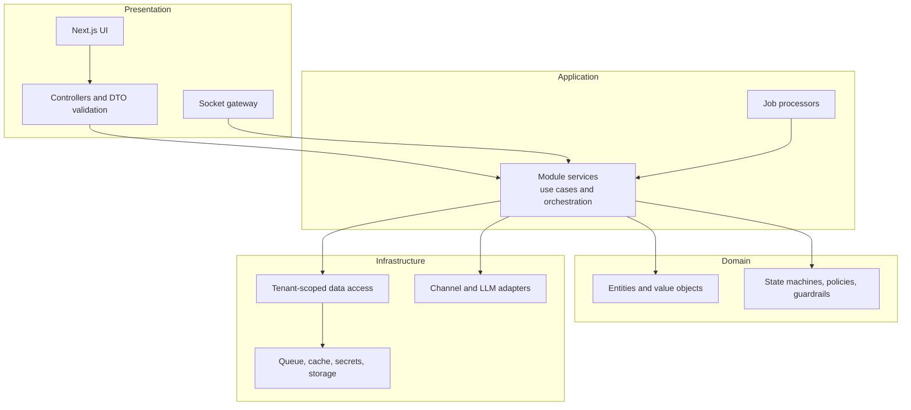

# 00. Design Overview

This is the entry point to the design phase. It explains the shape of the system, why it has that shape, and where to find each diagram.

## 1. The system in one paragraph

Customers message a shop on Instagram, Messenger or a website widget. A webhook stores each message durably, then a worker decides whether the AI should answer. The AI classifies the intent, checks policy, calls tools to read the shop's real catalog, stock and rules, drafts a reply, and has it verified against those facts. Routine questions are answered. Purchases are collected into a pending order. Sensitive topics are handed to a person with a briefing. Staff work a priority-ordered inbox, take over when needed, and confirm orders in one click. Four counters report whether it paid off.

## 2. Architectural drivers

The design is driven by the quality attributes ranked in the [NFRs](../01-requirements/04-non-functional-requirements.md). Each driver maps to concrete tactics:

| Driver | Tactic | Where |
|---|---|---|
| **Correct AI answers** | Facts only via tools; guardrail verification; golden set in CI | ADR-004, F7, C5 |
| **Never leak between shops** | Tenant guard, scoped DB client, composite keys, cross-tenant test suite | ADR-007, [component doc](05-component-and-deployment.md) |
| **No lost or duplicated message** | Persist before ack; unique keys; deterministic job ids; recovery sweep | ADR-002, F6 |
| **Fast webhook, slow AI** | Asynchronous queue between them | F6, F7 |
| **Safe by default** | Human confirms orders; approval mode first; policy check before generation | ADR-003, 005, 011 |
| **Survive provider outages** | Fallback chain; humans keep working | ADR-010, F15 |
| **Change later (WhatsApp, payments)** | Adapter and Strategy interfaces, module boundaries | C6, C8, C9 |
| **Control cost** | Caps on tool calls and tokens; usage metering; embedding by content hash | C5, F4 |

## 3. Architectural style and layers

Modular monolith with a layered structure inside each module:

| Layer | Allowed to depend on | Never |
|---|---|---|
| Presentation | Application | Reach into the database |
| Application | Domain, Infrastructure interfaces | Know Meta payload formats |
| Domain | Nothing external | Import frameworks |
| Infrastructure | External systems | Contain business rules |

## 4. Document map

| # | Document | Answers the question | Course requirement |
|---|---|---|---|
| 01 | [Use-case model](01-use-case.md) | Who uses the system and for what? | Use-case diagram |
| 02 | [Class diagrams](02-class-diagrams.md) | What are the things, and who may change them? | Class diagram (C1 to C9, with C5 in three views) |
| 03 | [State machines](03-state-machines.md) | What states can things be in, and which moves are legal? | Supports design and tests |
| 04 | [Flows and sequences](04-sequence-flows.md) | What happens, step by step, in every scenario? | Sequence diagrams (F1 to F20, at least two required) |
| 05 | [Components and deployment](05-component-and-deployment.md) | What runs where? | Component / deployment diagram |
| 06 | [Data model](06-data-model-erd.md) | How is it stored? | Persistence design |
| 07 | [Decisions](07-architecture-decisions.md) | Why is it built this way? | Architecture rationale |

Diagram source files (`.mmd`) are in [`diagrams/`](diagrams); they are extracted from these documents by a script so the two never drift apart.

## 5. The two most important flows

If a reviewer reads only two diagrams, they should be these.

1. **[F6 to F7: inbound webhook and AI turn](04-sequence-flows.md#f6-inbound-webhook-persist-acknowledge-enqueue).** Shows reliability (persist before acknowledging), asynchrony (queue between webhook and AI), and grounding (tools plus guardrails).
2. **[F9: purchase collection and pending order](04-sequence-flows.md#f9-purchase-collection-and-pending-order).** Shows the commercial heart: reserve, collect, re-check, create order, hand off.

For the data, the matching class diagrams are **C3** (conversations) and **C4** (orders), and the matching state machines are **S1** and **S2**.

## 6. Traceability from requirements to design

Every user story is traced to flows, class diagrams and states in the [traceability matrix](../01-requirements/05-traceability-matrix.md). Every NFR has a named design tactic in section 2 above and a verification method in the NFR document.

## 7. Provenance and what needs checking

This design was derived from the earlier planning documents and schema of the team's original repository (`aymnart/ai-sales-manager`: product docs, architecture, system-design and security design, and the Prisma schema). Entities, enumerations, field names, the state machines, the 15 handoff triggers, the job table and the NFR targets come from those sources.

The following are **design proposals** written for this project and should be confirmed against the implementation as it is built:

| Item | Status |
|---|---|
| Detailed steps of F1 (registration), F2 (invitation), F5 (OAuth connection), F19 (realtime reconnect) | Proposed; follow the documented rules but not copied step by step |
| Permission matrix cells in the use-case document (for example Employee view-only areas) | Proposed; the documented rules are: Owner and Admin only for traces, audit, export, erase, merge, playground |
| Order transition `CONFIRMED` to `CANCELLED` and stock return on that path (S2) | Proposed; the documented flow covers cancelling pending orders |
| Channel account transitions (S4) beyond `active`, `error`, `disconnected` | Proposed |
| Backlog sizes and sprint allocation | Estimates; to be validated at sprint planning |
| Class operations (method names and signatures) | Illustrative; the data model is faithful to the schema, the methods express intended responsibilities |

Per the course rules, AI assistance in producing these documents is recorded in the [AI usage log](../ai-usage-log.md).

## 8. Reviewing this design

A suggested review checklist for teammates:

- [ ] Every user story has at least one flow and one class diagram reference
- [ ] Every state machine transition table matches what the backend implements
- [ ] No flow lets the LLM write to the database directly
- [ ] Every flow that writes data names the tenant scope
- [ ] Every retryable step is idempotent
- [ ] The proposals listed in section 7 have been confirmed or corrected
