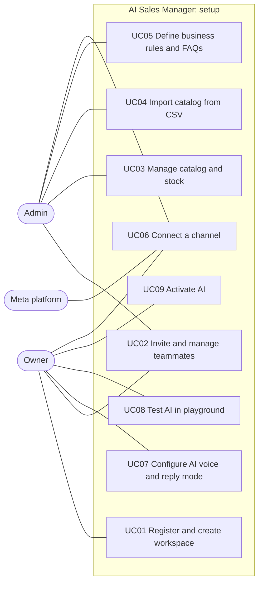
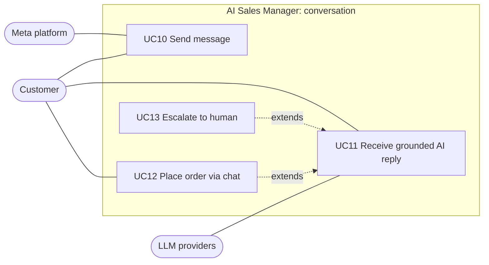
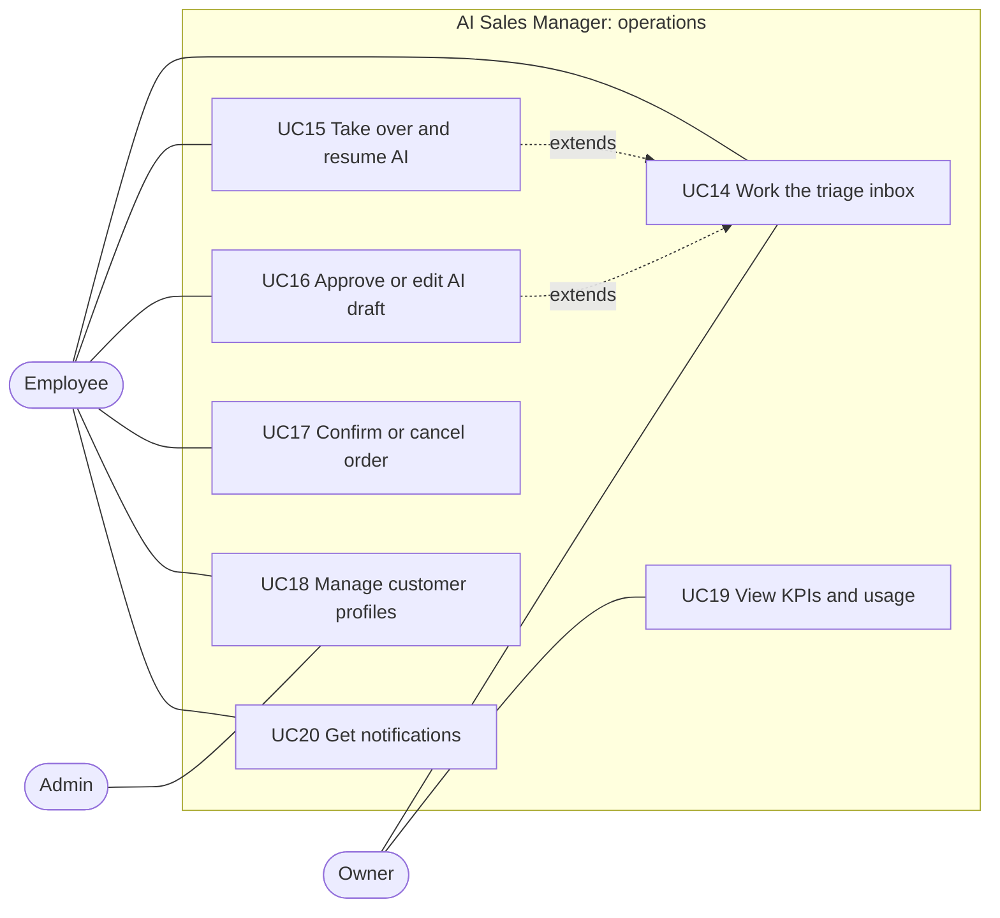
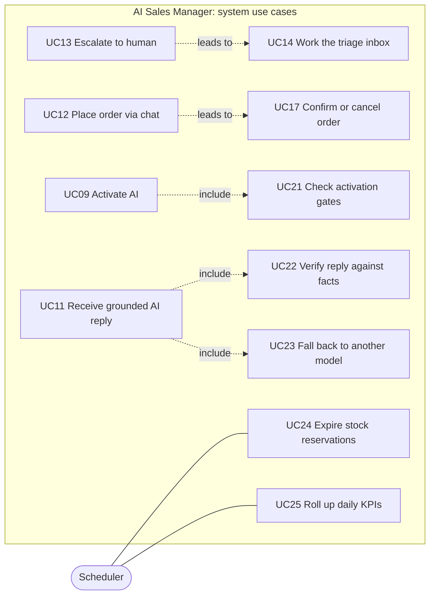

# 01. Use-Case Model

## 1. Actors

| Actor | Type | Description |
|---|---|---|
| **Owner** | Primary | The merchant. One per workspace. Full control, activates the AI, sees KPIs |
| **Admin** | Primary | Manages catalog, rules, team, channels. Cannot become or remove the Owner |
| **Employee** | Primary | Works conversations and orders. Read-only on configuration |
| **Customer** | Primary (external) | End shopper writing on Instagram, Messenger or the website widget |
| **AI Assistant** | Secondary (system) | Answers customers, collects orders, escalates |
| **Meta platform** | Secondary (external system) | Delivers inbound webhooks and accepts outbound messages |
| **LLM providers** | Secondary (external system) | Groq, OrcaRouter, Vercel AI Gateway |
| **Scheduler** | Secondary (system) | Time-based jobs: reservation expiry, rollups, token checks |

## 2. Use-case diagrams

Mermaid has no native use-case diagram, so each is drawn as a flowchart: rounded shapes are actors, rectangles are use cases, the box is the system boundary. The model is split into four readable views; `include` and `extend` links are shown in the last one.

### 2.1 Setup and configuration

### 2.2 Customer conversation

### 2.3 Daily operations

### 2.4 Platform behaviour and relationships between use cases

## 3. Use-case catalogue

Priority is MoSCoW. "Flow" points to the sequence diagram that specifies the behaviour.

| ID | Use case | Primary actor | Priority | Flow | Stories |
|---|---|---|---|---|---|
| UC01 | Register and create workspace | Owner | M | F1 | US-A-01, A-02 |
| UC02 | Invite and manage teammates | Owner, Admin | M | F2 | US-A-03 |
| UC03 | Manage catalog and stock | Admin | M | | US-B-01 |
| UC04 | Import catalog from CSV | Admin | M | F3 | US-B-02 |
| UC05 | Define business rules and FAQs | Admin | M | F4 | US-B-03..B-05 |
| UC06 | Connect a channel | Owner, Admin | M | F5 | US-C-01 |
| UC07 | Configure AI voice and reply mode | Owner | M | F13 | US-D-06 |
| UC08 | Test AI in playground | Owner | M | F17 | US-A-05 |
| UC09 | Activate AI | Owner | M | F16 | US-A-04 |
| UC10 | Send message | Customer | M | F6 | US-C-02 |
| UC11 | Receive grounded AI reply | Customer | M | F7 | US-D-07 |
| UC12 | Place order via chat | Customer | M | F9 | US-E-01..E-04 |
| UC13 | Escalate to human | Customer, AI | M | F8 | US-D-09, E-08 |
| UC14 | Work the triage inbox | Employee | M | F19 | US-D-01..D-03 |
| UC15 | Take over and resume AI | Employee | M | F10 | US-D-04, D-05 |
| UC16 | Approve or edit AI draft | Employee | M | F13 | US-D-06 |
| UC17 | Confirm or cancel order | Employee | M | F11 | US-E-06, E-07 |
| UC18 | Manage customer profiles | Admin, Employee | M | | US-F-01..F-05 |
| UC19 | View KPIs and usage | Owner | M | F18 | US-G-01..G-03 |
| UC20 | Get notifications | Employee | S | F8, F9 | US-E-05 |
| UC21 | Check activation gates | System | M | F16 | US-A-04 |
| UC22 | Verify reply against facts | System | M | F7 | US-D-07 |
| UC23 | Fall back to another model | System | M | F15 | US-D-08 |
| UC24 | Expire stock reservations | Scheduler | M | F20 | US-E-02 |
| UC25 | Roll up daily KPIs | Scheduler | S | F18 | US-G-01 |

## 4. Detailed use-case specifications

Three representative cases are specified in full: the one that earns money (UC12), the one that protects the business (UC13), and the one that gates everything (UC09).

### UC12. Place order via chat

| | |
|---|---|
| **Primary actor** | Customer |
| **Supporting actors** | AI Assistant, Employee (confirms) |
| **Goal** | Customer's purchase is captured completely and awaits human confirmation |
| **Preconditions** | AI is active on the channel; the product exists with stock |
| **Trigger** | Customer expresses buying intent ("nheb nechri") |
| **Postcondition (success)** | Order in `PENDING_CONFIRMATION`; stock reserved; conversation `HUMAN_REQUIRED` with reason `purchase_handoff`; staff notified |
| **Postcondition (failure)** | No order; reservation released; customer offered alternatives or a human |

**Main success scenario**

1. Customer states they want a product.
2. AI finds matching variants and their price and stock.
3. AI asks which variant (size, colour) if ambiguous.
4. AI checks availability and reserves the quantity.
5. AI asks for each missing field one at a time: name, phone, delivery address, quantity.
6. AI re-checks stock.
7. AI creates the pending order and tells the customer a team member will confirm.
8. System notifies staff.

**Alternative flows**

| Step | Condition | Behaviour |
|---|---|---|
| 2 | No product matches | AI says it does not know and offers a human |
| 4 | Not enough stock | AI offers alternatives; no reservation |
| 5 | Customer abandons | Reservation expires (F20); conversation stays `ORDER_INTENT_DETECTED` |
| 6 | Stock gone since step 4 | Reservation released; alternatives, or escalate `inventory_conflict` |
| any | Customer asks for a discount | Escalate `negotiation`; no order created |
| any | Customer asks for refund, complains, asks for a human | Escalate with the matching reason (F8) |

**Business rules:** no payment or discount promise; the AI never invents price or stock; the order is idempotent per conversation turn.

### UC13. Escalate to human

| | |
|---|---|
| **Primary actor** | Customer (indirectly) |
| **Goal** | The right person handles what the AI must not |
| **Precondition** | A trigger from the 15-item table in F8 is detected |
| **Postcondition** | Conversation is `HUMAN_REQUIRED`, AI disabled on the thread, briefing saved, staff notified, thread positioned by priority |

**Main success scenario:** policy check matches a trigger; briefing built; short pause message sent to the customer; status transition; notification; realtime update to the inbox.

**Quality requirement:** detection runs **before** generation so the model never improvises on refunds, legal topics or payment disputes.

### UC09. Activate AI

| | |
|---|---|
| **Primary actor** | Owner |
| **Precondition** | Workspace exists |
| **Postcondition** | AI enabled on all active channels |
| **Main scenario** | Owner completes G1 to G5, clicks Activate, system re-evaluates the gates on the server and enables the agent |
| **Failure** | 422 with the full list of unmet gates |

## 5. Role and permission matrix

`✓` allowed, `view` read only, `—` forbidden. The server checks permission codes; the UI only mirrors this table.

| Capability | Owner | Admin | Employee |
|---|---|---|---|
| Manage workspace settings | ✓ | ✓ | — |
| Invite, remove teammates | ✓ | ✓ (never Owner) | — |
| Manage catalog and stock | ✓ | ✓ | view |
| Manage rules and knowledge | ✓ | ✓ | view |
| Connect and manage channels | ✓ | ✓ | view status |
| Configure AI voice and reply mode | ✓ | ✓ | — |
| Activate or pause AI | ✓ | ✓ | — |
| Playground, AI traces | ✓ | ✓ | — |
| Read inbox and conversations | ✓ | ✓ | ✓ |
| Reply, take over, resume, close, notes | ✓ | ✓ | ✓ |
| Confirm or cancel orders | ✓ | ✓ | ✓ |
| Customer profiles | ✓ | ✓ | ✓ |
| Export, erase, merge customers | ✓ | ✓ | — |
| Audit log | ✓ | ✓ | — |
| View KPIs and usage | ✓ | ✓ | view |
| Billing | ✓ | — | — |
