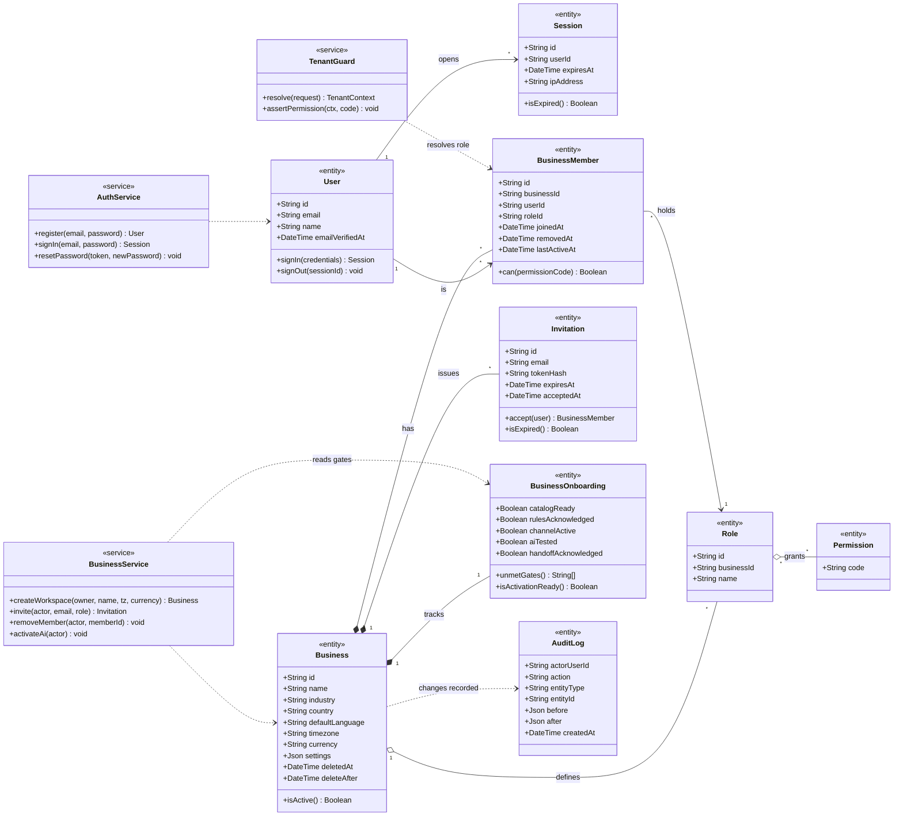
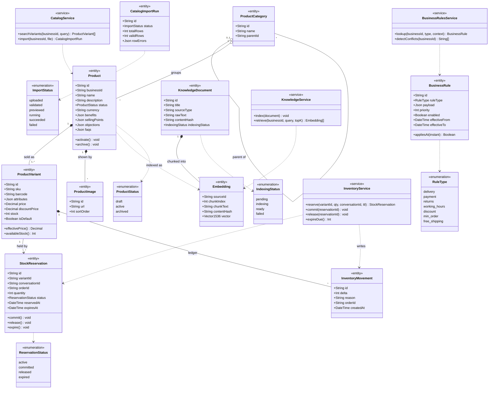
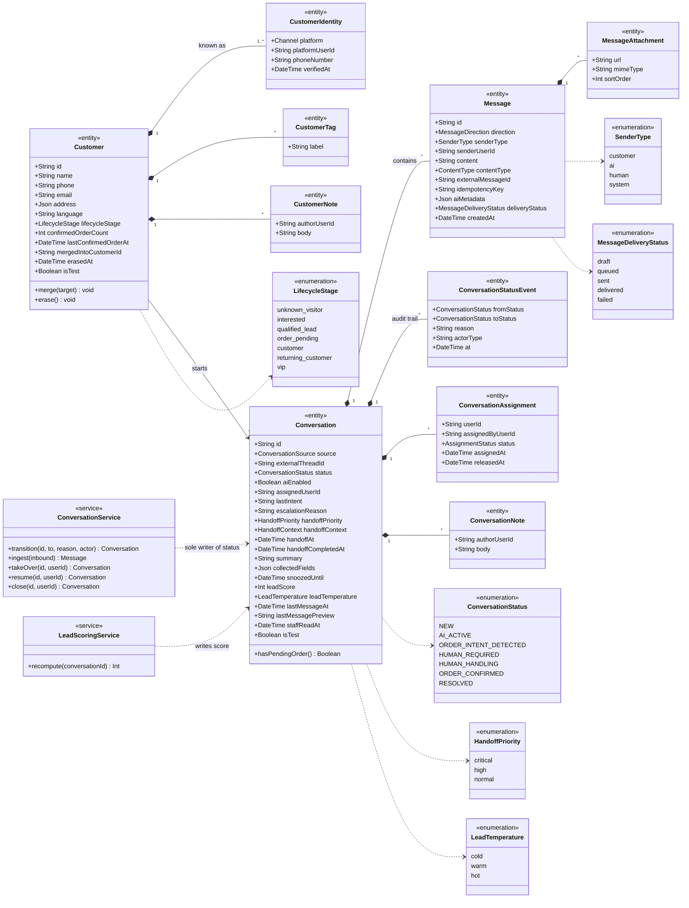
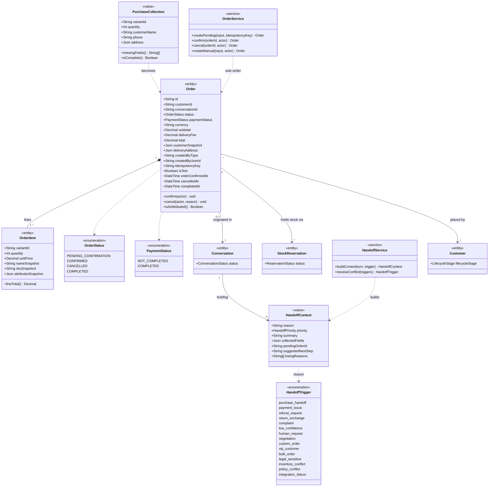
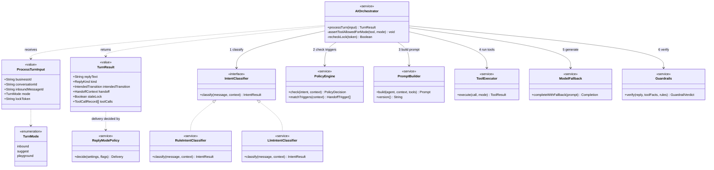
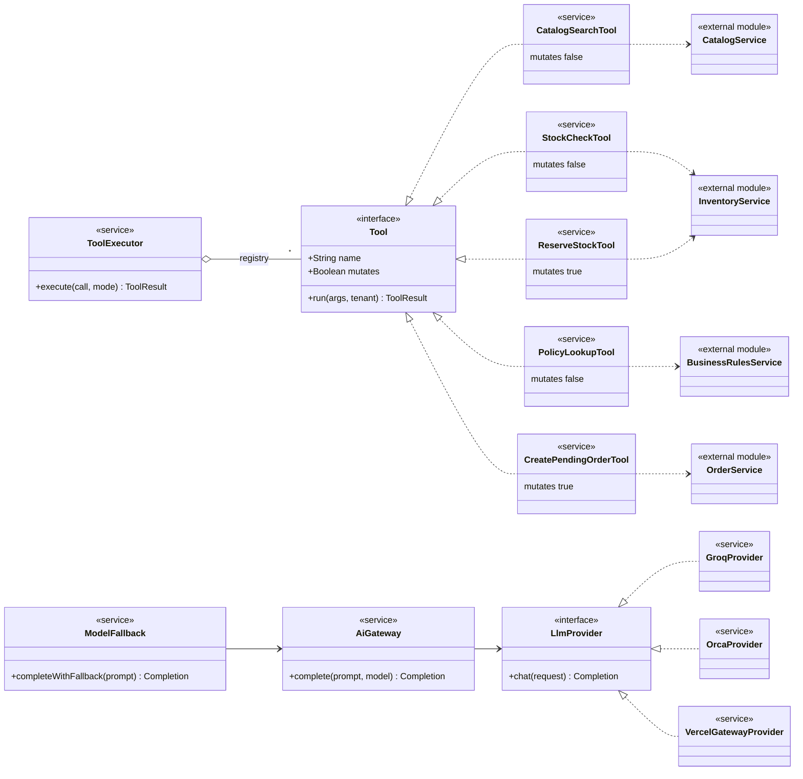
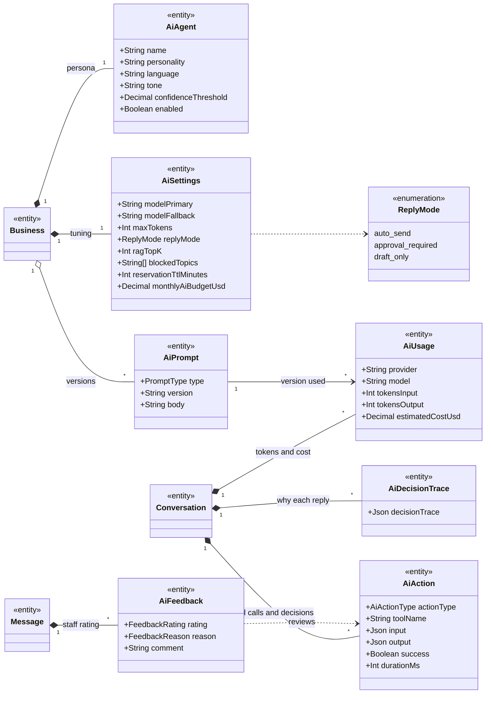
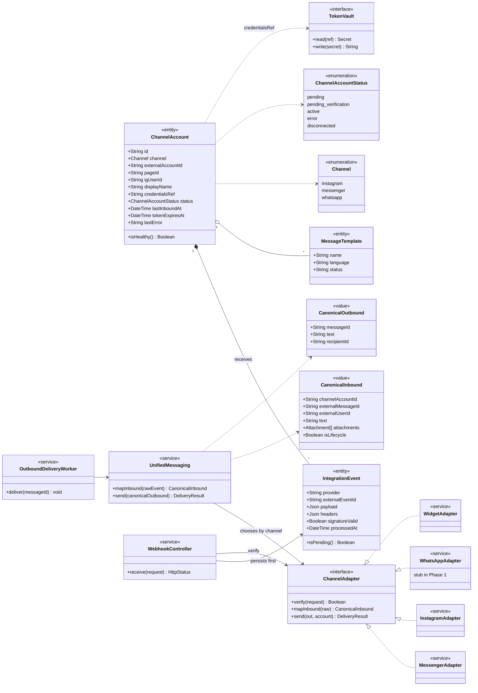
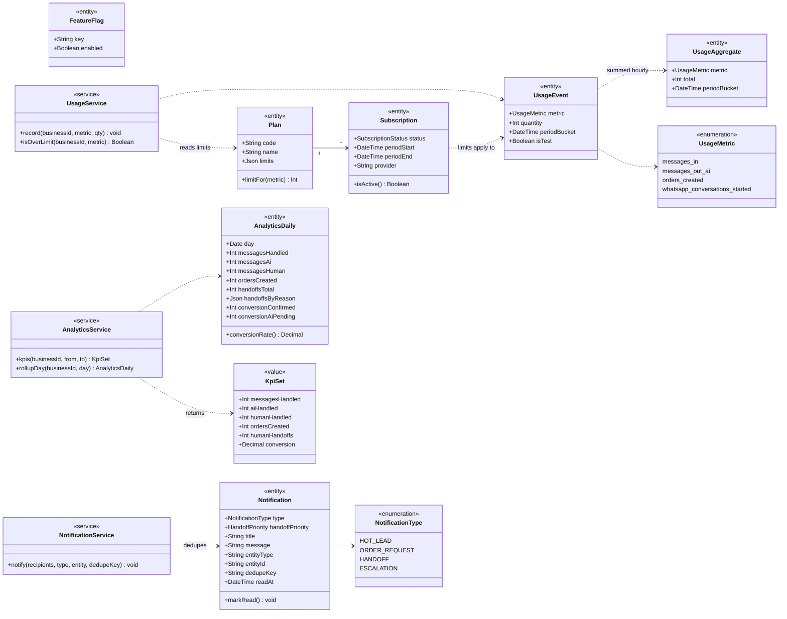
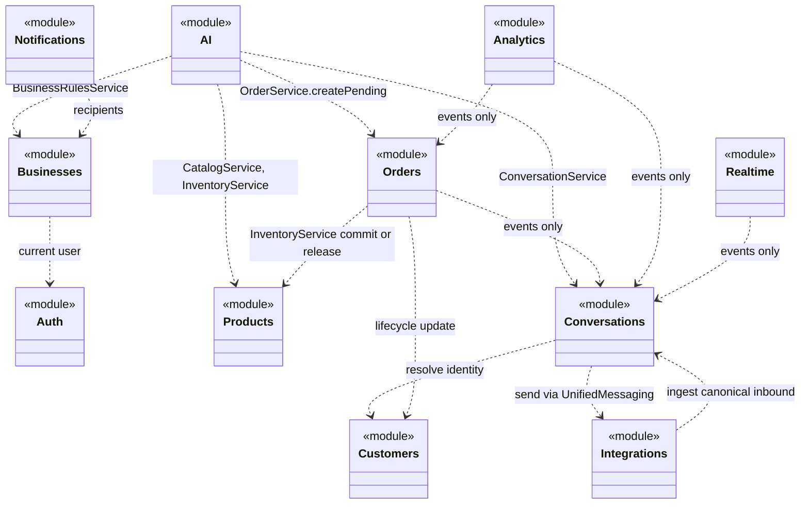

# 02. Class Diagrams

The domain is large, so it is modelled as **seven bounded-context diagrams** (C1 to C7), then a **module/service dependency diagram** (C8) and a **design-pattern map** (C9). Together they answer three questions a reviewer asks:

1. *What are the things in the business?* (C1 to C7: entities, value objects, enumerations)
2. *Who is allowed to change them?* (C8: each module owns its data; others call its service)
3. *Which known solutions are reused?* (C9: State, Strategy, Adapter, Facade, Observer, Repository)

## How to read the diagrams

| Notation | Meaning |
|---|---|
| `<<entity>>` | Persisted object with identity |
| `<<value>>` | Immutable value object, stored as JSON or embedded |
| `<<enumeration>>` | Closed set of values |
| `<<service>>` | Stateless domain service (the only writer of its module's data) |
| `<<interface>>` | Port: a contract implemented elsewhere |
| `*--` composition | Child cannot exist without parent; deleted with it |
| `o--` aggregation | Child has its own life but belongs to a parent |
| `-->` association | One object holds a reference to another |
| `..>` dependency | Uses at call time, no stored reference |
| `..|>` realisation | Class implements an interface |
| `"1"`, `"*"`, `"0..1"` | Multiplicity |

**Tenancy rule that applies to every entity below:** every entity (except global reference data such as `Permission` and `Plan`) carries `business_id`. Composite foreign keys `(id, business_id)` make it impossible for a row in one workspace to point at a row in another.

---

## C1. Identity, tenancy and access

Who the users are, which workspace they belong to, and what each role may do.

**Design notes**

- **Three roles** (Owner, Admin, Employee) are rows in `Role`, with permission codes in `Permission`. The server checks the permission code, never the role name, so a role's capabilities can change without code changes.
- There is **exactly one Owner**; the Owner cannot be demoted, removed or invited, and ownership cannot be transferred in Phase 1.
- `BusinessOnboarding` is the single source of truth for the five **activation gates** (G1 to G5). `unmetGates()` returns all failures at once so the API can list them, not just the first.
- `Business.deletedAt` / `deleteAfter` implement soft-delete with a retention window.

---

## C2. Catalog, inventory and knowledge

What the shop sells, how much is left, and the facts the AI is allowed to say.

**Design notes**

- **Stock is a number plus a ledger.** `ProductVariant.stock` is the current balance. `InventoryMovement` records every delta with a reason, so any balance can be audited.
- **Available stock = stock minus active reservations.** A `StockReservation` holds units while a customer is mid-purchase and expires after a configured TTL (`reservation_ttl_minutes`). A scheduled job releases expired holds.
- **Reservation correctness lives in the database** (an atomic conditional update), not in the AI conversation lock. The Redis lock only prevents two AI turns running on the same thread.
- **Rules are data.** `BusinessRule.payload` is validated per `RuleType`. When two enabled rules conflict, `detectConflicts` flags it and the AI escalates with `policy_conflict` rather than guessing.
- **Knowledge is retrieval, not memory.** Embeddings are tagged by source so a product edit re-indexes only that product (`contentHash` skips unchanged chunks).

---

## C3. Customers and conversations

The people who write in, the conversations they have, and the messages inside them.

**Design notes**

- **`ConversationService.transition` is the only code that may change `status`.** Every call appends a `ConversationStatusEvent`, which gives a full audit trail and makes the state machine testable in isolation (see S1).
- **Two flags, not one.** `ai_enabled` says whether the AI may speak. `status` says where the sale is. Taking over turns `ai_enabled` off without changing the collection label; only `HUMAN_REQUIRED` moves to `HUMAN_HANDLING`.
- **Idempotency is a column.** `Message.idempotencyKey` is unique, and `(channelAccountId, externalMessageId)` is unique, so a replayed webhook cannot create a second message.
- **Identity resolution:** one `Customer` may have several `CustomerIdentity` rows (Instagram id, Messenger id, phone), which is how a returning customer is recognised across channels. Duplicates merge by pointing `mergedIntoCustomerId` at the survivor.
- **`isTest` rows** (playground) are excluded from KPIs, billing and Meta delivery.

---

## C4. Orders and human handoff

How a conversation becomes an order, and what a human receives when the AI hands over.

**Design notes**

- **Snapshots, not live links.** `OrderItem` copies name, SKU, attributes and unit price at order time, and `Order.customerSnapshot` copies the customer details. A later catalog edit never rewrites history.
- **`PaymentStatus` stays `NOT_COMPLETED`** in Phase 1: the system never takes money. This is deliberate, and it is why `PENDING_CONFIRMATION` exists.
- **`idempotencyKey` on `Order`** means a retried AI turn or double click cannot create two orders.
- **`HandoffContext` must validate before `HUMAN_REQUIRED` is entered.** A handoff without a parseable briefing is a defect, because the human would have to read the whole thread.
- **AI attribution:** `createdByType` records whether the AI tool chain created the order. The conversion KPI counts only AI-created orders, regardless of which human later confirmed them.
- **Trigger conflicts:** when two triggers match in one turn, the higher priority wins; the losing reason is kept in `losingReasons` for audit.

---

## C5. AI module

The decision-making core. It is the only part that talks to an LLM, and it has no direct database writes: it calls other modules' services. It is shown in three views so each stays readable: **C5a** the turn pipeline, **C5b** tools and LLM providers, **C5c** configuration and records.

### C5a. Turn pipeline

### C5b. Tools and LLM providers

### C5c. Configuration and records

**Design notes**

- **Facts enter from tools, never from the model.** The prompt carries tool results; `Guardrails.verify` checks every price, stock figure and policy in the draft against those results before anything is sent.
- **Mutating tools are gated.** `ReserveStockTool` and `CreatePendingOrderTool` have `mutates = true`. They are blocked in `suggest` and `playground` mode and require the conversation-lock token to still be valid at call time.
- **Tools never change conversation status.** They return an `IntendedTransition`; the worker applies it through `ConversationService`, preserving single-writer state.
- **Tools call other modules' services**, never their tables (see C8).
- **Caps** bound cost and runaway loops: at most 8 tool calls and 2 generator/tool rounds per turn, a per-attempt model timeout, and bounded output tokens.
- **Provider fallback** (Groq, then OrcaRouter, then Vercel AI Gateway) sits behind one `LlmProvider` interface, so changing providers is configuration, not a code change.
- **Observability is built in:** `AiAction`, `AiDecisionTrace` and `AiUsage` record what happened, why, and what it cost, per turn.

---

## C6. Integrations (channels)

How messages enter and leave the system without the rest of the code knowing about Meta.

**Design notes**

- **Adapter pattern.** Conversations only ever sees `CanonicalInbound` and `CanonicalOutbound`. Adding WhatsApp later means writing one adapter, not touching the inbox or the AI.
- **`IntegrationEvent` is the durability point.** The raw webhook is stored before the `200` is returned. A row with `processedAt = null` is retried by a sweep job, so a crash after acknowledging cannot lose a message.
- **Tokens never live in the database.** `ChannelAccount` stores only a `credentialsRef` pointing into a managed secret store (`TokenVault`).
- **Health:** `lastInboundAt`, `tokenExpiresAt` and `lastError` drive the channel-health view and the daily token check job.

---

## C7. Billing, analytics and notifications

Everything that observes the system rather than drives a sale.

**Design notes**

- **Four counters only.** `KpiSet` is exactly the four canonical KPIs. `AnalyticsDaily` is a rollup table, so the dashboard reads one row per day instead of scanning every message.
- **Period semantics** use the business timezone: inclusive of the first day, exclusive of the day after the last.
- **Notifications dedupe** on `dedupeKey` so a retried job or a double event cannot spam staff.
- **Analytics and billing are off the hot path.** They consume events after the message flow is done.

---

## C8. Module and service dependency diagram

Each module **owns its tables** and exposes a **service** as its only entry point. Another module that needs the data calls that service; it never queries the other module's tables. This is the modular-monolith rule that stops the codebase becoming a ball of mud, and an architecture test enforces it.

| Module | Owns | Must not |
|---|---|---|
| Auth | users, sessions, credentials | know about conversations or Meta |
| Businesses | workspace, members, roles, rules, flags, plans | call Meta or the LLM |
| Products | catalog, stock, reservations, knowledge, embeddings | send messages or change conversation status |
| Customers | customers, identities, tags, notes | own conversations or orders |
| Conversations | conversations, messages, state machine, lead score | call Meta or the LLM directly |
| AI | agent config, prompts, orchestrator, traces, usage | persist orders or messages except through their services |
| Orders | orders, items, confirm and cancel | talk to Meta, mutate stock except through Products |
| Integrations | channel accounts, webhooks, adapters, delivery | import AI or inbox internals |
| Analytics | KPI rollups, usage | sit on the inbound hot path |
| Notifications | notifications and fan-out | decide when to hand off; it only delivers |
| Realtime | socket gateway | be a source of truth; it is an accelerator |

Dotted arrows marked "events only" mean the dependency is through in-process domain events, not direct calls (see [flow F6 to F11](04-sequence-flows.md)).

---

## C9. Design patterns applied

| Pattern | Where | Problem it solves | Class names |
|---|---|---|---|
| **State** | Conversation and order lifecycles | Illegal transitions (for example confirming a cancelled order) | `ConversationService.transition`, `Order.confirm` / `cancel`; allowed pairs listed in S1 and S2 |
| **Strategy** | Intent classification, LLM providers, reply modes | Swap algorithm without changing callers | `IntentClassifier` (rule or LLM), `LlmProvider`, `ReplyModePolicy` |
| **Adapter** | Channels | Meta's payloads differ per channel and change over time | `ChannelAdapter` implementations |
| **Facade** | Messaging, AI | Hide a subsystem behind one call | `UnifiedMessaging`, `AIOrchestrator.processTurn` |
| **Registry / Command** | AI tools | Uniform execution, permissions and logging of tool calls | `ToolExecutor` with `Tool` registry |
| **Chain of responsibility** | Provider fallback | Try next model if one fails | `ModelFallback` over providers |
| **Observer (domain events)** | Order confirmed, state changed, message received | Decouple modules; analytics and notifications react without being called | In-process event emitter |
| **Repository / ports** | Data access | Keep modules testable and tenant-scoped | Service layer over Prisma, tenant-scoped client |
| **Idempotent receiver** | Webhooks, jobs, orders | Exactly-once effect on at-least-once delivery | Unique keys, deterministic job ids |
| **Snapshot** | Orders | Preserve what the customer agreed to | `OrderItem.*Snapshot`, `Order.customerSnapshot` |
| **Value object** | Handoff briefing, canonical messages | Validated, immutable data crossing module boundaries | `HandoffContext`, `CanonicalInbound` |

### SOLID in this design

| Principle | Example |
|---|---|
| Single responsibility | Each module owns one domain; `Guardrails` only verifies, `PromptBuilder` only builds |
| Open/closed | New channel = new `ChannelAdapter`; new LLM = new `LlmProvider`; new tool = new `Tool` |
| Liskov | Any `Tool` or `LlmProvider` is substitutable behind its interface |
| Interface segregation | Ports are small (`Tool.run`, `LlmProvider.chat`) |
| Dependency inversion | The orchestrator depends on `IntentClassifier` and `Tool`, not on concrete classes or vendors |
