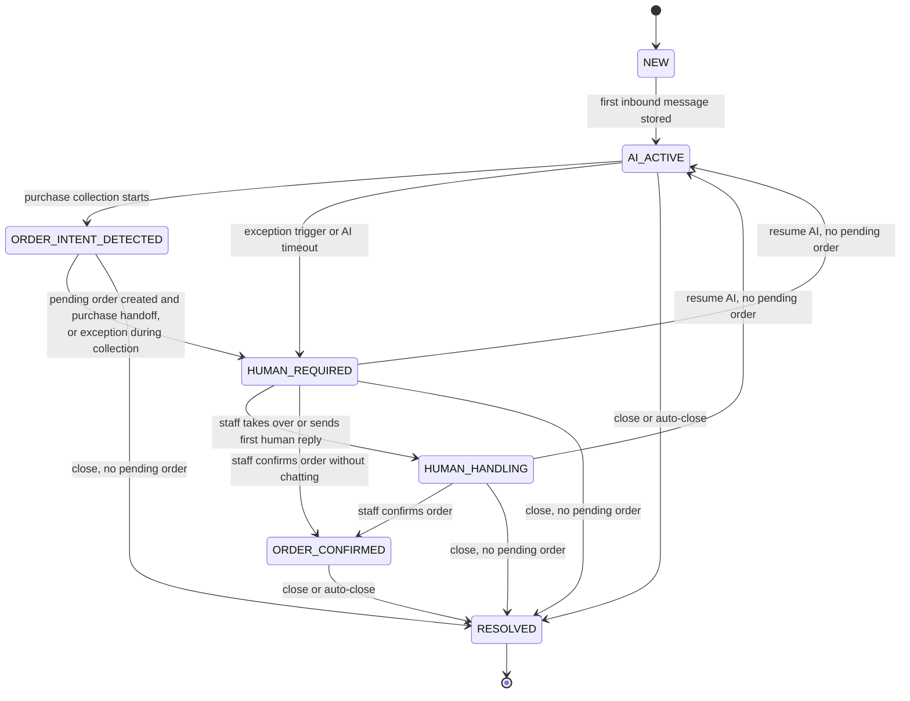
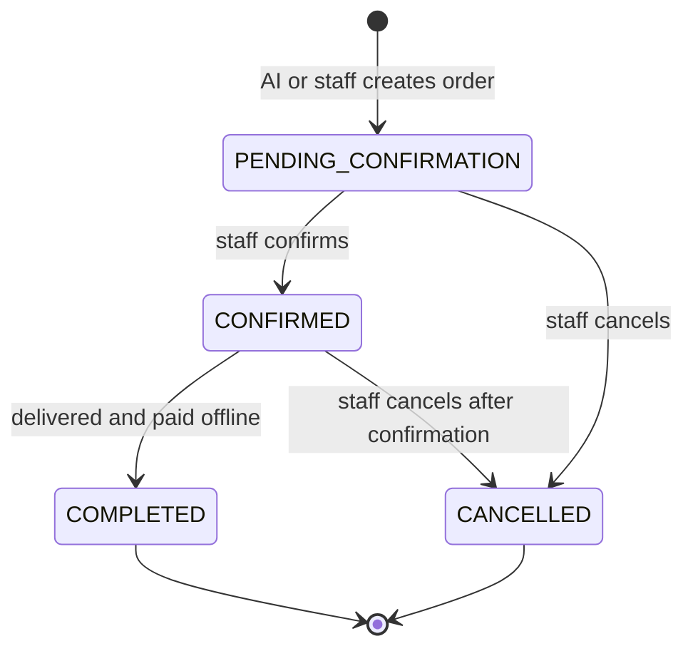
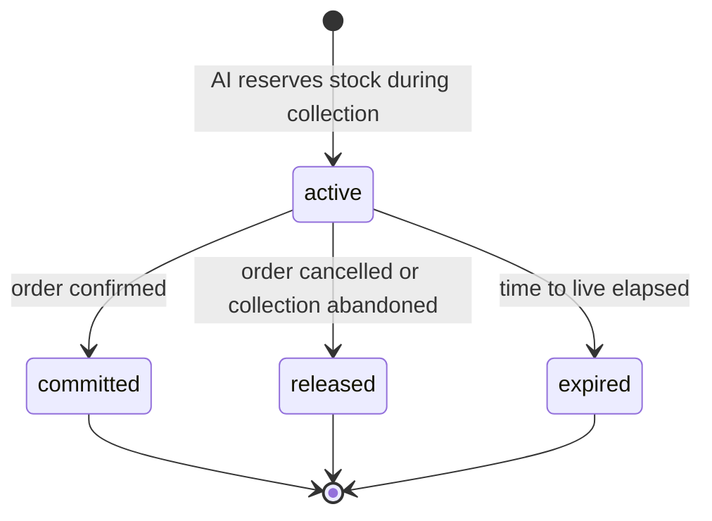
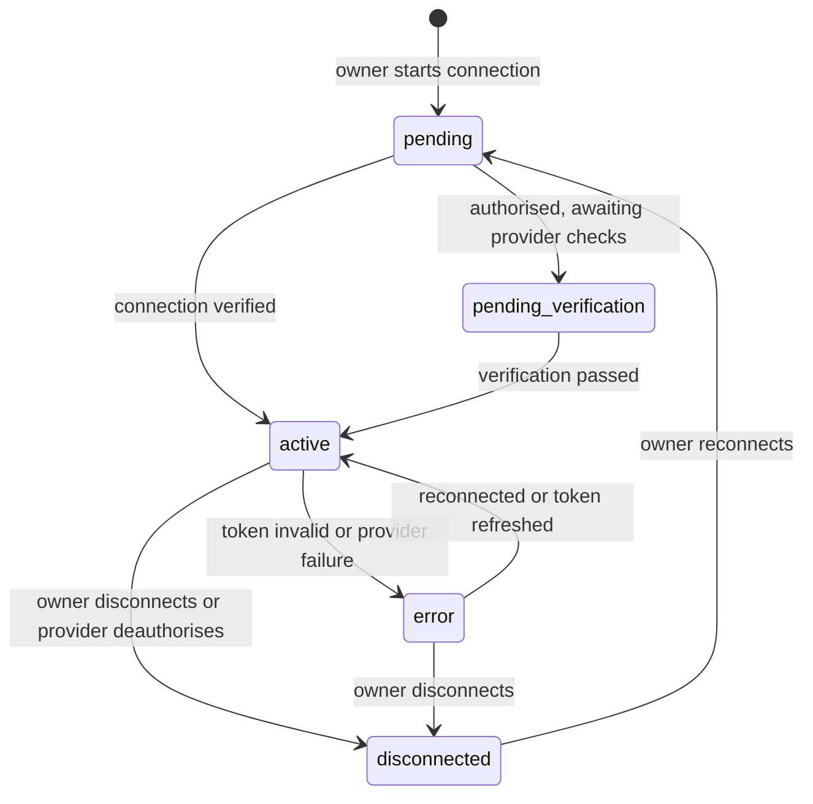
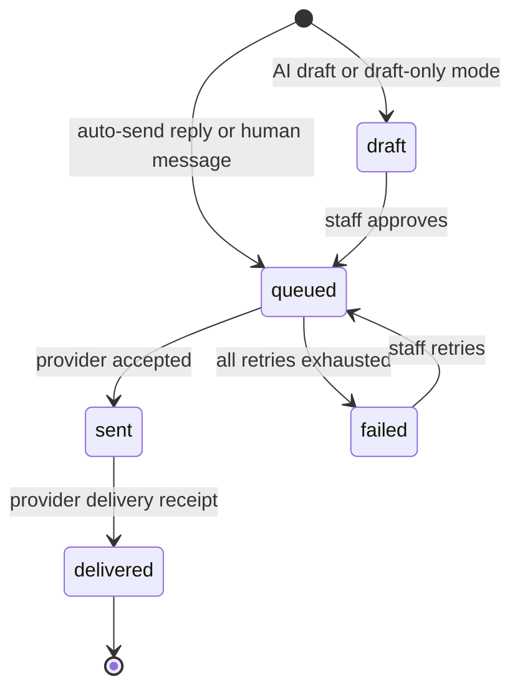
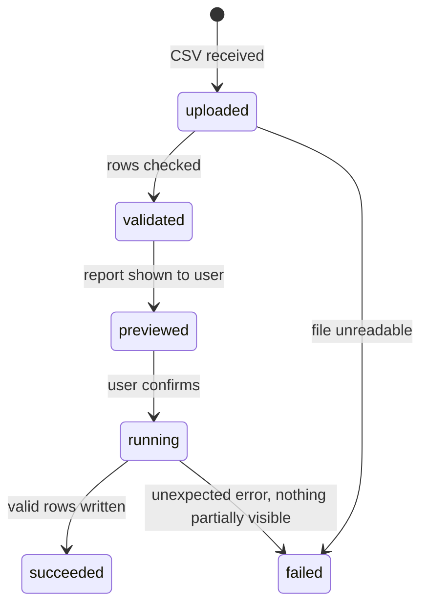

# 03. State Machines

Five objects have lifecycles that matter for correctness. For each one, this document gives the diagram, the **allowed transition table**, and the **forbidden transitions**. These tables are the specification for the state-machine unit tests: every row is one test, and every forbidden row is a negative test.

---

## S1. Conversation lifecycle

`ConversationStatus` has one value at a time. `ConversationService.transition({from, to, reason, actor})` is the only writer; an unknown pair returns **409 `invalid_transition`**. Every transition appends a `ConversationStatusEvent`.

### Allowed transitions

| # | From | To | Trigger | Actor |
|---|---|---|---|---|
| 1 | `NEW` | `AI_ACTIVE` | First inbound customer message persisted | System |
| 2 | `AI_ACTIVE` | `ORDER_INTENT_DETECTED` | Purchase intent and collection started | AI tools |
| 3 | `ORDER_INTENT_DETECTED` | `HUMAN_REQUIRED` | Pending order created, then purchase handoff | AI worker |
| 4 | `AI_ACTIVE` | `HUMAN_REQUIRED` | One of the 14 exception triggers, or AI timeout | AI worker |
| 5 | `ORDER_INTENT_DETECTED` | `HUMAN_REQUIRED` | Exception during collection (no new order unless one already exists) | AI worker |
| 6 | `HUMAN_REQUIRED` | `HUMAN_HANDLING` | Take over, or first human outbound message | Staff |
| 7 | `HUMAN_REQUIRED` | `ORDER_CONFIRMED` | `order.confirmed` event for this thread | System |
| 8 | `HUMAN_HANDLING` | `ORDER_CONFIRMED` | `order.confirmed` event | System |
| 9 | `HUMAN_REQUIRED` / `HUMAN_HANDLING` | `AI_ACTIVE` | Resume AI, with **no** order in `PENDING_CONFIRMATION` | Staff |
| 10 | any non-terminal | `RESOLVED` | Close, or inactivity auto-close, with no pending order | Staff / job |

### Forbidden transitions (each is a negative test)

| Attempt | Result |
|---|---|
| Resume while any order on the thread is `PENDING_CONFIRMATION` | 409 `pending_order_blocks_resume` |
| Close while an order is `PENDING_CONFIRMATION` | 409; cancel or confirm first |
| Enter `HUMAN_REQUIRED` without a valid `HandoffContext` | Defect; the briefing must be saved before the last autonomous reply |
| Set `status` directly from the AI model or raw SQL | Defect |
| Jump to `ORDER_CONFIRMED` without an order reaching `CONFIRMED` | Defect |
| Automatically resume from the handoff queue | Defect; resume is always an explicit click |
| Any transition out of `RESOLVED` | Not allowed; a new inbound message starts a new conversation thread |

### `status` versus `ai_enabled`

| Action | `ai_enabled` | `status` |
|---|---|---|
| Enter `HUMAN_REQUIRED` | false | `HUMAN_REQUIRED` |
| Take over from `HUMAN_REQUIRED` | false | `HUMAN_HANDLING` |
| Take over from `AI_ACTIVE` or `ORDER_INTENT_DETECTED` | false | unchanged (collection label stays) |
| Resume | true | `AI_ACTIVE` |

Inbound messages are **always stored**, even when `ai_enabled` is false.

---

## S2. Order lifecycle

| From | To | Trigger | Side effects |
|---|---|---|---|
| (new) | `PENDING_CONFIRMATION` | `OrderService.createPending` with idempotency key | Reservation attached; `order.created` and `order.pending_confirmation` events; staff notified |
| `PENDING_CONFIRMATION` | `CONFIRMED` | `OrderService.confirm` | Reservation committed, stock ledger entry written, conversation moves to `ORDER_CONFIRMED`, customer lifecycle advances |
| `PENDING_CONFIRMATION` | `CANCELLED` | `OrderService.cancel` | Reservation released; conversation is **not** auto-resumed |
| `CONFIRMED` | `COMPLETED` | Staff records completion | Offline payment recorded |
| `CONFIRMED` | `CANCELLED` | Staff cancels (design proposal, to be confirmed by the backend owner) | Stock returned by a compensating ledger entry |

**Forbidden:** confirming a `CANCELLED` or `COMPLETED` order; cancelling a `COMPLETED` order; creating a second order with the same idempotency key (returns the original).

**Accepted imprecision:** an order cancelled after confirmation still counts in the period's "orders created" and in the conversion numerator; cancellations are not retro-deducted in the MVP KPIs.

---

## S3. Stock reservation lifecycle

| From | To | Trigger |
|---|---|---|
| (new) | `active` | `InventoryService.reserve`; succeeds only if `stock - activeReserved >= quantity` (one atomic conditional update) |
| `active` | `committed` | Order confirmed; stock decremented and ledger written in the same transaction |
| `active` | `released` | Order cancelled, or the conversation resolved without an order |
| `active` | `expired` | `expire_reservations` job (every minute) after `reservation_ttl_minutes` |

**Concurrency rule:** two buyers for the last unit must produce exactly one `active` reservation. The check-and-hold is a single database operation, so no lock is needed for correctness.

---

## S4. Channel account lifecycle

| State | Inbound handling | Outbound handling |
|---|---|---|
| `active` | Processed normally | Delivered |
| `pending`, `pending_verification`, `error`, `disconnected` | Event is stored, marked processed, **no customer message is created** | Not delivered |

Disconnecting never deletes history: conversations and messages are kept.

---

## S5. Outbound message delivery

| Mode (`ReplyMode`) | AI reply is stored as | Becomes `queued` when |
|---|---|---|
| `auto_send` | `queued` | immediately |
| `approval_required` (default for a new business) | `draft` | a staff member approves |
| `draft_only` | `draft` | never; approval is refused (409) and staff copy the text into a human message |

A feature flag for shadow mode forces draft behaviour even when `auto_send` is configured.

Delivery retries: 3 attempts with exponential backoff (5 s, then 10 s), then the message is `failed`, the dead-letter queue is alerted, and the inbox shows a retry action.

---

## S6. Catalog import run

Validation and execution are **two separate jobs** so the user sees exactly what will happen before any product is created.
