# 04. Flows and Sequence Diagrams

Every significant flow in the system, each with: **purpose**, **actors**, **preconditions**, a **sequence diagram**, a **step-by-step explanation**, and **failure and edge cases**. Flows are grouped as:

| Group | Flows |
|---|---|
| Setup | F1 Register and create workspace, F2 Invite teammate, F3 Catalog CSV import, F4 Knowledge indexing, F5 Connect a channel, F16 AI activation gates, F17 Playground |
| The message path | F6 Inbound webhook, F7 AI turn, F12 Outbound delivery, F13 Reply modes and approval, F14 AI suggestion, F15 LLM failure fallback |
| Handoff and orders | F8 Exception handoff, F9 Purchase collection and pending order, F10 Takeover and resume, F11 Confirm or cancel an order, F20 Reservation expiry |
| Platform | F18 KPI rollup, F19 Realtime updates |

Four principles run through all of them. Reading them first makes every diagram easier to follow.

| Principle | Meaning |
|---|---|
| **Persist, acknowledge, then enqueue** | A webhook is stored durably before the `200` is returned. The LLM is never awaited in the request. |
| **Facts come from tools** | Prices, stock and policies enter a reply only from tool results, never from model memory. |
| **One writer per state** | Only `ConversationService` changes conversation status; only `OrderService` changes orders; only `InventoryService` changes stock. |
| **At-least-once, effect-once** | Jobs and webhooks may repeat; unique keys and deterministic job ids make repeats harmless. |

---

## F1. Register and create workspace

**Purpose:** a new merchant gets an account and an isolated workspace.
**Actors:** Merchant, Web app, API, Database.
**Preconditions:** none.

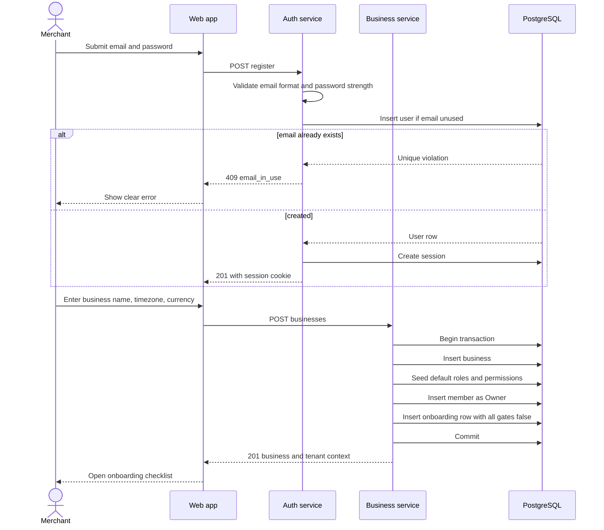

**Explanation**

1. Registration creates the user and a session. Passwords are hashed; the session cookie is HTTP-only.
2. Creating the workspace is **one transaction**: the business, its default roles, the Owner membership and the onboarding checklist all succeed or none do, so there is never a workspace without an owner.
3. From this point every request carries a tenant context derived from the session; the client never supplies `business_id`.

**Failure and edge cases:** duplicate email returns 409 without revealing which field failed beyond what is safe; weak password returns a field-level error; a failure after the user insert but before the workspace creation leaves a user with no workspace, and the UI resumes at "create workspace".

---

## F2. Invite a teammate

**Purpose:** an Owner or Admin adds a colleague with a role.
**Actors:** Owner/Admin, Invitee, API, Email service.
**Preconditions:** inviter has the `team.invite` permission.

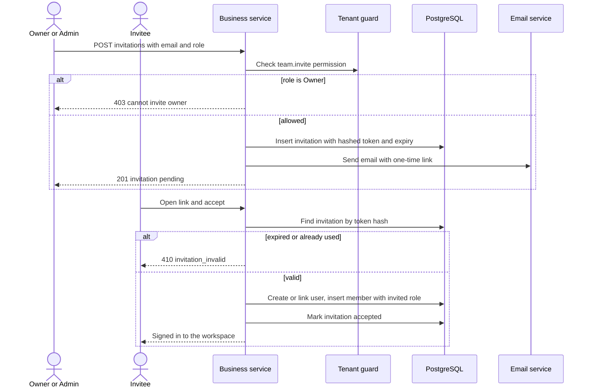

**Explanation:** only a **hash** of the token is stored, so a database leak does not reveal live links. The invitee receives exactly the role that was invited; there is no way to accept as a higher role.

**Edge cases:** inviting an existing member is rejected; inviting as Owner is always 403; removing the sole Owner is 403; an expired link can be re-issued.

---

## F3. Catalog CSV import

**Purpose:** load many products at once, safely.
**Actors:** Admin, API, Worker (`catalog` queue), Database.
**Preconditions:** `catalog.write` permission.

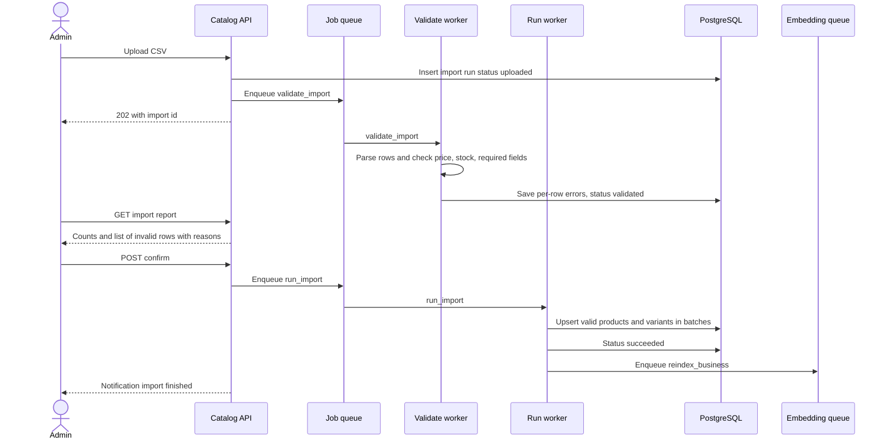

**Explanation:** the two jobs are separate on purpose. The user always sees a **preview report** (valid, invalid and why) before anything is written. Rows are written in batches; the target is 1,000 rows in under 60 seconds. A finished import triggers re-indexing so the AI knows the new products (F4).

**Failure and edge cases:** an unreadable file fails at `uploaded`; invalid rows are never imported and never block valid rows; re-confirming the same import is a no-op because the job id is `{importId}:run`.

---

## F4. Knowledge indexing (retrieval for the AI)

**Purpose:** keep what the AI can retrieve in sync with the catalog, rules and FAQs.
**Actors:** Admin, API, Embedding worker, Embedding model, Database with vector support.

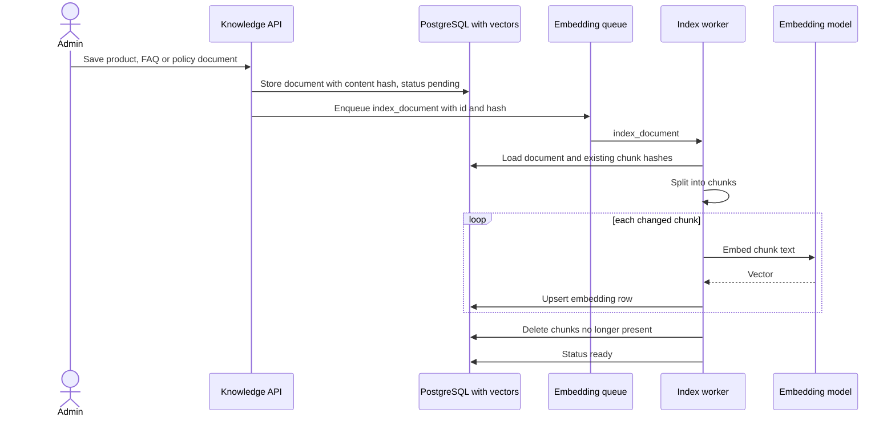

**Explanation:** the job id includes the **content hash**, so saving unchanged text does not re-embed anything, and saving the same change twice produces one job. Only changed chunks call the embedding model, which controls cost. During indexing the status is `indexing`; if embedding fails after retries it becomes `failed` and the owner sees a retry action.

**Edge cases:** retrieval always filters by `business_id` first, so one shop can never retrieve another's chunks.

---

## F5. Connect a channel (Instagram and Messenger)

**Purpose:** let the AI receive and send on the merchant's accounts.
**Actors:** Owner, Web app, API, Meta, Secret store.
**Preconditions:** `integrations.manage` permission. A Meta app is configured.

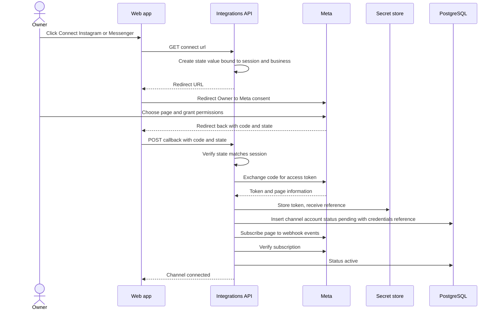

**Explanation:** the OAuth `state` is bound to the session, which blocks cross-site request forgery. The access token **never touches the database**: only a reference to the secret store is saved. The channel is `active` only after the webhook subscription is verified, so gate G3 (F16) cannot be satisfied by a half-connected account.

**Edge cases:** denied consent leaves the account `pending` with a message; a daily job (`check_channel_tokens`) marks accounts `error` before tokens expire and notifies the owner; disconnecting keeps all conversation history.

---

## F6. Inbound webhook: persist, acknowledge, enqueue

**Purpose:** receive a customer message with zero loss and no duplication, quickly.
**Actors:** Customer, Meta, Webhook controller, Database, Queue, Worker.
**Non-functional targets:** acknowledgement p95 under 500 ms (NFR-PERF-01), no acknowledged message lost (NFR-REL-02).

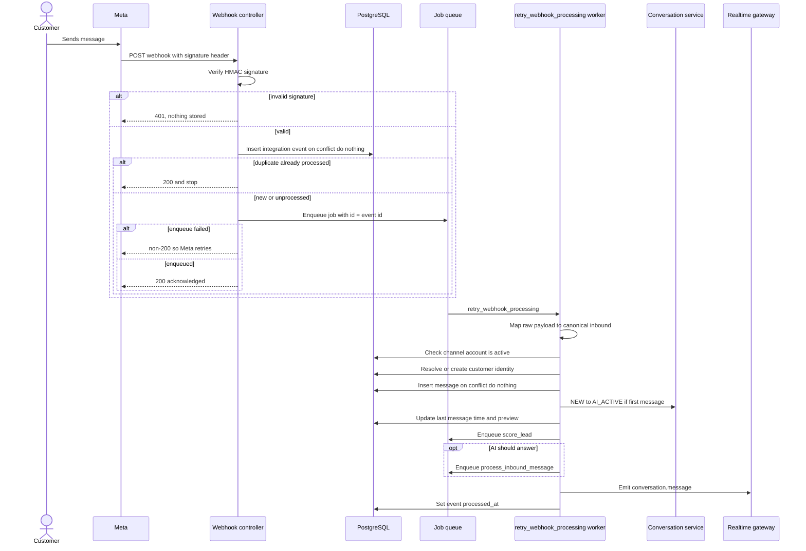

**Explanation**

1. **Verify first.** An invalid signature is rejected before anything is stored.
2. **Persist before acknowledging.** The raw event is the durable record. If the server dies after the `200`, the row exists with `processed_at` empty.
3. **Idempotent insert.** A duplicate delivery hits the unique constraint and is a no-op.
4. **Never wait for the LLM.** The webhook handler only stores and enqueues; mapping and AI happen in workers.
5. **The worker is also idempotent.** Every step can be repeated: the message insert, attachment insert and job ids are all deduplicated.
6. **AI only when appropriate.** The worker enqueues an AI turn only if `ai_enabled`, the agent is enabled, the usage cap is not exceeded, the reply mode allows a turn and the channel is active. Otherwise the inbound message is still stored and the inbox updates.

**Failure and edge cases**

| Case | Behaviour |
|---|---|
| Crash after `200`, before the worker finishes | A sweep job re-processes events where `processed_at` is empty and older than 30 s |
| Channel not active | Event marked processed, **no** customer message created |
| Delivery receipt or echo, not a customer message | Not treated as a customer message |
| Enqueue fails | Non-200 so Meta retries; the duplicate insert is harmless |
| Deauthorise callback | Handled as a lifecycle event; channel set to `disconnected` |

---

## F7. AI turn (`processTurn`)

**Purpose:** produce a grounded reply, or decide to hand over.
**Actors:** AI worker, Orchestrator, Intent classifier, Policy engine, Tools, LLM gateway, Guardrails, Database.
**Constraint:** at most one AI turn runs per conversation at a time.

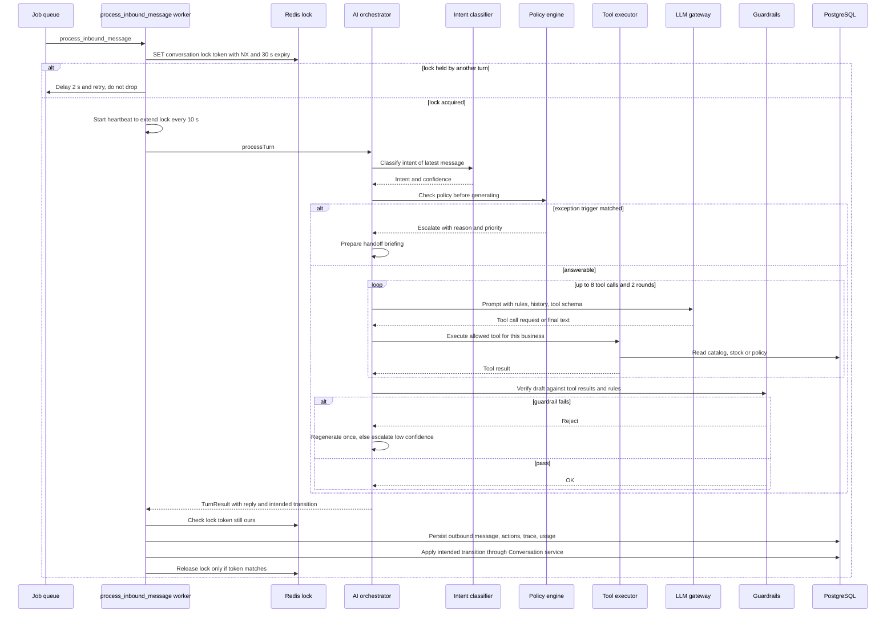

**Explanation**

1. **Serialise per conversation.** A Redis lock with a token and expiry stops two turns racing on one thread. A heartbeat extends it for long turns; the release is compare-and-delete so a slow worker cannot free someone else's lock.
2. **Policy before generation.** Exception triggers (refund, complaint, legal, and so on) are detected **before** the model writes anything, so the AI never improvises on those topics.
3. **Bounded tool loop.** The model may request tools; the executor validates each request against the current mode, scopes it to the business, and logs it. Hard caps stop runaway loops and cost.
4. **Guardrails verify the draft** against the tool facts and business rules (no invented price, no discount without a rule, no payment promise). One regeneration is allowed, then the turn escalates.
5. **Re-check the lock before any side effect.** If the lock was lost, sending is aborted; only a handoff that already created a pending order is still applied, so an order is never orphaned.
6. **Everything is recorded:** the actions, a decision trace for debugging, and token usage for cost tracking.

**Failure and edge cases:** tool failure produces an honest "I am not sure" reply and an `integration_failure` escalation; a model timeout triggers the fallback (F15); a duplicate job id is ignored by the queue.

---

## F8. Exception handoff

**Purpose:** pass topics the AI must not handle straight to a human with a useful briefing.
**Actors:** AI orchestrator, Policy engine, Conversation service, Notification service, Staff.

There are **15 triggers**; 14 are exceptions and one (#1) is the successful end of a purchase (F9).

| # | Situation | `escalation_reason` | Priority |
|---|---|---|---|
| 1 | Purchase completion (no online payment) | `purchase_handoff` | high |
| 2 | Payment issue (claims already paid, amount dispute) | `payment_issue` | critical |
| 3 | Refund request | `refund_request` | critical |
| 4 | Return or exchange | `return_exchange` | high |
| 5 | Complaint or negative sentiment | `complaint` | critical |
| 6 | Low confidence after one clarifying question | `low_confidence` | normal |
| 7 | Customer asks for a human | `human_request` | high |
| 8 | Negotiation or discount with no matching rule | `negotiation` | high |
| 9 | Custom or out-of-catalog order | `custom_order` | high |
| 10 | VIP or high-value customer (when the flag is on) | `vip_customer` | critical |
| 11 | Bulk or large quantity | `bulk_order` | high |
| 12 | Legal or sensitive topic | `legal_sensitive` | critical |
| 13 | Inventory conflict | `inventory_conflict` | high |
| 14 | Conflicting business rules | `policy_conflict` | normal |
| 15 | Integration or tool failure | `integration_failure` | critical |

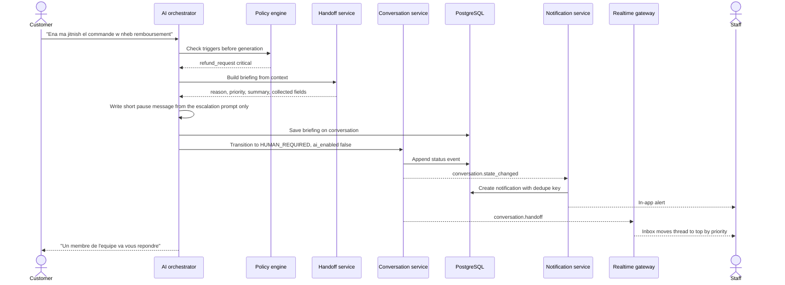

**Explanation**

- If two triggers match in one turn, the **higher priority wins**; at equal priority the more specific commercial or legal reason beats `low_confidence`. The losing reason is stored in the briefing for audit.
- The briefing is saved **before** the final customer-facing reply, so the human always has context. A handoff without a valid briefing is treated as a defect.
- The AI's last message makes no promise about money, refunds, or outcomes. It only says a person will follow up.
- The inbox orders threads by priority (critical, high, normal) and then by waiting time.
- `purchase_handoff` notifications are sent as **order requests** (F9), not as generic handoff alerts, to avoid double notification.

**Edge cases:** an exception raised mid-collection moves `ORDER_INTENT_DETECTED` to `HUMAN_REQUIRED` without creating a new order, but keeps any reservation or order that already exists.

---

## F9. Purchase collection and pending order

**Purpose:** turn buying intent into a complete pending order a human can confirm in one click.
**Actors:** Customer, AI orchestrator, Tools, Inventory service, Order service, Conversation service, Staff.
**Key rule:** the purchase close is **code, not a prompt**: search, check stock, reserve, collect, re-check, create order, hand off.

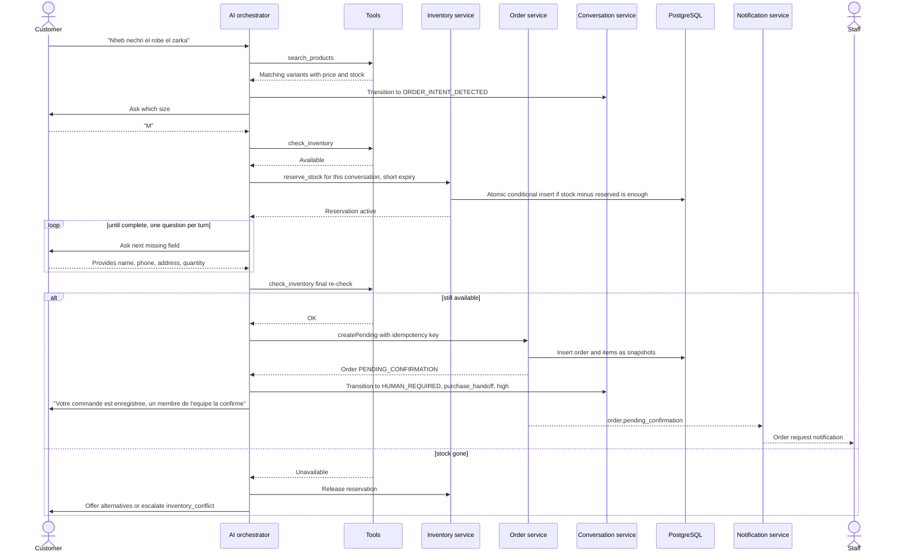

**Explanation**

1. **Intent is not enough.** "Nheb nechri" only starts collection. A handoff happens only when all required fields are present, stock has been re-verified, and the pending order exists.
2. **One question per turn** keeps messages short for a phone screen and makes the collected state easy to resume.
3. **Reserve early, commit late.** Holding stock during collection prevents selling the last item twice; the hold expires if the customer disappears (F20).
4. **Re-check at the end** because minutes may have passed between the first check and the last field.
5. **Idempotency key on the order** means a retried turn or double submission returns the same order.
6. **No payment, discount or delivery-date promises** appear in the closing message; those belong to the human.

**Failure and edge cases:** the lock token is re-checked before `reserve_stock` and `createPending`; in `suggest` and `playground` modes these tools are blocked, so test conversations never reserve real stock.

---

## F10. Takeover and resume

**Purpose:** a human can stop the AI and later give the thread back.
**Actors:** Staff, API, Conversation service.

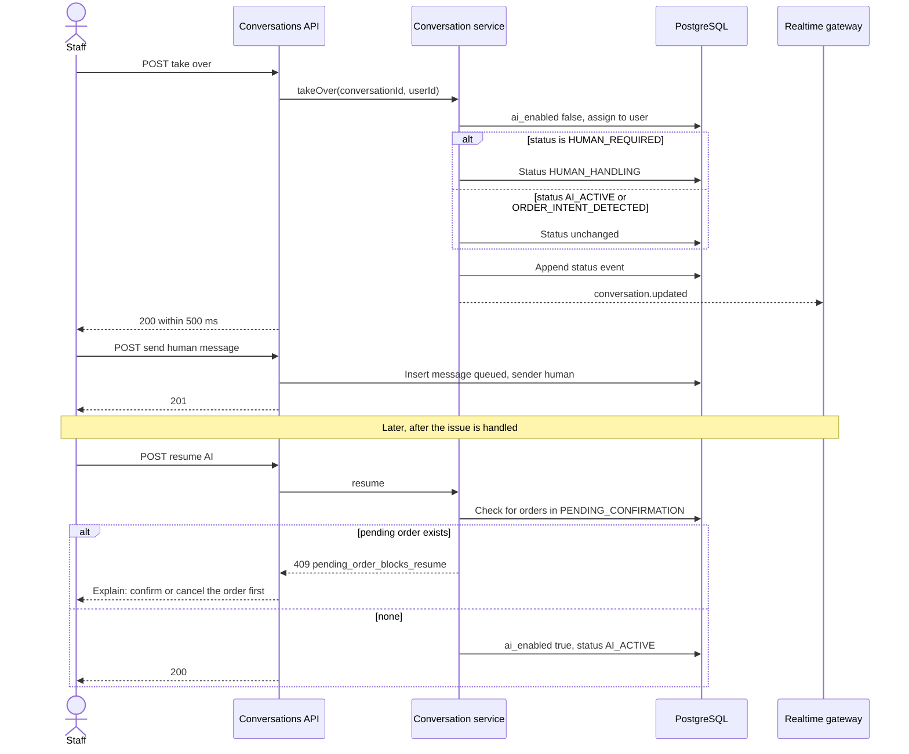

**Explanation:** taking over only flips `ai_enabled`; inbound messages are still stored while a human is handling. **Resume is always an explicit click** and is blocked while an order awaits confirmation, because the AI could otherwise chat about an order a human has not decided on. Assigning a conversation to a person does not pause or resume the AI by itself.

---

## F11. Confirm or cancel an order

**Purpose:** one human action settles a pending order and updates everything that depends on it.
**Actors:** Staff, Order service, Inventory service, Conversation service, Customer service, Analytics, Notifications.

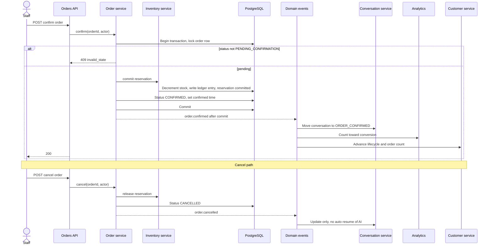

**Explanation:** confirmation is one transaction covering the order status, the stock decrement and the ledger entry, so stock and orders can never disagree. Side effects happen **after commit** through events, which keeps the money-like path small and lets handlers be retried safely. Cancelling releases the reservation and deliberately does **not** hand the conversation back to the AI.

---

## F12. Outbound delivery with retry

**Purpose:** send a stored message to the channel reliably, without blocking the user.
**Actors:** Sender (AI worker or staff), API, Queue, Delivery worker, Channel adapter, Meta.

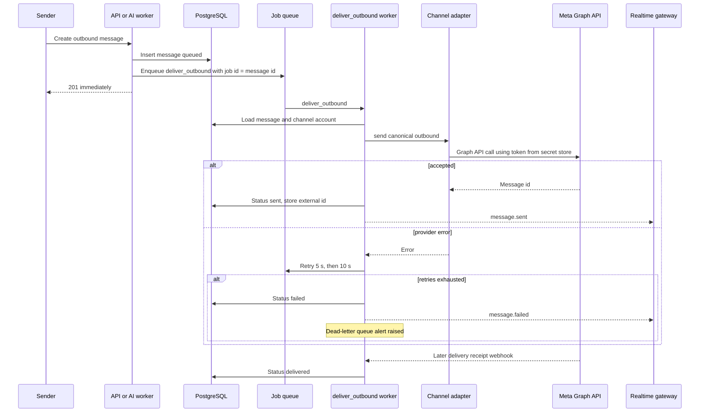

**Explanation:** the HTTP request never waits for Meta; it returns once the message is stored and queued. The job id equals the message id, so the same message is never sent twice. After three attempts the message is `failed`, an alert fires, and the inbox shows a **retry** button for staff.

---

## F13. Reply modes and draft approval

**Purpose:** let owners build trust gradually by controlling whether AI replies send themselves.

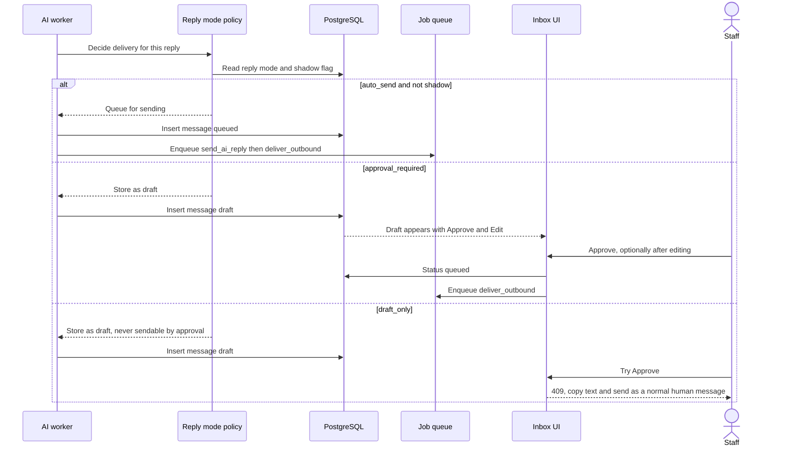

**Explanation:** a **new business starts in `approval_required`**, so the AI proposes and a human sends. The owner moves to `auto_send` when satisfied. An approved or edited AI suggestion still counts as AI-handled in the KPIs. A shadow-mode feature flag forces drafts even for `auto_send`, which is useful when testing a new prompt in production.

---

## F14. AI suggestion for a human reply

**Purpose:** help a human who is already replying, without letting the AI send anything.
**Actors:** Staff, API, Queue, AI orchestrator, Realtime.

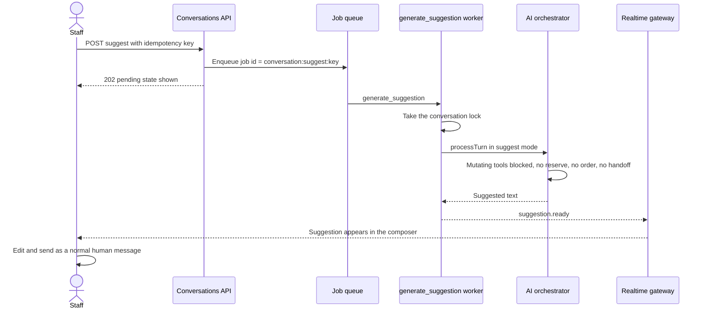

**Explanation:** it works even when the AI is switched off for the thread (`ai_enabled` false), because the person is the sender. It is suppressed on complaints and refunds, where a generated reply would be inappropriate. Target: the suggestion arrives in under 5 seconds with a visible waiting state.

---

## F15. LLM failure and fallback

**Purpose:** a provider outage must not stop the business.

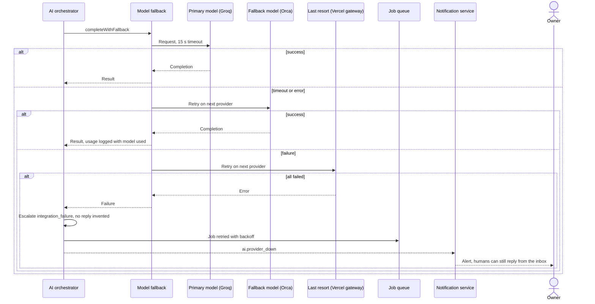

**Explanation:** each attempt has its own timeout, so total latency stays bounded. When every provider fails, the AI **does not guess**: the thread is escalated to a human, staff can reply manually, and the owner is notified. The inbox, catalog and orders keep working because they do not depend on the LLM.

---

## F16. AI activation gates

**Purpose:** prevent the AI going live before the shop is ready.
**Actors:** Owner, Web app, Business service.

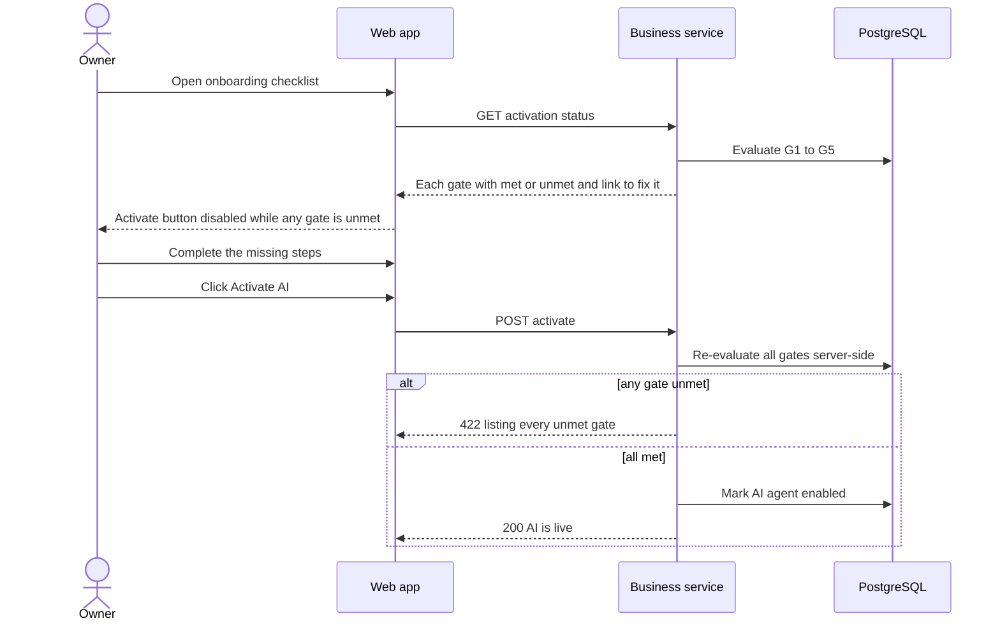

| Gate | Condition |
|---|---|
| **G1 Catalog** | At least one active product with a variant that has a price and a stock value |
| **G2 Rules** | Delivery, payment and return rules present and acknowledged (accepting seeded defaults counts) |
| **G3 Channel** | At least one channel account in `active` status |
| **G4 AI test** | A playground simulation completed, or an approved reply in approval mode |
| **G5 Handoff** | Owner acknowledged that buying intent creates a pending order that a human must confirm |

**Explanation:** the check runs again on the server at activation time; a disabled button is a convenience, not the control. The error lists **every** unmet gate so the merchant fixes them in one pass.

---

## F17. Playground (safe simulation)

**Purpose:** let the owner see the AI's voice and satisfy gate G4 with no real-world effects.

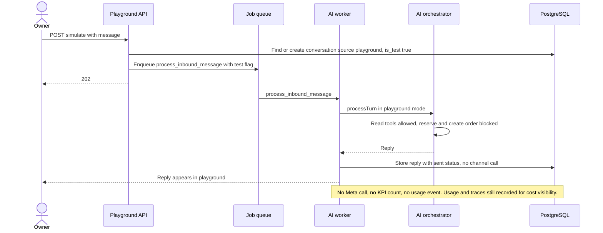

**Explanation:** test rows carry `is_test = true`, which excludes them from KPIs, billing and Meta delivery. The same orchestrator runs, so what the owner sees is what customers will get.

---

## F18. KPI rollup

**Purpose:** four numbers, computed once a day, read instantly.

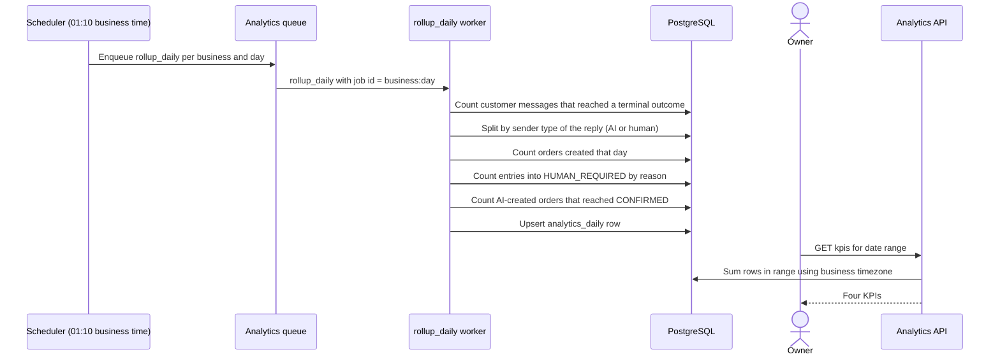

| KPI | Definition |
|---|---|
| Messages handled | Inbound customer messages that reached a terminal outcome (AI replied, escalated, or answered by a human); split AI vs human by who produced the reply |
| Orders created | Orders created in the period in pending or confirmed state, counted even if cancelled later |
| Human handoffs | Entries into `HUMAN_REQUIRED`, grouped by reason; escalating twice counts twice |
| Conversion | AI-created orders that reached `CONFIRMED` divided by AI-created pending orders |

Test rows are excluded. Periods start at the beginning of the first day and end before the day after the last, in the **business timezone**. Re-running the job for a day produces the same row (idempotent upsert).

---

## F19. Realtime updates

**Purpose:** staff see new messages and status changes without refreshing.

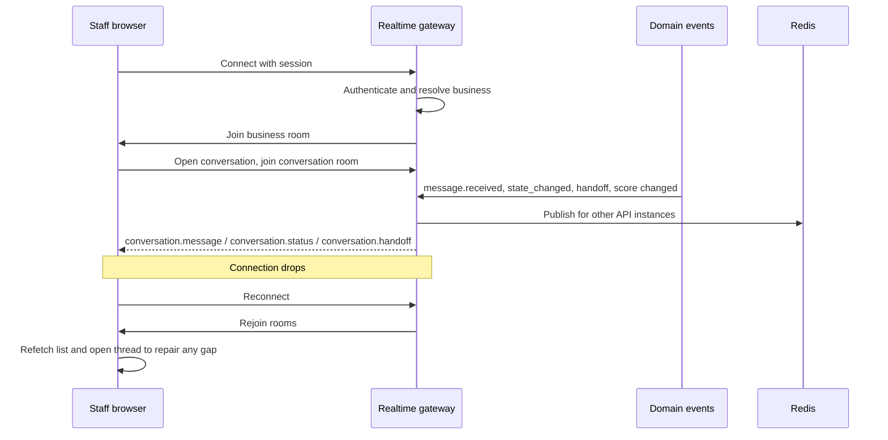

**Explanation:** realtime is an **accelerator, not a source of truth**. If a socket event is missed, the next fetch from the API gives the correct state; the client refetches after every reconnect. Rooms are keyed by business, so a user can never subscribe to another tenant's events. Target: a new message visible within 2 s of being stored.

---

## F20. Reservation expiry

**Purpose:** abandoned purchases must give stock back.

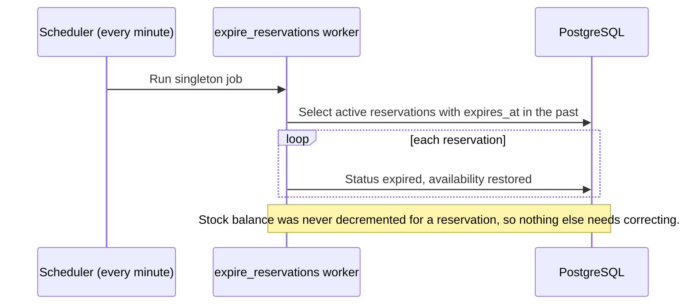

**Explanation:** a reservation only reduces *available* stock; the real `stock` number changes only when an order is confirmed (F11). Expiry therefore needs no compensating ledger entry. The job is a singleton so two instances never race.
