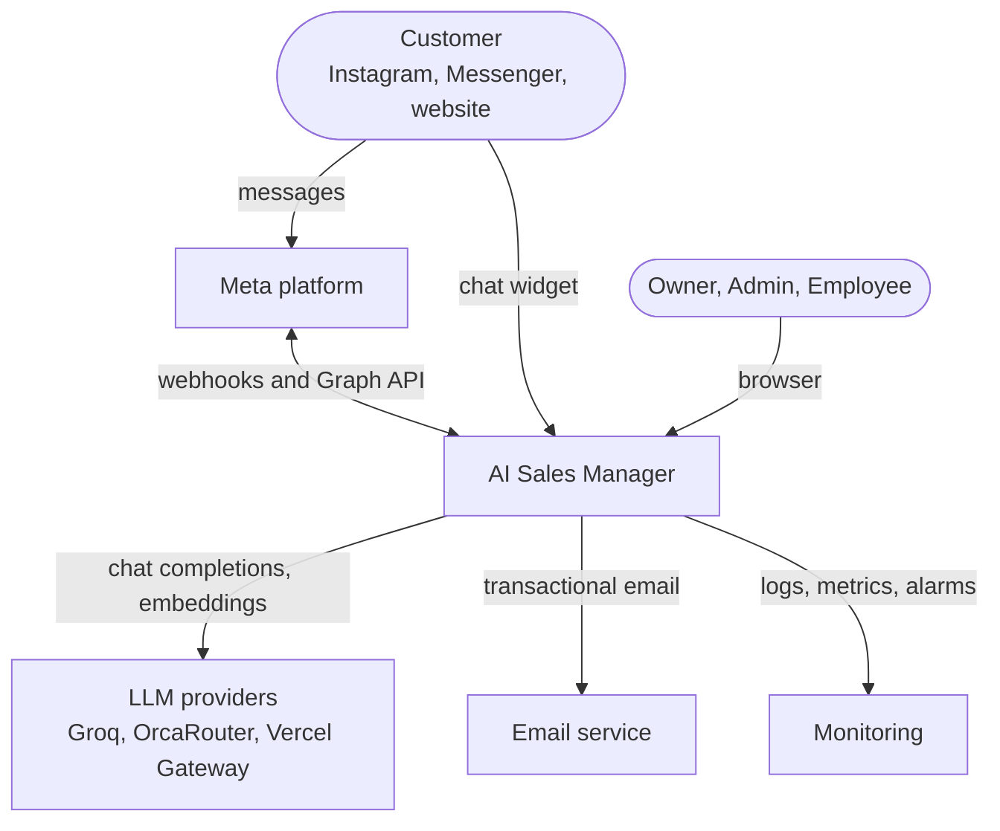
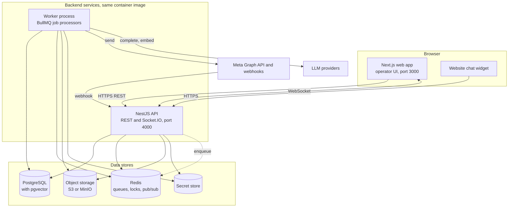
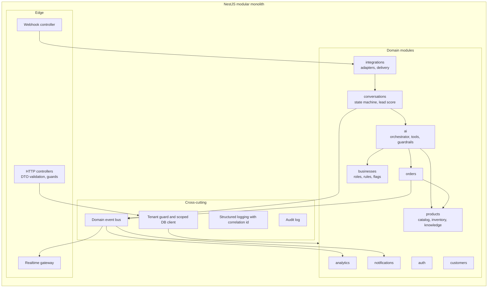
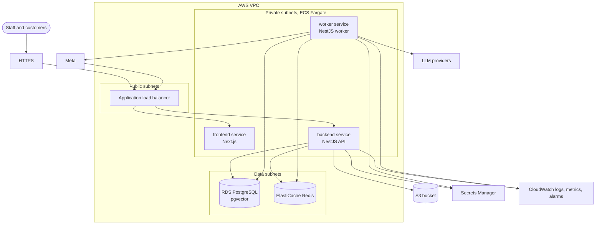

# 05. Component and Deployment Architecture

## 1. System context (C4 level 1)

Who and what the system talks to.

## 2. Containers (C4 level 2)

| Container | Responsibility | Scales by |
|---|---|---|
| **Web (Next.js)** | Operator UI: inbox, orders, catalog, settings, onboarding. Stateless | Task count |
| **API (NestJS)** | REST, webhooks, auth, realtime gateway. Never waits on the LLM | Task count |
| **Worker** | AI turns, delivery, imports, indexing, rollups, scheduled jobs | Task count, independent of API |
| **PostgreSQL + pgvector** | System of record and vector search | Instance size, read replicas later |
| **Redis** | Job queues, conversation locks, realtime pub/sub | Instance size |
| **Object storage** | Product images, inbound media | Managed |
| **Secret store** | Channel tokens, API keys | Managed |

The API and worker are **the same codebase and image** started with different entry points. That keeps one build and lets each tier scale on its own.

## 3. Components inside the backend (C4 level 3)

**Request path rules**

1. Every controller call passes through the **tenant guard**, which resolves the business and permissions from the session.
2. All database access goes through a **tenant-scoped client**, so a forgotten `WHERE business_id` cannot leak data.
3. Modules interact only through each other's exported services (see class diagram C8), or by publishing domain events.

## 4. Job queues

| Queue | Jobs | Trigger |
|---|---|---|
| `ai` | `process_inbound_message`, `send_ai_reply`, `generate_suggestion`, `summarize_conversation`, `score_lead` | Message events, staff actions |
| `integrations` | `deliver_outbound`, `retry_webhook_processing`, `fetch_inbound_media`, `check_channel_tokens` | Queued messages, webhook events, daily |
| `embeddings` | `index_document`, `reindex_business` | Knowledge save, import |
| `catalog` | `validate_import`, `run_import` | Upload, confirm |
| `analytics` | `rollup_daily` | Daily per business timezone |
| `billing` | `sync_usage_aggregates` | Hourly |
| `notifications` | `notify_handoff`, `notify_order_request`, `notify_hot_lead` | Domain events |
| `maintenance` | `expire_reservations`, `auto_close_inactive`, `sweep_retention` | Every minute, daily |

Retry policy for all jobs: 3 attempts with exponential backoff (5 s, then 10 s), then a dead-letter record and an alert. Job ids are deterministic (for example `{conversationId}:{inboundMessageId}`), so duplicates are ignored.

## 5. Deployment (production target)

| Concern | Choice | Why |
|---|---|---|
| Compute | ECS Fargate, three services (frontend, backend, worker) | No servers to manage; no Kubernetes needed at this scale |
| Database | RDS PostgreSQL with pgvector | One store for relational data and vectors |
| Queues and locks | ElastiCache Redis | BullMQ and conversation locks |
| Secrets | Secrets Manager | Tokens never in code or env files |
| Migrations | Versioned, forward-only, run on deploy | Predictable schema evolution |
| Observability | CloudWatch plus structured logs with correlation ids | Trace a message from webhook to outbound send |

### Local development

`docker compose up` starts PostgreSQL (with pgvector), Redis and optional MinIO; `pnpm dev:api` and `pnpm dev:web` start the apps; a seed script creates a demo shop. This is NFR-OPS-06.

## 6. Tenancy topology

All tenants share one database and one deployment (**pooled multi-tenancy**).

| Layer | Isolation mechanism |
|---|---|
| API | Tenant context resolved from the session; never taken from the request body |
| Database | `business_id` on every tenant table; composite foreign keys `(id, business_id)`; tenant-scoped client |
| Vectors | Retrieval filtered by `business_id` before similarity search |
| Queues | Job payloads carry `businessId`; workers re-establish tenant context |
| Realtime | Rooms keyed by business |
| Secrets | One secret reference per channel account |
| Tests | An automated suite hits every endpoint with a token from another tenant and expects a denial |

**Why pooled:** it is the cheapest to run and simplest to deploy for a Phase 1 with up to about 100 tenants. The cost is that isolation correctness is entirely in code, which is why a cross-tenant access is classed as Sev-1 and has its own test suite.

## 7. Failure modes and responses

| Failure | Effect | Response |
|---|---|---|
| LLM provider down | No AI replies | Fallback chain; then escalate and alert; humans keep working |
| Redis down | No new jobs, no realtime | Webhooks still persist to PostgreSQL; sweep re-enqueues when Redis returns |
| Worker crash mid-turn | Turn incomplete | Lock expires; job retried; idempotent steps repeat safely |
| Meta outage | Outbound cannot send | Messages stay `queued`, retry with backoff; inbound is acknowledged only after persist |
| Database failover | Brief errors | Retries; RPO 5 min, RTO 4 h targets |
| Duplicate webhook | Would double-process | Unique keys make it a no-op |
