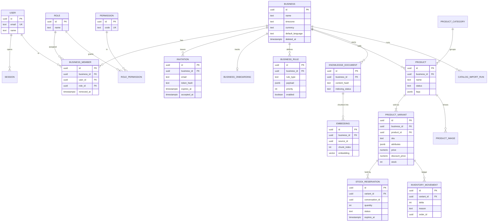
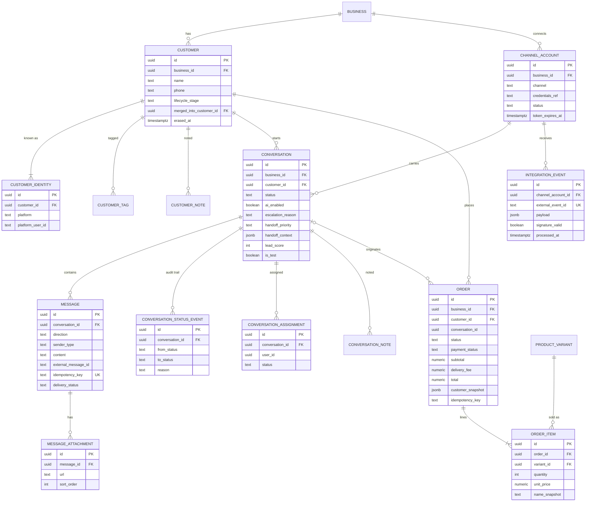

# 06. Data Model (Entity-Relationship)

The relational schema has about 60 tables. The diagrams show the tables that carry the business, grouped in three views so each stays readable. Column lists are the important ones, not every column.

## Conventions

| Convention | Rule |
|---|---|
| Keys | UUID primary keys |
| Tenancy | Every tenant table has `business_id`. Cross-table references use composite keys `(id, business_id)` so a row can only point inside its own tenant |
| Time | `timestamptz` everywhere; the business timezone is applied only when reporting |
| Money | `numeric(12,3)`: Tunisian dinar has three decimal places (millimes) |
| Soft delete | Businesses use `deleted_at` plus a retention date; customers can be erased (`erased_at`) |
| Idempotency | Unique keys on `messages.idempotency_key`, `(channel_account_id, external_message_id)`, `orders (business_id, idempotency_key)` |
| JSON | Flexible, validated fields (`address`, `handoff_context`, `payload`) use `jsonb` with a schema checked in code |

## View 1. Tenancy, catalog and inventory

## View 2. Customers, conversations and orders

`CONVERSATION to ORDER` is a pointer without a hard foreign key (`order.conversation_id`) so that deleting or archiving conversations never cascades into financial records.

## View 3. AI, billing and observability

```mermaid
erDiagram
    BUSINESS ||--|| AI_AGENT : configures
    BUSINESS ||--|| AI_SETTINGS : tunes
    BUSINESS ||--o{ AI_PROMPT : versions
    CONVERSATION ||--o{ AI_ACTION : records
    CONVERSATION ||--o{ AI_DECISION_TRACE : explains
    CONVERSATION ||--o{ AI_USAGE : costs
    MESSAGE ||--o{ AI_FEEDBACK : rated
    MESSAGE ||--o{ AI_DECISION_TRACE : "inbound or outbound"
    AI_PROMPT ||--o{ AI_USAGE : "used by"
    PLAN ||--o{ SUBSCRIPTION : subscribed
    BUSINESS ||--o{ SUBSCRIPTION : has
    BUSINESS ||--o{ USAGE_EVENT : emits
    BUSINESS ||--o{ ANALYTICS_DAILY : summarised
    BUSINESS ||--o{ NOTIFICATION : sends
    USER ||--o{ NOTIFICATION : receives
    BUSINESS ||--o{ FEATURE_FLAG : toggles
    BUSINESS ||--o{ AUDIT_LOG : audited

    AI_AGENT {
        uuid business_id PK
        text personality
        text language
        numeric confidence_threshold
        boolean enabled
    }
    AI_SETTINGS {
        uuid business_id PK
        text model_primary
        text model_fallback
        text reply_mode
        int rag_top_k
        int reservation_ttl_minutes
        numeric monthly_ai_budget_usd
    }
    AI_PROMPT {
        uuid id PK
        text type
        text version
        text body
    }
    AI_ACTION {
        uuid id PK
        uuid conversation_id FK
        text action_type
        text tool_name
        jsonb input
        jsonb output
        boolean success
        int duration_ms
    }
    AI_DECISION_TRACE {
        uuid id PK
        uuid conversation_id FK
        uuid inbound_message_id FK
        uuid outbound_message_id FK
        jsonb decision_trace
    }
    AI_USAGE {
        uuid id PK
        text provider
        text model
        int tokens_input
        int tokens_output
        numeric estimated_cost_usd
    }
    AI_FEEDBACK {
        uuid id PK
        uuid message_id FK
        text rating
        text reason
    }
    PLAN {
        uuid id PK
        text code UK
        jsonb limits
    }
    SUBSCRIPTION {
        uuid id PK
        uuid plan_id FK
        text status
        timestamptz period_end
    }
    USAGE_EVENT {
        uuid id PK
        text metric
        int quantity
        boolean is_test
    }
    ANALYTICS_DAILY {
        uuid business_id PK
        date day PK
        int messages_handled
        int orders_created
        int handoffs_total
        jsonb handoffs_by_reason
        int conversion_confirmed
    }
    NOTIFICATION {
        uuid id PK
        uuid user_id FK
        text type
        text dedupe_key UK
        timestamptz read_at
    }
    FEATURE_FLAG {
        uuid id PK
        text key
        boolean enabled
    }
    AUDIT_LOG {
        uuid id PK
        uuid actor_user_id
        text action
        text entity_type
        jsonb after
    }
```

## Key constraints and indexes (design intent)

| Constraint | Purpose |
|---|---|
| `UNIQUE (channel_account_id, external_message_id)` on messages | No duplicate inbound message |
| `UNIQUE idempotency_key` on messages | Safe retry of outbound creation |
| `UNIQUE (business_id, idempotency_key)` on orders | One order per AI turn or click |
| `UNIQUE external_event_id` per provider on integration events | Webhook dedupe |
| Partial index on `integration_events (created_at) WHERE processed_at IS NULL` | Fast recovery sweep |
| `UNIQUE dedupe_key` on notifications | No duplicate alerts |
| One default variant per product (partial unique index) | Predictable pricing display |
| Index on `(business_id, status, handoff_priority, handoff_at)` for conversations | Inbox triage ordering |
| Vector index on `embedding` filtered by `business_id` | Tenant-scoped retrieval under 250 ms |
| Composite FK `(customer_id, business_id)` | A conversation cannot reference another tenant's customer |
