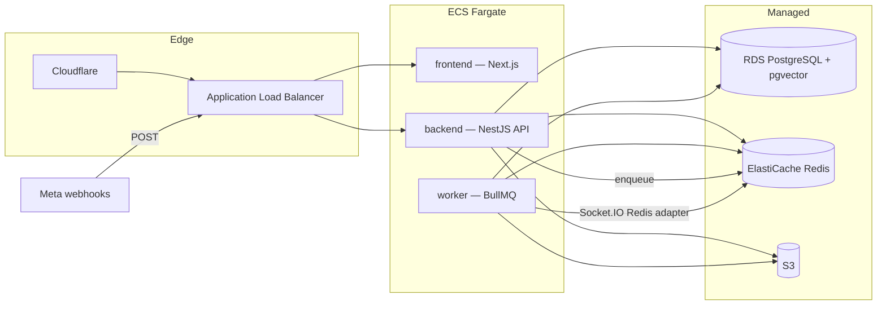

# 10 — Architecture

| Field           | Value                                                                                                                                                                                                                                                                                                       |
| --------------- | ----------------------------------------------------------------------------------------------------------------------------------------------------------------------------------------------------------------------------------------------------------------------------------------------------------- |
| Document ID     | `10_ARCHITECTURE`                                                                                                                                                                                                                                                                                           |
| Status          | Approved — canonical for module boundaries and dependencies                                                                                                                                                                                                                                                 |
| Owner           | Engineering                                                                                                                                                                                                                                                                                                 |
| Audience        | Backend, frontend, DevOps, AI coding agents                                                                                                                                                                                                                                                                 |
| Depends on      | `00_PROJECT_OVERVIEW.md`, `03_MVP_SCOPE.md`                                                                                                                                                                                                                                                                 |
| Consumed by     | `11_TECH_STACK.md`, `12_DATABASE_DESIGN.md`, `13_API_DESIGN.md`, `14_SYSTEM_DESIGN.md`, `15_AI_ARCHITECTURE.md`, `16_INTEGRATION_DESIGN.md`, `17_SECURITY_DESIGN.md`, `18_DEPLOYMENT.md`, `30_execution/30_TASKS.md`, `30_execution/31_IMPLEMENTATION_PLAN.md`, `30_execution/32_FEATURE_SPECIFICATIONS.md` |
| Upstream source | `docs/AI_Sales_Agent_Brain_Dump.md` → `# Backend`, `# Event Architecture`, `# Infrastructure`, `# Integration Architecture`, `# Final Decisions`                                                                                                                                                            |

---

## 1. Purpose and scope

This document is **canonical for how the system is cut into pieces and how those pieces may talk**. A pull request that reaches across another module's tables is a defect (NFR-MNT-01), not a shortcut.

**In scope:** the modular-monolith decision, module map and ownership, allowed dependencies, the async boundary, the extraction path, and the architectural hooks that keep Phase 2 (WhatsApp) and later phases from becoming rewrites.

**Out of scope, and where it lives instead:**

| Topic                                                                 | Canonical location                                                |
| --------------------------------------------------------------------- | ----------------------------------------------------------------- |
| Language, library, and version choices                                | `11_TECH_STACK.md`                                                |
| Tables, columns, indexes                                              | `12_DATABASE_DESIGN.md`                                           |
| Endpoint contracts                                                    | `13_API_DESIGN.md`                                                |
| State machine, jobs, locks, rate limits, lead scoring, realtime rooms | `14_SYSTEM_DESIGN.md`                                             |
| Orchestrator internals, RAG, prompts, traces                          | `15_AI_ARCHITECTURE.md`                                           |
| Adapter internals, webhooks, Meta OAuth                               | `16_INTEGRATION_DESIGN.md`                                        |
| Auth protocols, RBAC matrix, encryption, secrets                      | `17_SECURITY_DESIGN.md`                                           |
| Environments, VPC, ECS sizing, CI/CD, DNS, alarms                     | `18_DEPLOYMENT.md`                                                |
| Operator UI tokens, type, colour, RTL, density                        | `20_DESIGN_SYSTEM.md`                                             |
| Brand positioning, voice & tone, naming, trust cues                   | `21_BRAND_STRATEGY.md`                                            |
| AI behaviour and handoff _rules_                                      | `05_AI_BEHAVIOR_SPECIFICATION.md`, `06_AI_HUMAN_HANDOFF_RULES.md` |

`20_DESIGN_SYSTEM.md`, `21_BRAND_STRATEGY.md`, `22_UX_FLOWS.md`, and `23_UI_COMPONENTS.md` are canonical for operator UI tokens, brand/voice, screen/inbox flows, and component inventory. `30_TASKS.md` is canonical for Phase 1 work breakdown, `31_IMPLEMENTATION_PLAN.md` for its schedule, and `32_FEATURE_SPECIFICATIONS.md` for the feature join. Until remaining exports exist (`07`, `24`), the Brain Dump remains authoritative for those details. This file must not copy them. `12_DATABASE_DESIGN.md` is the canonical schema. `13_API_DESIGN.md` is the canonical HTTP/Socket.IO contract. `14_SYSTEM_DESIGN.md` is the canonical runtime (state machine, jobs, locks, scoring). `15_AI_ARCHITECTURE.md` is the canonical orchestrator/RAG/prompts. `16_INTEGRATION_DESIGN.md` is the canonical Meta adapter/HMAC/OAuth/Graph. `17_SECURITY_DESIGN.md` is the canonical auth/RBAC/secrets/PII. `18_DEPLOYMENT.md` is the canonical hosting spec.

---

## 2. Architectural style — modular monolith

**Decision:** one deployable NestJS application with hard internal module boundaries. Modules communicate through **application services** and **domain events**, never through each other's database tables.

This is non-negotiable product decision 5.6 in `00_PROJECT_OVERVIEW.md`.

### 2.1 Why not microservices in MVP

| Pressure           | Why a monolith wins now                                                                                              |
| ------------------ | -------------------------------------------------------------------------------------------------------------------- |
| Team size          | A small team cannot operate ten independently deployed services, ten queues, and ten failure modes                   |
| Transactional core | Purchase handoff is `reserve → order → state → notify`. That is one unit of work, not a distributed saga             |
| Tenant model       | One Postgres, `business_id` on every tenant row — splitting the database early buys isolation theatre, not isolation |
| Channel volatility | WhatsApp will change _inside_ Integrations; it must not force a new deployable                                       |
| Cost               | ECS + RDS + Redis is already the right ops surface; service mesh is not                                              |

### 2.2 Why not a single Nest module either

A ball of controllers sharing entities would make the WhatsApp adapter, the inbox, and the orchestrator leak into each other — the exact failure the adapter pattern exists to prevent. **Modular** is load-bearing; **monolith** is the deploy shape.

### 2.3 What "modular" means in this codebase

1. One NestJS `AppModule` imports domain modules. Domain modules do **not** import each other's `*.module.ts` internals.
2. Each domain module owns a set of tables (see §4). Other modules query those tables **only** through the owner's public service.
3. Cross-module side effects that can be eventually consistent go through **domain events** (§6), not direct writes.
4. Shared kernel is thin: identity of the current user/tenant, error envelope, pagination, idempotency helpers, the event bus. It contains **no** business rules.

A review that finds `OrdersModule` importing `ConversationsEntity` (or the equivalent Prisma model) fails, even if the query is "faster."

---

## 3. System containers

Three Fargate services, two Docker images (Nest API+worker, Next frontend), three managed data stores.



External from **backend** only: Instagram + Messenger (MVP), WhatsApp Cloud API (Phase 2 stub), LLM APIs. Secrets Manager holds tokens and keys. CloudWatch for API errors, worker failures, AI latency, Meta failures.

| Service               | Responsibility                                                                                                        |
| --------------------- | --------------------------------------------------------------------------------------------------------------------- |
| **frontend**          | Next.js operator UI. No business logic, no direct database, no Meta calls.                                            |
| **backend**           | HTTP, webhooks, Socket.IO gateway. Persists inbound, returns `200`, enqueues work.                                    |
| **worker**            | Same NestJS image as backend, different command. BullMQ: AI turns, outbound send, embeddings, rollups, notifications. |
| **RDS PostgreSQL**    | System of record, including `pgvector`. Automated backups.                                                            |
| **ElastiCache Redis** | BullMQ, conversation locks, rate limits, Socket.IO adapter. Not a source of truth.                                    |
| **S3**                | Product images, CSV originals, knowledge docs, conversation media, customer uploads.                                  |

Backend and worker **must** be the same artifact so domain code cannot drift. Scaling them independently is an ops choice (task count), not an architecture change.

ALB: HTTPS to frontend and backend; **WebSocket upgrade and idle timeout** for Socket.IO. Clients fall back to polling (Brain Dump, Sales Command Center). Cloudflare sits in front of the ALB.

**Networking:** ECS tasks in a **public** subnet (public IPs reach Meta and LLM APIs). RDS and Redis in a **private** subnet. Security groups only. **No NAT Gateway in MVP.**

---

## 4. Domain modules

Brain Dump `# Backend` lists the modules. The table below is the ownership contract. **CRM** in the integration sketch is not a module — it is Customers + Conversations. We are not building a CRM.

### 4.1 Ownership map

| Module            | Owns (conceptual)                                                                                                  | Public services others may call                                 | Must not                                                                    |
| ----------------- | ------------------------------------------------------------------------------------------------------------------ | --------------------------------------------------------------- | --------------------------------------------------------------------------- |
| **Auth**          | Users, credentials, sessions (`users`, refresh/password/OAuth tokens)                                              | `AuthService`, current-user/tenant context                      | Know about conversations or Meta                                            |
| **Businesses**    | Workspace, members, roles, invitations, settings, `business_rules`, feature flags, plans/subscriptions, onboarding | `BusinessService`, `BusinessRulesService`, `FeatureFlagService` | Call Meta or the LLM                                                        |
| **Products**      | Catalog, variants, images, stock, reservations, knowledge documents, embeddings rows                               | `CatalogService`, `InventoryService`, `KnowledgeService`        | Send messages or change conversation status                                 |
| **Customers**     | Customer records, identities, tags, notes, lifecycle stage                                                         | `CustomerService`, `CustomerLifecycleService`                   | Own conversations or orders                                                 |
| **Conversations** | Conversations, messages, assignments, summaries, lead score fields, state machine transitions                      | `ConversationService`, `StateMachine`, `LeadScoringService`     | Call Meta APIs or the LLM directly                                          |
| **AI**            | Agent config, prompts, orchestrator, traces, usage, feedback                                                       | `AIOrchestrator.processTurn`, `SuggestionService`               | Persist orders except via Orders; persist messages except via Conversations |
| **Orders**        | Orders, line items, confirmation/cancel                                                                            | `OrderService` (`createPending`, `confirm`, `cancel`)           | Talk to Meta or mutate catalog stock except via Products.Inventory          |
| **Integrations**  | Channel accounts, OAuth/tokens, adapters, `integration_events`, outbound delivery                                  | `UnifiedMessaging` (canonical in/out), `MetaIntegrationService` | Import AI or inbox internals                                                |
| **Analytics**     | KPI rollups, usage_events / aggregates (billing meters live here operationally)                                    | `AnalyticsService`, `UsageService`                              | Be on the inbound hot path                                                  |
| **Notifications** | In-app notification records and fan-out to recipients                                                              | `NotificationService`                                           | Decide _when_ to hand off — it only delivers                                |
| **Realtime**      | Socket.IO gateway, room joins, client event translation                                                            | Gateway only — no tables                                        | Be a source of truth; it is an accelerator                                  |

**Audit** (`audit_logs`) is a platform concern invoked by other modules; it is not a twelfth domain with its own product surface.

### 4.2 Modular Domain Layout & Topic-Based Directory Organization

To ensure maintainability, clear separation of concerns, and clean architectural boundaries, each domain module in `apps/api/src/` is grouped into topic-specific subdirectories rather than flat folders:

```
apps/api/src/
  ai/                           ← AI intelligence module
    config/                     ← Agent settings & configurations
    gateway/                    ← Model routing, fallback, and rate tracking
    guardrails/                 ← Input/output safety & compliance checks
    handoff/                    ← Escalation & handoff triggers
    intent/                     ← Intent classifiers (LLM & heuristic)
    orchestrator/               ← Multi-turn engine, suggestion service & briefing generator
    prompts/                    ← Versioned prompt templates & builder
    playground/                 ← Sandbox simulation & isolated test execution
    evaluation/                 ← Golden-set offline evaluation & accuracy suites
    observability/              ← Structured execution traces & LLM decision audit
    feedback/                   ← Merchant feedback loop & RLHF corrections
    usage/                      ← AI token & cost telemetry endpoints
    tools/                      ← Registered agent tools (catalog, stock, policy)
    dto/                        ← Data transfer objects
    ai.module.ts                ← NestJS module entrypoint
  auth/                         ← Identity & authentication
    better-auth/                ← Better Auth engine & Fastify adapter
    email/                      ← Transactional email dispatcher
    core/                       ← Auth service, controller, and token refresh
    guards/                     ← Rate throttling & session guards
    dto/                        ← Auth DTOs
    auth.module.ts              ← NestJS module entrypoint
  businesses/                   ← Workspace & tenant management
    workspace/                  ← Profile & organization settings
    activation/                 ← Pre-launch gate validation & live switch
    audit/                      ← Compliance & audit logging
    flags/                      ← Feature flags & business switches
    members/                    ← Team invitations & role management
    onboarding/                 ← Onboarding wizard state
    dto/                        ← Business DTOs
    businesses.module.ts        ← NestJS module entrypoint
  catalog/                      ← Commerce inventory & categories
    categories/                 ← Category hierarchies & trees
    products/                   ← Products, variants, and image gallery
    csv-import/                 ← Asynchronous bulk CSV ingestion
    indexer/                    ← Semantic catalog vector indexer
    dto/                        ← Catalog DTOs
    catalog.module.ts           ← NestJS module entrypoint
  conversations/                ← Messaging & inbox domain
    threads/                    ← Conversation threads & distributed locks
    messages/                   ← Inbound/outbound message timeline
    state-machine/              ← Deterministic conversation status transitions
    lead-scoring/               ← Deterministic lead scoring & decay processor
    timeline/                   ← Audit timeline events
    pipeline/                   ← Kanban lead pipeline aggregation
    dto/                        ← Conversation DTOs
    conversations.module.ts     ← NestJS module entrypoint
  customers/                    ← Customer CRM & identity
    workspace/                  ← Customer listing & profile management
    identity/                   ← Channel phone/handle resolution & merge
    lifecycle/                  ← Customer lifecycle stages & activity tracker
    dto/                        ← Customer DTOs
    customers.module.ts         ← NestJS module entrypoint
  orders/                       ← Commerce orders & reservations
    core/                       ← Order lifecycle, line items, status management
    reservations/               ← Timed stock reservation holds & sweeper
    dto/                        ← Order DTOs
    orders.module.ts            ← NestJS module entrypoint
  notifications/                ← Alerting & notification dispatcher
    core/                       ← Notification feed & user read status
    dispatcher/                 ← In-app & worker notification delivery
    dto/                        ← Notification DTOs
    notifications.module.ts     ← NestJS module entrypoint
  analytics/                    ← Metrics & telemetry
    kpis/                       ← Realtime KPI summary & trend queries
    rollups/                    ← Nightly aggregation & summary rollups
    dto/                        ← Analytics DTOs
    analytics.module.ts         ← NestJS module entrypoint
  billing/                      ← Subscriptions & quota metering
    core/                       ← Subscription status & plan endpoints
    plans/                      ← Pricing tier definitions & features
    metering/                   ← Event metering & usage recording
    quota/                      ← Enforced monthly usage quotas
    dto/                        ← Billing DTOs
    billing.module.ts           ← NestJS module entrypoint
  integrations/                 ← External channels & webhooks
    channels/                   ← Channel account management & connection status
    meta/                       ← Unified Meta Graph API client & OAuth token exchange
    webhooks/                   ← Webhook ingestion & HMAC signature verification
    media/                      ← Private S3 media download & CDN caching
    outbound/                   ← BullMQ outbound delivery queue & processor
    normalizer/                 ← Canonical message schema normalization
    adapters/                   ← Channel-specific inbound/outbound adapters
    guards/                     ← HMAC verification guards
    integrations.module.ts      ← NestJS module entrypoint
  knowledge/                    ← RAG & merchant knowledge base
    rules/                      ← Business rule management & evaluation
    documents/                  ← Knowledge document uploads & storage
    search/                     ← Vector similarity search & embeddings processor
    dto/                        ← Knowledge DTOs
    knowledge.module.ts         ← NestJS module entrypoint
  platform/                     ← Shared platform kernel
    health/                     ← Terminus health checks & readiness indicators
    security/                   ← Tenant guard, permissions guard, RBAC, JWT
    core/                       ← Standard error mapping, Fastify HTTP, Prisma token
    platform.module.ts          ← NestJS global module entrypoint
  realtime/                     ← Realtime gateway & Socket.IO events
```

Names may vary; **ownership must not**. Each domain keeps its `[domain].module.ts` at the domain root as its NestJS entrypoint to preserve modular encapsulation and satisfy cross-module boundary rules (`python3 backlog/_runner.py check-arch`). Direct canonical topic imports are used internally, avoiding redundant barrel indirection. WhatsApp lives as a stub adapter so Phase 2 is a fill-in, not a new module.

### 4.3 Frontend as a client, not a module

Next.js pages (Dashboard, Inbox, Pipeline, Products, Customers, Orders, Analytics, Settings, Integrations) are **not** backend modules. They consume `/api/v1` and the gateway. They must not embed a second copy of the state machine or scoring rules.

---
