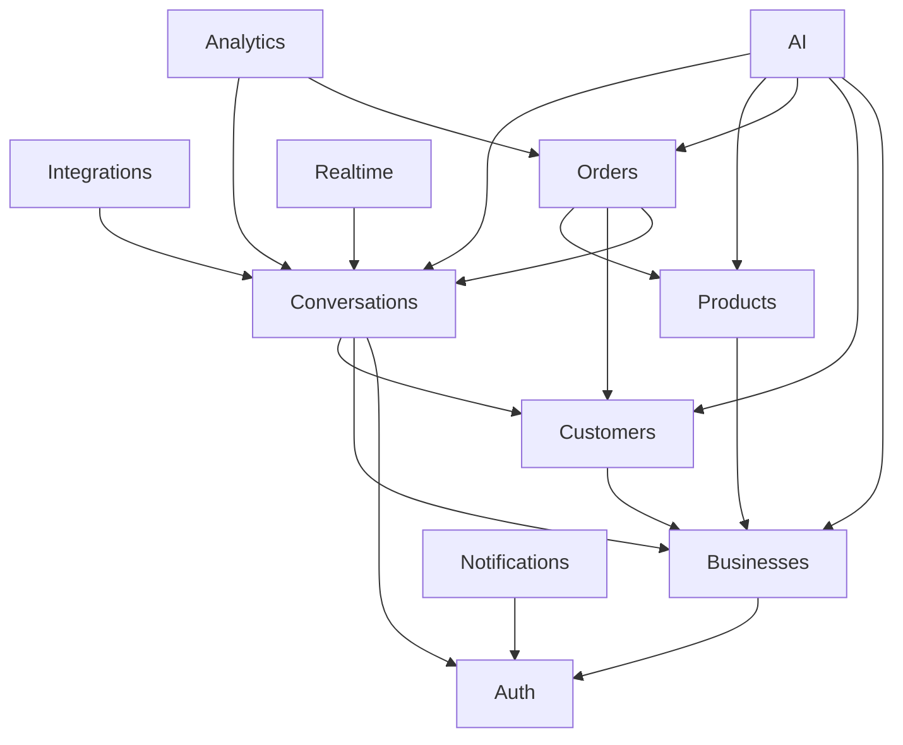

## 5. Dependency rules

Dependencies point **inward** toward stable domain, and **never** sideways into another module's persistence.



### 5.1 Allowed

- AI calls `CatalogService.search`, `InventoryService.check/reserve`, `OrderService.createPending`, `BusinessRulesService.effective`. AI does **not** call `ConversationService.transition` — it returns `intendedTransition`; the **worker** applies it (`14` §4, `15` §3).
- Integrations push a **canonical message** into Conversations; Conversations never parse a Graph API payload.
- Orders commit or release reservations **through** Products.
- Notifications and Analytics subscribe to events; they do not reach into AI tables for the hot path.
- Realtime subscribes to events and pushes to rooms; it does not write domain state.

### 5.2 Forbidden

| Forbidden                                        | Why                                                   |
| ------------------------------------------------ | ----------------------------------------------------- |
| Module A `JOIN`s Module B's tables               | Ownership evaporates; migrations become political     |
| Integrations importing `AIOrchestrator`          | Webhook latency and LLM failure modes must not couple |
| AI constructing Meta Graph requests              | Channel constraints belong in the adapter             |
| Conversations calling `create_pending_order` SQL | Orders own idempotency and snapshots                  |
| Frontend talking to Postgres or Redis            | Tenant isolation and RBAC live in NestJS              |
| Worker running a different commit than API       | Dual artifacts diverge; same image required           |
| A second "WhatsApp service" outside Integrations | Duplicates the adapter contract                       |

### 5.3 Cycles

The graph above has **Orders → Conversations** (`orders.conversation_id`, drive `ORDER_CONFIRMED` via `order.confirmed`) and **AI → Orders → Conversations**. That is acceptable if Conversations exposes `transition` and Orders never load message rows. Conversations does **not** store `order_id`; inbox “open order” is queried through `OrderService`.

If a cycle appears in code (`ConversationsModule` importing `OrdersModule` **and** the reverse at Nest module level), break it with an event: `order.confirmed` → Conversations handler, or a thin `SalesCoordination` facade in `platform/` that both call. Do not merge the modules.

---

## 6. Control flow — one inbound message

Authoritative sequence and jobs: `14_SYSTEM_DESIGN.md`. This is the architectural shape those details must preserve.

```
Meta webhook
  → Integrations (verify, persist raw integration_events, enqueue retry_webhook_processing, 200)
  → worker: map to canonical
  → Conversations (idempotent insert message)
  → event message.received
  → BullMQ process_inbound_message
  → Redis lock conversation:{id}:processing (token-fenced)
  → AIOrchestrator.processTurn
       Policy / tools / generate — business logic outside the LLM
       Inventory reserve: DB transaction + variant `FOR UPDATE` (`12` §6.5), not this Redis lock
  → Conversations persist outbound + state
  → events (ai.response.generated, conversation.state_changed, …)
  → Integrations deliver_outbound
  → Notifications / Analytics / Realtime consume events
```

Three properties are load-bearing (`00_PROJECT_OVERVIEW` §8):

1. **The webhook never waits for the LLM.** Persist, `200`, enqueue.
2. **Facts flow from the database through tools into the prompt**, never the reverse.
3. **The state manager, not the model, owns conversation status.**

If a design violates one of these, it is the wrong design even if it is simpler.

### 6.1 Two buses

| Bus                                                       | Use                                                                                    |
| --------------------------------------------------------- | -------------------------------------------------------------------------------------- |
| **In-process events** (NestJS EventEmitter or equivalent) | Same-request side effects that must not fail the write (e.g. enqueue a job)            |
| **BullMQ**                                                | AI processing, outbound send, embeddings, webhook retry, rollups, notify, `score_lead` |

Handlers are idempotent on `external_message_id` or an event `idempotency_key`. Core event catalog: `14_SYSTEM_DESIGN.md`. Adapter/provider mapping: `16_INTEGRATION_DESIGN.md`.

### 6.2 Realtime is not a bus

The Socket.IO gateway **translates** domain events into client events. Domain writes stay on REST. Occupancy only: the client may emit `thread:open` / `thread:close` so the server can join/leave `conversation:{id}` (`13_API_DESIGN.md`, `14_SYSTEM_DESIGN.md`). On reconnect the client refetches; a missed frame must not permanently corrupt the UI.

---

## 7. Multi-tenancy (architecture)

Shared database, `business_id` on every tenant-scoped table, **application-layer** enforcement on every query and command. Postgres RLS is **off** in MVP (`17` OQ-70).

Implications:

- Module public methods take an explicit `businessId` (from `X-Business-Id` + membership, `17`), never "whatever is on the row we loaded without checking."
- Socket rooms are joined **server-side** (`business:{id}`, `conversation:{id}`, `user:{id}`). Clients cannot subscribe to arbitrary rooms.
- Workers receive `businessId` on the job payload; a job without it is invalid.

AuthN/Z, encryption, and the permission matrix are `17_SECURITY_DESIGN.md`.

---

## 8. Deployment topology

Canonical: `18_DEPLOYMENT.md`. This section is the architectural constraint only: three Fargate services (`frontend`, `backend`, `worker`), managed Postgres / Redis / S3, no Kubernetes, no NAT Gateway in MVP. Sizing, VPC, DNS, pipeline, and alarms do not live here.

---

## 9. Architectural hooks (deliberate, not speculative)

These exist in MVP so later phases do not rip the monolith apart.

| Hook                                         | MVP shape                                                                      | Unlocks                                                                   |
| -------------------------------------------- | ------------------------------------------------------------------------------ | ------------------------------------------------------------------------- |
| Canonical `channel` enum includes `whatsapp` | Adapter folder stub, `feature_flags.whatsapp_enabled = false`, not connectable | Phase 2 Cloud API without a new messaging model                           |
| Meta Integration Service                     | Shared OAuth, tokens, webhook router by payload `object`                       | Third Meta surface is another adapter, not another platform               |
| Tool Executor as a port                      | Tools are functions the orchestrator calls on **other modules' services**      | New tools (payment link, Shopify) register without rewriting the pipeline |
| `GraphRetrievalProvider` port                | Unused in MVP; RAG is SQL + pgvector                                           | Retrieval stage R3 without swapping the orchestrator                      |
| Feature flags table                          | Per-tenant keys                                                                | WhatsApp, advanced analytics, VIP auto-handoff, shadow mode               |
| Same API/worker image                        | Two ECS commands (`node dist/main` vs `node dist/worker`)                      | Scale the worker fleet without a rewrite                                  |

Do **not** add a knowledge-graph database, a second queue product, or a microservice for "future scale."

---

## 10. Extraction path

Extract a module only when **one** of these is true: independent scale needs, independent failure domain that is taking the monolith down, or an independent team with a published API. Until then, keep the boundary inside the repo.

Likely order, not a schedule:

1. **Integrations** — provider rate limits and webhook bursts should not starve the inbox API.
2. **AI workers** — already a separate ECS service; promoting the worker to its own deployable is already done.
3. **Realtime gateway** — if Socket.IO connections dominate API tasks.

Products, Orders, and Conversations stay together the longest: they _are_ the transactional core.

---

## 11. Quality attributes this architecture must protect

| Attribute           | Architectural mechanism                                                             |
| ------------------- | ----------------------------------------------------------------------------------- |
| Grounding           | Tools read other modules; the model never writes catalog or policy                  |
| Handoff correctness | State machine in Conversations; AI requests transitions, does not SET status in SQL |
| Idempotency         | Unique `external_message_id`; job IDs; order keys — per module, same rule           |
| Tenant isolation    | `business_id` + server-side room joins + no cross-module raw SQL                    |
| Inbox latency       | Webhook path is persist+enqueue; AI is async; realtime is push                      |
| Operability         | One artifact, structured logs with correlation id webhook → job → send              |
| Phase 2 WhatsApp    | Stub adapter + flag; unofficial bridges prohibited at every phase                   |

---

## 12. Open questions

| #     | Question                                                                                               | Working answer                                                                                                                                                                                                                                                                  | Owner       | Revisit                                              |
| ----- | ------------------------------------------------------------------------------------------------------ | ------------------------------------------------------------------------------------------------------------------------------------------------------------------------------------------------------------------------------------------------------------------------------- | ----------- | ---------------------------------------------------- |
| OQ-39 | API and worker as two ECS services from day one, or one task running both until load requires a split? | **Three Fargate services from day one:** `frontend`, `backend`, `worker`. Backend and worker share one Nest image. Local Compose mirrors that split.                                                                                                                            | Engineering | First staging deploy                                 |
| OQ-40 | Prisma vs TypeORM (or similar) for module-owned repositories?                                          | **Prisma 7.x** — decided in `11_TECH_STACK.md` §6. Bootstrap must prove migrations, generated client, Nest DI, and pgvector KNN before CI treats the pin as proven. Repositories wrap Prisma inside the owning module; pgvector KNN via `$queryRaw` in Products/Knowledge only. | Engineering | Repo bootstrap; if vector latency misses NFR-PERF-06 |
| OQ-41 | Should `score_lead` live on the `ai` queue even though Conversations owns scoring?                     | Yes in MVP (Brain Dump job table). Ownership is the module, not the queue name. Rename queues in `14_SYSTEM_DESIGN.md` if mixing confuses ops.                                                                                                                                  | Engineering | Worker metrics review                                |
| OQ-42 | In-process EventEmitter vs an outbox table for domain events?                                          | **No table in MVP.** In-process + BullMQ. Webhooks use `integration_events.processed_at` as the durable inbox (`14`). If a crash after commit but before enqueue is observed on a path that sweep cannot cover, add a transactional outbox — do not add Kafka.                  | Engineering | First production incident class                      |

---

## 13. References

- `docs/AI_Sales_Agent_Brain_Dump.md` → `# Backend`, `# Event Architecture`, `# Infrastructure`, `# Integration Architecture`, `# Final Decisions`
- `docs/00_product/00_PROJECT_OVERVIEW.md` §5.6, §8, §9
- `docs/00_product/03_MVP_SCOPE.md` — adapter stub, MVP channel scope
- `docs/00_product/05_AI_BEHAVIOR_SPECIFICATION.md` — orchestrator as consumer of other modules' tools
- `docs/00_product/06_AI_HUMAN_HANDOFF_RULES.md` — state transitions the Conversations module must implement
- `docs/10_engineering/18_DEPLOYMENT.md` — VPC, ECS, CI/CD, sizing
