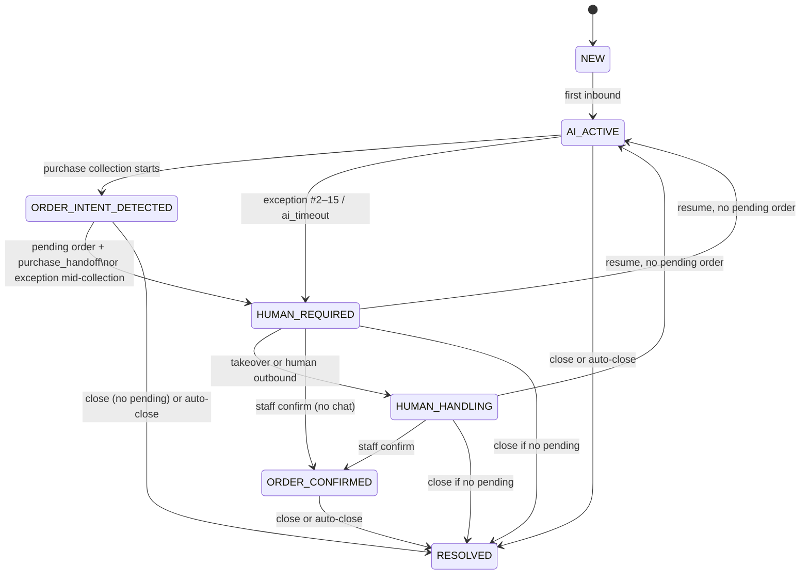

# 14 — System Design

| Field           | Value                                                                                                                                                                                          |
| --------------- | ---------------------------------------------------------------------------------------------------------------------------------------------------------------------------------------------- |
| Document ID     | `14_SYSTEM_DESIGN`                                                                                                                                                                             |
| Status          | Approved — canonical for runtime behaviour                                                                                                                                                     |
| Owner           | Engineering                                                                                                                                                                                    |
| Audience        | Backend, worker, realtime, AI coding agents                                                                                                                                                    |
| Depends on      | `10_ARCHITECTURE.md`, `11_TECH_STACK.md`, `12_DATABASE_DESIGN.md`, `13_API_DESIGN.md`, `06_AI_HUMAN_HANDOFF_RULES.md`, `01_PRODUCT_REQUIREMENTS.md`                                            |
| Consumed by     | Nest workers in `apps/api`, `15_AI_ARCHITECTURE.md`, `16_INTEGRATION_DESIGN.md`, `31_IMPLEMENTATION_PLAN.md`                                                                                   |
| Upstream source | `docs/AI_Sales_Agent_Brain_Dump.md` → `# Conversation State Machine`, `# Event Architecture`, `# Background Jobs`, `# Rate Limiting`, `# Failure Scenarios`, Sales Command Center lead scoring |

---

## 1. Purpose and scope

This document is **canonical for what happens after a request is accepted**. If a transition, job, lock, rate-limit number, scoring weight, or failure path is not here, it does not exist. Add it here first, then implement.

**In scope:** conversation state machine, inbound/outbound control flow, Redis locks, BullMQ queues and job ids, domain events, numeric rate limits, lead-score weights and recompute, reservation sweeper, Socket.IO occupancy/reconnect, failure behaviour.

**Out of scope, and where it lives instead:**

| Topic                                                              | Canonical location               |
| ------------------------------------------------------------------ | -------------------------------- |
| Module graph, who may call whom                                    | `10_ARCHITECTURE.md`             |
| Package versions, queue _names_ baseline, Redis key patterns       | `11_TECH_STACK.md`               |
| Tables, enums, stock SQL, JSONB Zod                                | `12_DATABASE_DESIGN.md`          |
| HTTP/Socket.IO _contracts_ (routes, DTOs, event names)             | `13_API_DESIGN.md`               |
| Escalation _reasons_, `handoff_context`, purchase-handoff pipeline | `06_AI_HUMAN_HANDOFF_RULES.md`   |
| Orchestrator, RAG, prompts, model fallback _inside_ a turn         | `15_AI_ARCHITECTURE.md`          |
| Meta HMAC, adapter mapping, provider token buckets                 | `16_INTEGRATION_DESIGN.md`       |
| JWT crypto, RBAC enforcement internals                             | `17_SECURITY_DESIGN.md`          |
| Four KPI _definitions_                                             | `01_PRODUCT_REQUIREMENTS.md` §15 |
| Hosts, ALB, alarms                                                 | `18_DEPLOYMENT.md`               |

**References:** `§N` is this file. Sibling docs are filenames. Do not copy the fifteen `HUMAN_REQUIRED` triggers here.

The state manager, not the model, owns `conversations.status`. The model may request `transfer_to_human()` / tools; it never `UPDATE`s status SQL (`10` §6, `06` §2).

---

## 2. Invariants

1. Webhook path: **persist → 200 → enqueue**. Never wait for the LLM (`10` §6).
2. Facts enter the prompt from tools/DB, never the reverse (`15_AI_ARCHITECTURE.md`).
3. Redis `conversation:{id}:processing` serializes **AI turns on that thread**. It is **not** stock correctness (`12` §6.5).
4. Duplicate webhook / job / order: **no** second AI run, send, or reserve (`13` §2.5, `12` §2.7).
5. `is_test` / playground: no Meta, no KPI rollup, no `usage_events` (`12` §2.6).
6. No `outbox_events` table in MVP (OQ-42). Webhook recovery is `integration_events.processed_at` (`12` §8.3), not Kafka. Other lost-enqueues wait for an incident.
7. Correlation id: webhook → job → send (`18`). Silent drop is a defect.

---

## 3. Conversation state machine

Enum: `12` §3 `ConversationStatus`. One status at a time. Every transition appends `conversation_status_events`.



### 3.1 Allowed transitions

| From                       | To                      | Trigger                                                                   | Actor                      |
| -------------------------- | ----------------------- | ------------------------------------------------------------------------- | -------------------------- |
| `NEW`                      | `AI_ACTIVE`             | First inbound customer message persisted                                  | Conversations              |
| `AI_ACTIVE`                | `ORDER_INTENT_DETECTED` | `purchase_intent` and collection started (`06` §7)                        | Conversations via AI tools |
| `ORDER_INTENT_DETECTED`    | `HUMAN_REQUIRED`        | `create_pending_order()` **then** `trigger_human_handoff()`               | Orders + Conversations     |
| `AI_ACTIVE`                | `HUMAN_REQUIRED`        | `transfer_to_human` reasons in `06` §4, or `ai_timeout`                   | Conversations              |
| `ORDER_INTENT_DETECTED`    | `HUMAN_REQUIRED`        | Exception mid-collection — **no** new order unless already created (`06`) | Conversations              |
| `HUMAN_REQUIRED`           | `HUMAN_HANDLING`        | Take over **or** first human outbound (`06` §9, `13`)                     | Conversations              |
| `HUMAN_REQUIRED`           | `ORDER_CONFIRMED`       | `order.confirmed` for this thread                                         | Conversations handler      |
| `HUMAN_HANDLING`           | `ORDER_CONFIRMED`       | `order.confirmed`                                                         | Conversations handler      |
| `HUMAN_REQUIRED`           | `AI_ACTIVE`             | Resume AI, **no** `PENDING_CONFIRMATION`                                  | Conversations              |
| `HUMAN_HANDLING`           | `AI_ACTIVE`             | Resume AI, **no** `PENDING_CONFIRMATION`                                  | Conversations              |
| `ORDER_CONFIRMED`          | `RESOLVED`              | Close, or inactivity auto-close                                           | Conversations              |
| `*` (except blocked below) | `RESOLVED`              | `POST …/close` (`inbox.write` — `13`, not Owner-only), or auto-close      | Conversations              |

`ConversationService.transition({ from, to, reason, actor })` is the only writer. Unknown pair → **409** `invalid_transition` (`13`).

### 3.2 Forbidden / blocked

| Attempt                                                                       | Result                                                                      |
| ----------------------------------------------------------------------------- | --------------------------------------------------------------------------- |
| Resume while any order on the thread is `PENDING_CONFIRMATION`                | **409** `pending_order_blocks_resume` (`13`, `06` §7)                       |
| Close while `PENDING_CONFIRMATION` exists                                     | **409** — cancel or confirm first                                           |
| `HUMAN_REQUIRED` without `handoff_context` that parses `HandoffContextSchema` | Defect — persist briefing **before** the last autonomous outbound (`06` §2) |
| Model / raw SQL sets `status`                                                 | Defect                                                                      |
| Skip to `ORDER_CONFIRMED` without an order reaching `CONFIRMED`               | Defect                                                                      |
| Auto-resume from the handoff queue                                            | Defect — Resume is an explicit click                                        |

### 3.3 `ai_enabled` vs `status`

| Action                                                             | `ai_enabled`                                               | Status                                 |
| ------------------------------------------------------------------ | ---------------------------------------------------------- | -------------------------------------- |
| Enter `HUMAN_REQUIRED`                                             | `false`                                                    | `HUMAN_REQUIRED`                       |
| Take over / human send from `HUMAN_REQUIRED`                       | `false`                                                    | `HUMAN_HANDLING`                       |
| Take over / human send from `AI_ACTIVE` or `ORDER_INTENT_DETECTED` | `false`                                                    | **unchanged** (collection label stays) |
| Resume                                                             | `true`                                                     | `AI_ACTIVE`                            |
| Global agent `ai_agents.enabled = false` or hard usage cap         | Skip `process_inbound_message`; do not mass-flip every row | Unchanged                              |

Inbound is **always** persisted, even when `ai_enabled` is false.

### 3.4 Auto-close (FR-CONV-017 Should)

Job `auto_close_inactive` (maintenance). Default `ai_settings.inactivity_close_days = 30`.

Close to `RESOLVED` when: no `messages.created_at` in that window **and** no `PENDING_CONFIRMATION` on the thread.

Applies to `HUMAN_REQUIRED` without a pending order (OQ-09). The **7-day stale-handoff warning** is Phase 2 — do not implement it in MVP.

### 3.5 Assign

Writes `conversation_assignments`. Does **not** pause or resume AI (`06` §9).

---

## 4. Inbound message flow

Architectural shape in `10` §6. This is the implementable sequence.

```
Meta POST /api/v1/webhooks/meta (and `/deauthorize`)
  1. Verify (`16` HMAC or `signed_request`). Fail → 401, no persist
  2. Apply persist table `16` §4.3 (insert / skip / `processed_at=now()` / enqueue or not)
  3. If enqueue: INSERT ON CONFLICT DO NOTHING (`processed_at` null) if not already inserted
     Duplicate + processed_at set → 200, stop
     Duplicate + processed_at null → same jobId, then 200
  4. Enqueue `retry_webhook_processing` jobId `{integrationEventId}` when the table says yes
  5. Then 200. p95 < 500 ms (NFR-PERF-01). Do not wait for map / LLM
  6. If step 4 failed → **non-200** so Meta retries (duplicate insert is a no-op)
```

Worker `retry_webhook_processing` (map + persist + AI enqueue):

**Idempotency:** every step after map must be safe on retry or sweep. Crash after partial completion (message inserted, jobs enqueued, `processed_at` still null) is normal — sweep re-runs this worker. Rely on: message `ON CONFLICT DO NOTHING`; attachment unique `(message_id, sort_order)`; deterministic BullMQ `jobId`; `processed_at` set only after the batch finishes (completion marker, not a separate durability gate). **One HTTP body = one `integration_events` row**; `mapInbound` may return many `CanonicalInbound`.

```
  1. Map to canonical (`16`). Conversations never parse Graph JSON.
     Apply `16` §4.4 **per inbound** first (`lifecycle` from UnifiedMessaging even if status was `active`; deauthorize is **not** `ChannelAdapter.mapInbound`).
     If not `lifecycle` and channel_account status ≠ `active` (missing, pending, error, disconnected):
       do **not** create identity/message; SET processed_at; stop
     Do not treat a delivery receipt as a customer message.
  2. Customer messages only: identity resolve; idempotent INSERT messages
       unique (channel_account_id, external_message_id)
  3. NEW → AI_ACTIVE if needed. last_message_at / preview. Event message.received
     Set channel_accounts.last_inbound_at
  4. Enqueue score_lead (ingested customer messages only)
  5. If ai_enabled && agent enabled && not over hard usage cap
       && reply_mode allows a turn
       && channel_account.status = active:
         Enqueue process_inbound_message
         jobId = `{conversationId}:{inboundMessageId}`
  6. Realtime conversation.message to business + conversation rooms
  7. SET integration_events.processed_at = now()
```

Crash after 200 before the worker finishes: `processed_at` stays null. Sweep those rows (§7). Do not add `outbox_events`.

Worker `process_inbound_message`:

```
  1. SET conversation:{id}:processing {token} NX EX 30. Else delay 2s and retry (do not drop)
  2. Heartbeat every 10s: Lua — EXPIRE only if value == token
  3. Rate-limit check (§9). Maybe delay or skip AI (still keep the inbound row)
  4. AIOrchestrator.processTurn — internals in 15.
     Caps already pinned: `max_tokens` 400/200, 15s per model attempt, p95 turn ≤ 30s (`11` §9).
     Tool-loop: max **8** tool invocations, max **2** generator↔tool rounds (`15` §8.1). Do not raise the lock TTL to 60s to hide a runaway turn.
     Tools must not `ConversationService.transition` (`15` §3).
  5. Before persist outbound / transition: GET lock must still equal token; else abort **send**. If `TurnResult.staleLock` and `intendedTransition` set, still apply handoff (pending order must not orphan)
  6. Persist outbound (draft / queued / playground `sent`) + `transition` from `intendedTransition`
  7. Events: ai.response.generated, conversation.state_changed, …
  8. If auto_send and not draft: enqueue send_ai_reply then deliver_outbound
  9. Enqueue summarize_conversation on HUMAN_REQUIRED / takeover if summary missing
 10. finally: Lua — DEL only if value == token
```

Playground / `POST /ai/playground` **202**: same job with `is_test=true`, no Meta, no KPI / `usage_events`. Still `ai_usage` + traces (`15`).

`POST …/suggest` **202**: job `generate_suggestion`, jobId `{conversationId}:suggest:{idempotencyKey}`. Does **not** require `ai_enabled`. Suppressed on complaint/refund (`05` / `06`). Still takes the conversation lock.

---

## 5. Outbound and reply modes

| `ai_settings.reply_mode`                   | Persist                                    | Send                                                    |
| ------------------------------------------ | ------------------------------------------ | ------------------------------------------------------- |
| `auto_send`                                | `delivery_status=queued`, `sender_type=ai` | `deliver_outbound`                                      |
| `approval_required` (default new business) | `draft`                                    | Only after `POST …/approve`                             |
| `draft_only`                               | `draft`                                    | Never via approve (409). Staff copy → `POST …/messages` |

`feature_flags.ai_shadow_mode=true` forces draft behaviour even if `reply_mode=auto_send`.

Human `POST …/messages`: **201**, `queued`, enqueue `deliver_outbound`, do not wait on Meta (`13`). Sets `ai_enabled=false` and `HUMAN_REQUIRED`→`HUMAN_HANDLING` when applicable.

Approve / retry: same enqueue; do not wait on Meta.

`deliver_outbound` (Integrations): provider send; set `sent` or `failed`; store `external_message_id` on success. Provider 429 → backoff, stay `queued`. Exhaust retries → `failed` + DLQ. Never report delivered on a refused send.

Phase 2 WhatsApp 24h window: `16`. MVP: ignore `whatsapp_window_expires_at`.

---
