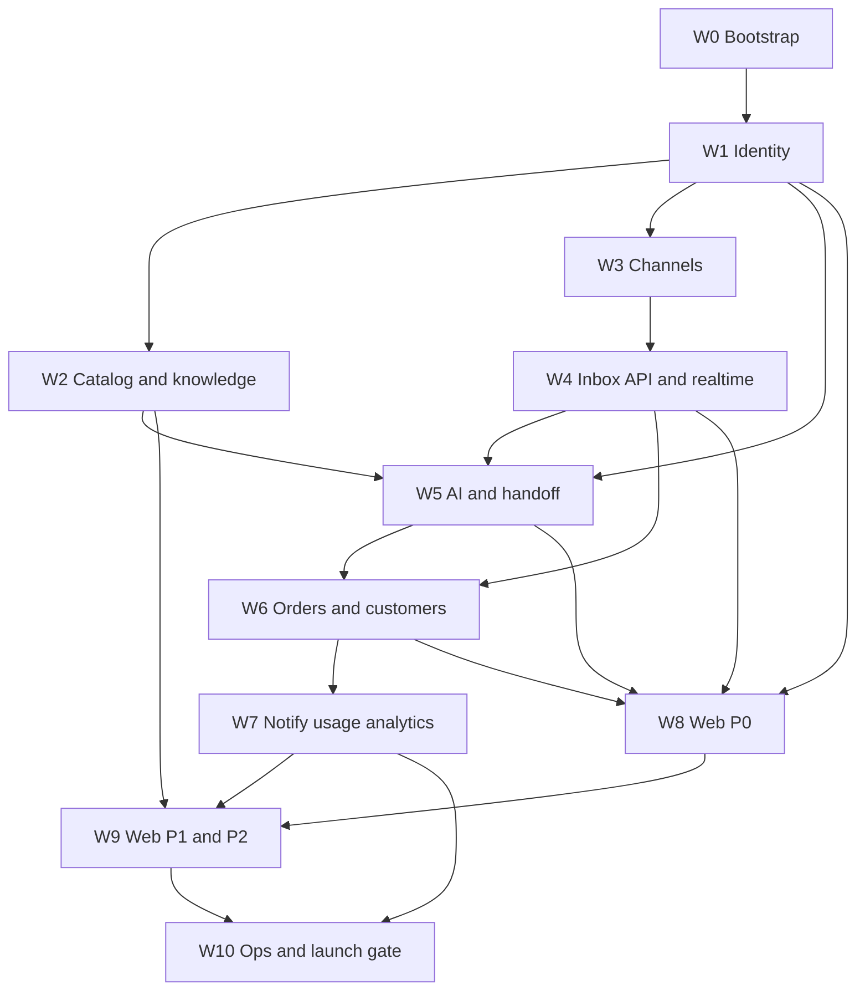

# 30 — Tasks

| Field           | Value                                                                                                                                 |
| --------------- | ------------------------------------------------------------------------------------------------------------------------------------- |
| Document ID     | `30_TASKS`                                                                                                                            |
| Status          | Approved — canonical for Phase 1 work breakdown, task IDs, dependencies, and estimates                                                |
| Owner           | Engineering / Product                                                                                                                 |
| Audience        | Engineers, QA, AI coding agents, project leads                                                                                        |
| Depends on      | `03_MVP_SCOPE.md`, `01_PRODUCT_REQUIREMENTS.md`, `02_USER_STORIES.md`, `10_ARCHITECTURE.md`, `11_TECH_STACK.md`, `12`–`18`, `20`–`23` |
| Consumed by     | [`backlog/`](../../backlog/) (live board), `31_IMPLEMENTATION_PLAN.md`, `32_FEATURE_SPECIFICATIONS.md`                                |
| Upstream source | `docs/AI_Sales_Agent_Brain_Dump.md` → `# MVP`, `# Final Decisions`                                                                    |

---

## 1. Purpose and scope

This document is **canonical for what parent work exists in Phase 1** (`T-*` ids, waves, sizes, FR coverage, start constraints). **The live board is [`backlog/`](../../backlog/):** status, session cursor, and `/a` `/b` splits live there. Do not run a parallel sprint board. Child ids (`T-BOOT-01/a`) exist only under `backlog/` — never add them here.

If a slice is not a `T-*` id here, do not invent it. Add the parent in this register **and** a card under `backlog/`.

**In scope:** task IDs, titles, size, dependencies, FR/US pointers, done-when, waves (dependency clusters). Not status.

**Out of scope, and where it lives instead:**

| Topic                                                                                          | Canonical location                                       |
| ---------------------------------------------------------------------------------------------- | -------------------------------------------------------- |
| Live status, `/a` `/b` splits, session cursor                                                  | [`backlog/`](../../backlog/)                             |
| Calendar, milestones, who-when                                                                 | `31_IMPLEMENTATION_PLAN.md`                              |
| External calendar waits (Meta review, AWS, model quota, design partners, golden-set authoring) | `31_IMPLEMENTATION_PLAN.md` §8 — not `T-*` depends       |
| Per-feature problem → AC prose                                                                 | `32_FEATURE_SPECIFICATIONS.md` (stories already in `02`) |
| Whether something is in MVP                                                                    | `03_MVP_SCOPE.md`                                        |
| Routes / DTOs                                                                                  | `13_API_DESIGN.md`                                       |
| Tables                                                                                         | `12_DATABASE_DESIGN.md`                                  |
| UI widgets                                                                                     | `23_UI_COMPONENTS.md`                                    |
| Screens / panes                                                                                | `22_UX_FLOWS.md`                                         |
| Hosting sizes                                                                                  | `18_DEPLOYMENT.md`                                       |

`24_REFERENCE_SCREENS.md` is empty until visual assets exist. Do not block tasks on `24`. `07_DOMAIN_MODEL.md` is empty; glossary is `00` §14.

---

## 2. How to read

### 2.1 ID scheme

```
T-<AREA>-<NN>
```

Area letters are permanent. Numbers are never reused.

| Area    | Owns                                                            |
| ------- | --------------------------------------------------------------- |
| `BOOT`  | Scaffold, shared kernel, CI, Compose, module shells             |
| `AUTH`  | Users, session, invitations, tenant header                      |
| `BIZ`   | Businesses, members, onboarding, flags, audit                   |
| `CAT`   | Catalog, variants, images, CSV                                  |
| `KNOW`  | Rules, knowledge documents, reindex                             |
| `INT`   | Meta OAuth, webhooks, adapters, outbound                        |
| `CONV`  | Conversations, inbox API, lock, timeline, pipeline GET, sockets |
| `LEAD`  | Deterministic scoring                                           |
| `AI`    | Orchestrator, tools, prompts, playground, golden set            |
| `HAND`  | Fifteen triggers + purchase collect                             |
| `ORD`   | Orders, reservations, sweep                                     |
| `CUST`  | Identities, merge, lifecycle                                    |
| `NOTIF` | Four notification types                                         |
| `BILL`  | Plans, usage events, pause                                      |
| `ANL`   | Four KPI rollups                                                |
| `OBS`   | Actions, traces, feedback, cost                                 |
| `WEB`   | `apps/web` by `23` `C-*` / `22` §18                             |
| `OPS`   | ECS, deploy, alarms, tenancy suite, launch gate                 |

### 2.2 Size

One engineer-equivalent. **Not** a calendar (`31`).

| Size   | Meaning  |
| ------ | -------- |
| **S**  | < 1 day  |
| **M**  | 1–3 days |
| **L**  | 3–5 days |
| **XL** | 5–8 days |

### 2.3 Done when

Every task is done when **all** of:

1. Behaviour matches the listed FRs / `13` routes (no extra endpoints).
2. Automated tests exist: Jest for API/state/idempotency (`NFR-MNT-03`); Playwright only on the critical UI path (`11`, `23` §12).
3. UI tasks implement listed `C-*` only (`23` §3.1 / §15). File name = export name.
4. Tenant queries carry `business_id` (`NFR-SEC-04`). UI hiding is not authZ (`17`).
5. No secrets/PII in logs (`17`).

Blanket AC from `02` §11 (BAC-1–10) apply to every story-backed task.

---

## 3. Rules for coding agents

1. Execute the leaf named in [`backlog/CURSOR.md`](../../backlog/CURSOR.md). Do not start a leaf whose `depends:` are open. After `done_cmd`, run `python3 backlog/_build.py --refresh`. Wave order in this file is the start constraint; the board is `backlog/`. Required leaves must not wait on optional Should leaves.
2. Read `13` / `12` / `23` before writing code. If a field is missing, update the canonical doc first (`00` §15.2).
3. Scaffold with Better Fullstack pins in `11` §2.1. Do not hand-roll a second starter. **Not** Storybook, Radix, Zustand, Vitest, Stripe HTTP, unofficial WhatsApp.
4. Do not add `C-*` widgets, nav items, or query params (`view=unread`, `PATCH /orders/:id/items`, `POST /orders/:id/confirm`).
5. Should rows are **not** launch-blocking (`03` §10.1 is every **M** FR).
6. `31` may parallelise independent tasks inside a wave. It may not reorder waves that have hard depends. `T-WEB-01` / `T-WEB-05` may start after `W1` against the real auth API (`W1 → W8`). Do not add MSW, fixture-only screens, or a second `WEB-CONTRACT` wave.
7. Do not add `X-*` ids here. External waits are `31` §8.

---

## 4. Forbidden tasks (do not add)

| Temptation                                 | Home                                          |
| ------------------------------------------ | --------------------------------------------- |
| WhatsApp connect / templates               | Phase 2 (`03` §6.2) — stub only (`T-INT-06`)  |
| Stripe / payment links / checkout          | Phase 4                                       |
| Shopify / Woo sync                         | Phase 2                                       |
| Snooze / `SNOOZED`                         | Phase 2                                       |
| Drag-to-advance pipeline                   | post-MVP                                      |
| Fifth KPI, CSAT, cost tile on `/analytics` | `01` §15                                      |
| Employee playground                        | `13` / `17` 403                               |
| Clients / Commandes / Tableau de bord nav  | `22` §3.2                                     |
| `24` screenshot production                 | when assets exist                             |
| Splitting `23` into `23A`–`E`              | `23` §15.13                                   |
| MSW / fixture-only `WEB-CONTRACT` wave     | `11`, `23` §15 — UI talks to real `13` routes |

---

## 5. Waves (dependency clusters)

Waves are **start constraints**, not sprint names. Calendar is `31`.



---

## 6. Task register

### W0 — Bootstrap

| ID          | Task                                                                                                                                            | Size | Depends     | FRs / NFRs             | Stories | Done when                                                                |
| ----------- | ----------------------------------------------------------------------------------------------------------------------------------------------- | ---- | ----------- | ---------------------- | ------- | ------------------------------------------------------------------------ |
| `T-BOOT-01` | Scaffold monorepo from `11` §2.1 (Nest 11, Next, Prisma 7, pnpm, Compose, GHA, tanstack-query, eslint, prettier). `--no-install` then lockfile. | L    | —           | NFR-OPS-06, NFR-MNT-02 | —       | Apps `api` / `web` / `worker` same Nest image; no Storybook/Radix/Biome  |
| `T-BOOT-02` | `packages/shared`: Zod JSONB + error envelope + pagination cursor (`13` §2.6–2.8, `12` §14)                                                     | M    | `T-BOOT-01` | NFR-MNT-02, BAC-3      | —       | API and web import the same types                                        |
| `T-BOOT-03` | Prisma schema from `12` (enums, `business_id`, indexes). First forward-only migration                                                           | XL   | `T-BOOT-02` | NFR-OPS-05, NFR-SEC-04 | —       | `prisma migrate` local; no invented tables                               |
| `T-BOOT-04` | Compose: Postgres+pgvector, Redis, MinIO, api, worker, web. Seed demo business                                                                  | M    | `T-BOOT-03` | NFR-OPS-06             | —       | One command up; playground/`is_test` rows excluded from KPIs (`12` §2.6) |
| `T-BOOT-05` | CI: ESLint, `tsc --noEmit`, Jest, Playwright install, vuln scan (`NFR-SEC-08`)                                                                  | M    | `T-BOOT-01` | NFR-SEC-08, NFR-MNT-03 | —       | PR blocked on typecheck + lint                                           |
| `T-BOOT-06` | Nest module shells per `10` §4. No cross-module Prisma imports                                                                                  | M    | `T-BOOT-03` | NFR-MNT-01             | —       | Reviewer can fail a cross-entity import                                  |

### W1 — Identity and workspace

| ID          | Task                                                                                                                 | Size | Depends     | FRs                                      | Stories       | Done when                                                        |
| ----------- | -------------------------------------------------------------------------------------------------------------------- | ---- | ----------- | ---------------------------------------- | ------------- | ---------------------------------------------------------------- |
| `T-AUTH-01` | `POST` register / login / refresh / logout, `GET /auth/me`. Argon2, refresh cookie `aisales_refresh` (`13` §4, `17`) | L    | `T-BOOT-06` | FR-AUTH-001–005, 010                     | US-A-01–03    | Duplicate email 409; login 401 same copy; min password 10        |
| `T-AUTH-02` | Tenant resolution + RBAC guards (`13` §2.4 / §2.11, `17`). `X-Business-Id`                                           | L    | `T-AUTH-01` | FR-AUTH-007, FR-BIZ-006, NFR-SEC-04–05   | BAC-1, BAC-2  | Wrong tenant 403; missing perm 403                               |
| `T-AUTH-03` | `POST /auth/invitations/accept`                                                                                      | M    | `T-AUTH-02` | FR-AUTH-011                              | US-A-05       | Membership role from invite                                      |
| `T-AUTH-04` | Login/register/forgot throttles 5/min (`13` §2.9)                                                                    | S    | `T-AUTH-01` | FR-AUTH-009, NFR-SEC-09                  | —             | 429 + `Retry-After`                                              |
| `T-AUTH-05` | **Should** forgot/reset (`13` §4)                                                                                    | M    | `T-AUTH-01` | FR-AUTH-008                              | —             | Always 204 on forgot                                             |
| `T-AUTH-06` | **Should** Google OAuth (`13` §4)                                                                                    | M    | `T-AUTH-01` | FR-AUTH-006                              | —             | Link by verified email                                           |
| `T-BIZ-01`  | `POST /businesses` + seed agent, `ai_settings` (`approval_required`), starter rules, onboarding (`12` §19)           | L    | `T-AUTH-02` | FR-BIZ-001–003, FR-AI-001, FR-AI-011     | US-A-04       | Idempotency-Key; caller Owner                                    |
| `T-AI-10`   | `GET`/`PATCH /ai/agents/:id` + `GET`/`PATCH /ai/settings` (`13` §11)                                                 | L    | `T-BIZ-01`  | FR-AI-002–004, 006–007, 010, FR-LEAD-005 | US-B-05       | Next turn no redeploy; unknown model id 400; `draft_only` Should |
| `T-BIZ-02`  | `GET`/`PATCH /businesses/:id` profile fields only                                                                    | S    | `T-BIZ-01`  | FR-BIZ-002, FR-BIZ-004                   | —             | No onboarding flags on this PATCH                                |
| `T-BIZ-03`  | Members + invitations (`13` §5). Seat limit `quota_exceeded`                                                         | L    | `T-BIZ-01`  | FR-BIZ-010–012, 014                      | US-A-05       | Cannot invite Owner; cannot demote sole Owner                    |
| `T-BIZ-04`  | `GET`/`PATCH` onboarding. Client-writable **only** `{ handoffAcknowledged: true }`                                   | M    | `T-BIZ-01`  | FR-BIZ-020–025                           | US-A-07, A-10 | Reject `{ aiActivated: true }`; `unmetGates` computed            |
| `T-BIZ-06`  | Feature flags GET/PATCH closed keys (`13` §13)                                                                       | S    | `T-AUTH-02` | FR-FLAG-001–004                          | US-G-07       | Unknown key 400; no redeploy                                     |
| `T-BIZ-07`  | Audit writer for human/security/money actions                                                                        | M    | `T-AUTH-02` | FR-AUD-001, FR-AUD-003                   | BAC-9         | AI tools never in `audit_logs`                                   |
| `T-BIZ-08`  | **Should** soft-delete business                                                                                      | M    | `T-BIZ-01`  | FR-BIZ-005                               | —             | Stops AI + channels                                              |

### W2 — Catalog and knowledge

| ID          | Task                                                                    | Size | Depends                 | FRs                      | Stories    | Done when                                                     |
| ----------- | ----------------------------------------------------------------------- | ---- | ----------------------- | ------------------------ | ---------- | ------------------------------------------------------------- |
| `T-CAT-01`  | Categories CRUD                                                         | M    | `T-BIZ-01`              | FR-CAT-003               | US-B-01    | Tenant scoped                                                 |
| `T-CAT-02`  | Products + variants + images → S3. Price/stock on variants only         | XL   | `T-CAT-01`              | FR-CAT-001–009, 012–013  | US-B-01–02 | `availableStock` computed; archive not delete-if-on-order     |
| `T-CAT-03`  | CSV: template GET, import 202, poll, confirm 202 (`13` §12.2)           | L    | `T-CAT-02`              | FR-CAT-020–027           | US-B-03    | No catalog writes until confirm; upsert by SKU                |
| `T-CAT-04`  | Enqueue re-embed on merchandising/price/stock/name writes               | M    | `T-CAT-02`              | FR-CAT-011               | —          | Job not HTTP-thread parse                                     |
| `T-KNOW-01` | `business-rules` GET/POST new version; PATCH enable/`effective_to` only | L    | `T-BIZ-01`              | FR-KNOW-001–005, 007–010 | US-B-05–07 | Payload Zod `12` §14.8; conflict → escalate `policy_conflict` |
| `T-KNOW-02` | Knowledge documents + `index_document` 201 `indexingStatus: pending`    | M    | `T-BIZ-01`              | FR-KNOW-011–012, 014     | US-B-08    | Reindex 202 `jobId`                                           |
| `T-KNOW-03` | Chunk + embed worker (pgvector)                                         | L    | `T-KNOW-02`, `T-CAT-04` | FR-KNOW-012, FR-CAT-011  | —          | RAG retrieval used by `T-AI-01`                               |

### W3 — Channels

| ID         | Task                                                              | Size | Depends                | FRs                                    | Stories    | Done when                                                                                |
| ---------- | ----------------------------------------------------------------- | ---- | ---------------------- | -------------------------------------- | ---------- | ---------------------------------------------------------------------------------------- |
| `T-INT-01` | Meta OAuth + `channel_account` (IG + Messenger). Encrypted tokens | L    | `T-BIZ-01`, `T-BIZ-06` | FR-INT-001–006, 012, FR-BILL-008       | US-C-01–03 | WhatsApp card disabled unless flag **and** account; over-plan connect → `quota_exceeded` |
| `T-INT-02` | Webhook HMAC, persist raw, **200** before AI (`16`)               | L    | `T-INT-01`             | FR-INT-007–009, FR-AUD-004, NFR-REL-02 | US-C-04    | Invalid sig 401 no row; dup → no second AI/order                                         |
| `T-INT-03` | Adapters → canonical message. No provider fields to AI/inbox      | M    | `T-INT-02`             | FR-INT-010                             | —          | Module boundary `10`                                                                     |
| `T-INT-04` | `deliver_outbound` + backoff + DLQ + per-account throttle         | L    | `T-INT-03`             | FR-INT-011, FR-INT-031, NFR-REL-03     | US-C-05    | Failed → `deliveryStatus=failed`                                                         |
| `T-INT-05` | Inbound images to S3; shown in thread; AI does not interpret      | M    | `T-INT-03`             | FR-INT-013                             | —          |                                                                                          |
| `T-INT-06` | WhatsApp adapter **folder stub** + `whatsapp_enabled` false       | S    | `T-INT-03`             | FR-INT-032                             | —          | No unofficial client in lockfile                                                         |
| `T-INT-07` | Channel health + disconnect CTA (`integrations.manage`)           | M    | `T-INT-01`             | FR-INT-005–006, 012                    | US-C-02    | Employee sees status, no reconnect                                                       |

### W4 — Inbox API, scoring, realtime

| ID          | Task                                                                                                                           | Size | Depends                  | FRs                                | Stories       | Done when                                                                               |
| ----------- | ------------------------------------------------------------------------------------------------------------------------------ | ---- | ------------------------ | ---------------------------------- | ------------- | --------------------------------------------------------------------------------------- |
| `T-CONV-01` | `GET /conversations` views `needs_me` \| `all`, `sort=sales_priority`, filters, cursor. Exclude `isTest`                       | L    | `T-INT-03`               | FR-CONV-001–005, 031–036           | US-D-01, D-15 | Server order; no client re-sort                                                         |
| `T-CONV-02` | Thread: GET detail/messages, POST read/messages/approve/retry/takeover/resume/assign/close/notes/suggest **202**/confirm-order | XL   | `T-CONV-01`              | FR-CONV-007–008, 010–016, 038, 043 | US-D-03–09    | GET does **not** mark read; send = implicit takeover; 409 pending order on resume/close |
| `T-CONV-03` | State machine transitions (`14`) + `invalid_transition` 409                                                                    | L    | `T-CONV-02`              | FR-CONV-021                        | —             | Jest every legal/illegal edge                                                           |
| `T-CONV-04` | Redis conversation lock — no interleaved AI turns                                                                              | M    | `T-CONV-03`              | FR-CONV-021                        | —             | Two inbound → one lock                                                                  |
| `T-CONV-05` | `GET .../timeline` projection only                                                                                             | S    | `T-CONV-02`              | FR-CONV-040                        | US-D-16       | No new table                                                                            |
| `T-CONV-06` | Socket.IO rooms + client events (`13` §14). REST remains SoT                                                                   | L    | `T-CONV-02`, `T-AUTH-02` | FR-RT-001–006                      | US-D-02, D-23 | Scoped subscribe; reconnect refetch; polling fallback                                   |
| `T-LEAD-01` | Deterministic score 0–100 + temperature + factors. **No LLM**                                                                  | L    | `T-CONV-02`              | FR-LEAD-001–009                    | US-D-19       | Recompute triggers `14` §10; nightly decay                                              |

### W5 — AI, playground, handoff

| ID          | Task                                                                                                 | Size | Depends                                       | FRs                                              | Stories       | Done when                                                            |
| ----------- | ---------------------------------------------------------------------------------------------------- | ---- | --------------------------------------------- | ------------------------------------------------ | ------------- | -------------------------------------------------------------------- |
| `T-AI-01`   | Orchestrator turn: classify → tools → grounded reply (`05`, `15`). Model ids `11` §9.3               | XL   | `T-KNOW-03`, `T-CAT-02`, `T-CONV-04`          | FR-AI-020–027, FR-CAT-002, 013, FR-KNOW-009      | US-H-01–02    | No invented price/stock/fee                                          |
| `T-AI-02`   | Guardrail tests: no discount, no refund, no payment promise, complaint no upsell                     | L    | `T-AI-01`                                     | FR-AI-021, FR-HAND-007, FR-KNOW-005              | —             | Golden + unit                                                        |
| `T-AI-03`   | Prompt versions POST new row; message stores `prompt_version_id`                                     | M    | `T-AI-01`                                     | FR-AI-025–027                                    | US-G-08       | Never PATCH content in place                                         |
| `T-AI-04`   | Reply modes: default `approval_required` drafts; `auto_send`; **Should** `draft_only` 409 on approve | L    | `T-AI-01`, `T-AI-10`                          | FR-AI-010–012, 015                               | US-D-10–12    | G4 does **not** flip mode                                            |
| `T-AI-05`   | Fallback model then escalate; never send degraded                                                    | M    | `T-AI-01`                                     | FR-AI-028–029, NFR-REL-07                        | —             |                                                                      |
| `T-HAND-01` | All **15** `HUMAN_REQUIRED` triggers + briefing schema (`06`)                                        | XL   | `T-AI-01`                                     | FR-HAND-001–006, FR-CONV-019–020                 | US-E-01, E-04 | `ai_enabled=false`; summary job; emits domain event for `T-NOTIF-01` |
| `T-BIZ-05`  | `PATCH /integrations/live` `{ enabled: true }` enforces G1–G5                                        | M    | `T-BIZ-04`, `T-CAT-02`, `T-INT-01`, `T-AI-07` | FR-BIZ-024–025, FR-AI-011                        | US-A-10       | 422 `activation_not_ready` lists gates                               |
| `T-AI-06`   | `POST /ai/playground` **202**; `ai.playground` 403 Employee                                          | L    | `T-AI-01`                                     | FR-AI-030–031, FR-BIZ-026                        | US-A-08       | `source=playground`, `is_test`; never Meta                           |
| `T-AI-07`   | Playground/G4 completion sets `playground_passed` only                                               | S    | `T-AI-06`                                     | FR-AI-011, FR-BIZ-026                            | US-A-08       | Does not PATCH `replyMode`                                           |
| `T-AI-08`   | On-demand `POST .../suggest` **202**; suppress complaint 409; `ai_paused` 403                        | M    | `T-AI-04`                                     | FR-AI-016–019, 020a, 020b                        | US-D-14       | Not on open/keystroke; send records human-approved AI message        |
| `T-AI-09`   | Golden set 50–100 Derja/FR in CI; blocks merge                                                       | L    | `T-AI-02`                                     | FR-AI-032, NFR-MNT-04, NFR-UX quality `03` §10.2 | —             |                                                                      |
| `T-OBS-01`  | `ai_actions` + decision traces per turn                                                              | M    | `T-AI-01`                                     | FR-OBS-001–004, 008, 011                         | US-G-04       | Employee 403 on traces                                               |
| `T-OBS-02`  | `POST /messages/:id/feedback`; `GET /ai/feedback` (`ai.configure`)                                   | M    | `T-AI-04`                                     | FR-OBS-006–007                                   | US-G-10       | Negative requires `FeedbackReason`                                   |

### W6 — Orders and customers

| ID          | Task                                                                       | Size | Depends                 | FRs                       | Stories          | Done when                                                |
| ----------- | -------------------------------------------------------------------------- | ---- | ----------------------- | ------------------------- | ---------------- | -------------------------------------------------------- |
| `T-ORD-01`  | Create/confirm/cancel/complete + optional `paymentStatus`. Idempotency-Key | L    | `T-CONV-02`             | FR-ORD-001–008            | US-E-06–09       | No `POST /orders/:id/confirm`; no item PATCH             |
| `T-ORD-02`  | Reservations TTL 30 min + sweep job                                        | M    | `T-ORD-01`              | FR-ORD-010–012            | US-E-08          | `availableStock` subtracts active holds                  |
| `T-ORD-03`  | `GET /orders`, `GET /orders/:id` (`inbox.read`)                            | M    | `T-ORD-01`              | FR-ORD-009                | —                | **No** `/orders` nav (`22` §3.2); list is API + pipeline |
| `T-ORD-04`  | Manual `POST /orders`                                                      | M    | `T-ORD-01`              | FR-ORD-003                | US-E-07          | Totals server-side                                       |
| `T-CONV-07` | `GET /pipeline` four columns, no PATCH                                     | M    | `T-LEAD-01`, `T-ORD-01` | FR-CONV-050–053           | US-D-21          | Copy _en attente de confirmation_                        |
| `T-HAND-02` | Purchase: collect → reserve → pending order → handoff → no payment copy    | XL   | `T-HAND-01`, `T-ORD-01` | FR-HAND-008–010           | US-E-02–03, H-03 | Re-verify stock; insufficient → alternatives             |
| `T-CUST-01` | Identity match on inbound; verified-phone auto-link; no fuzzy merge        | L    | `T-INT-03`              | FR-CUST-001–003, 006, 011 | US-F-01          |                                                          |
| `T-CUST-02` | PATCH profile, tags, VIP, notes                                            | M    | `T-CUST-01`             | FR-CUST-002, 004–005, 008 | US-F-03          | Pane 3 / API; no Clients nav                             |
| `T-CUST-03` | Owner/Admin merge + audit; Employee 403                                    | M    | `T-CUST-01`, `T-BIZ-07` | FR-CUST-010               | US-F-04          | If UI needed, add `C-*` in `23` first                    |
| `T-CUST-04` | Lifecycle stage from events; feeds AI tone (`05`)                          | M    | `T-CUST-01`, `T-ORD-01` | FR-CUST-006–007           | US-F-05          |                                                          |

### W7 — Notifications, usage, analytics

| ID           | Task                                                             | Size | Depends                   | FRs                       | Stories       | Done when                                        |
| ------------ | ---------------------------------------------------------------- | ---- | ------------------------- | ------------------------- | ------------- | ------------------------------------------------ |
| `T-NOTIF-01` | Four `NotificationType`s only; dedupe hour; collapse hot leads   | L    | `T-HAND-01`, `T-LEAD-01`  | FR-NOTIF-001–002, 010–014 | US-E-05, D-22 | No notify on routine AI                          |
| `T-NOTIF-02` | GET / PATCH read / POST read-all + `notification.new`            | M    | `T-NOTIF-01`, `T-CONV-06` | FR-NOTIF-003–005          | —             | Deep-link `entityType=conversation`              |
| `T-BILL-01`  | Seed `plans` + subscription on business create                   | M    | `T-BIZ-01`                | FR-BILL-001–002           | US-G-02       |                                                  |
| `T-BILL-02`  | Append-only `usage_events` + period aggregate job                | L    | `T-BILL-01`, `T-AI-01`    | FR-BILL-003–004, 010      | —             | Exclude `is_test`                                |
| `T-BILL-03`  | `GET /usage` Owner; 80/95 warnings; hard limit → `ai_paused` 403 | L    | `T-BILL-02`               | FR-BILL-005–008           | US-G-03       | Humans still reply; Admin must not call `/usage` |
| `T-BILL-04`  | `GET /ai/usage` Owner cost/tokens — not a KPI tile               | S    | `T-OBS-01`                | FR-BILL-010, FR-OBS-004   | —             |                                                  |
| `T-ANL-01`   | `analytics_daily` rollup job (business TZ)                       | L    | `T-ORD-01`, `T-HAND-01`   | FR-ANL-001–003            | US-G-01       | Four definitions `01` §15 only                   |
| `T-ANL-02`   | `GET /analytics/overview` all roles `analytics.read`             | M    | `T-ANL-01`                | FR-ANL-001–004            | US-G-01       | AI/human **breakdown**, not fifth tile           |

### W8 — Web P0 (auth, shell, inbox, onboarding)

Implement `23` §3.2 P0. Query owners `23` §3.5. Tokens `20`. Flows `22`.

| ID         | Task                                                                                              | Size | Depends                                                   | FRs                                                                      | Stories      | Done when                                       |
| ---------- | ------------------------------------------------------------------------------------------------- | ---- | --------------------------------------------------------- | ------------------------------------------------------------------------ | ------------ | ----------------------------------------------- |
| `T-WEB-01` | Full-bleed `C-AUTH-*`. Should forgot/reset/Google only if `T-AUTH-05/06` shipped                  | L    | `T-AUTH-01`, `T-AUTH-03`                                  | FR-AUTH-001–005, 011                                                     | US-A-01–03   | No app shell; register does not create business |
| `T-WEB-02` | Shell `C-SHELL-*`. Hamburger `< lg` Sheet. Hide settings for Employee. `PlanUsageCard` Owner-only | L    | `T-WEB-01`, `T-BILL-03`, `T-NOTIF-02`                     | FR-NOTIF-003, FR-BILL-005–006                                            | —            | `23` §6                                         |
| `T-WEB-03` | Inbox `C-INBOX-01`–`22`. Draft-to-approve default. Playwright takeover + approve + confirm        | XL   | `T-WEB-02`, `T-CONV-02`, `T-ORD-01`, `T-AI-08`            | FR-CONV-030–044, FR-AI-012, 015–016, FR-HAND-010, FR-ORD-006, FR-OBS-006 | US-D-*, E-03 | `23` §7; no snooze; no line-item editor         |
| `T-WEB-04` | Onboarding `C-ONB-*` + `ActivationGate`. Employee: no playground                                  | L    | `T-WEB-02`, `T-BIZ-04`, `T-AI-06`, `T-INT-01`, `T-CAT-03` | FR-BIZ-020–026                                                           | US-A-07–10   | Optional auto_send toggle off                   |
| `T-WEB-05` | `next-intl` catalogs `fr-TN` / `ar-TN` / `en` per `23` §11                                        | M    | `T-WEB-01`                                                | NFR-UX-08, NFR-I18N                                                      | —            | No JSX literals                                 |
| `T-WEB-06` | Playwright: signup → onboard stub → inbox takeover → approve draft → confirm order                | M    | `T-WEB-03`, `T-WEB-04`                                    | NFR-MNT-03, `11` UI tests                                                | —            | Core path green in CI                           |

### W9 — Web P1 / P2

| ID         | Task                                                                           | Size | Depends                                                     | FRs                                            | Stories       | Done when                                                                                  |
| ---------- | ------------------------------------------------------------------------------ | ---- | ----------------------------------------------------------- | ---------------------------------------------- | ------------- | ------------------------------------------------------------------------------------------ |
| `T-WEB-07` | Pipeline `C-PIPE-*`. Click → `/inbox?id=`. No drag                             | M    | `T-WEB-02`, `T-CONV-07`                                     | FR-CONV-050–053                                | US-D-21       |                                                                                            |
| `T-WEB-08` | Products `C-PROD-*`. Employee read-only                                        | L    | `T-WEB-02`, `T-CAT-02`                                      | FR-CAT-001–008                                 | US-B-01–02    | Never PATCH `availableStock`                                                               |
| `T-WEB-09` | Analytics four `KpiCard` + one chart. Page owns `GET /analytics/overview`      | M    | `T-WEB-02`, `T-ANL-02`                                      | FR-ANL-001–004                                 | US-G-01       | No revenue/CSAT/cost tile                                                                  |
| `T-WEB-10` | Settings tabs `C-SET-*`. Canaux reuses `ChannelConnectCard`. Facturation Owner | L    | `T-WEB-02`, `T-KNOW-01`, `T-BIZ-03`, `T-BILL-03`, `T-AI-10` | FR-AI-002–004, 006, 010, FR-KNOW-*, FR-BIZ-010 | US-B-05, A-05 | Employee: do not mount `/settings`; agent Inputs stay in Personnalité tab (no extra `C-*`) |
| `T-WEB-11` | Public Landing Page: Hero, interactive Derja demo, bento features, auth CTAs   | M    | `T-WEB-10`                                                  | FR-AUTH-013                                    | US-A-01       | Responsive landing page at `/` with auth links                                             |

### W10 — Ops and launch gate

| ID         | Task                                                                    | Size | Depends                 | FRs / NFRs                 | Stories | Done when                      |
| ---------- | ----------------------------------------------------------------------- | ---- | ----------------------- | -------------------------- | ------- | ------------------------------ |
| `T-OPS-01` | Prod topology `18`: ECS ×3, RDS, Redis, S3, SM, CF→ALB. No NAT, no K8s  | XL   | `T-BOOT-04`             | NFR-OPS-07, NFR-SCAL-05–06 | —       | Two API tasks; worker separate |
| `T-OPS-02` | GHA → ECR → ECS. Migrations after rollout (`18` §12)                    | L    | `T-OPS-01`, `T-BOOT-05` | NFR-OPS-05                 | —       |                                |
| `T-OPS-03` | Health `/ready` `/health/live`, pino JSON, CloudWatch alarms (`18` §13) | M    | `T-OPS-01`              | NFR-OPS-01–04, NFR-REL-01  | —       | DLQ / LLM / HMAC alarms        |
| `T-OPS-04` | Automated tenancy + RBAC matrix tests per `13` §2.11                    | L    | `T-AUTH-02`             | NFR-SEC-04–05, `03` §10.4  | BAC-1   |                                |
| `T-OPS-05` | Fault injection: dup webhook, LLM outage, Meta 5xx                      | M    | `T-INT-04`, `T-AI-05`   | `03` §10.3, NFR-REL-07–08  | —       |                                |
| `T-OPS-06` | Runbook: channel disconnect, model outage, stuck queue                  | S    | `T-OPS-03`              | `03` §10.6                 | —       |                                |
| `T-OPS-07` | Launch-gate review: every **M** FR + `03` §10 checklist                 | M    | all M tasks             | `03` §10                   | —       | Sign-off in `43`               |

---

## 7. M-requirement coverage

Every **M** FR in `01` maps to ≥1 task. `W` FRs have no task. `S` FRs are Should tasks or omitted from the launch gate.

| FR prefix                                                             | Tasks                                                       |
| --------------------------------------------------------------------- | ----------------------------------------------------------- |
| FR-AUTH-001–005, 007, 009–011, 013                                    | `T-AUTH-01`–`04`, `T-WEB-11`                                |
| FR-AUTH-006, 008                                                      | `T-AUTH-06`, `T-AUTH-05` (Should)                           |
| FR-BIZ-001–004, 006, 010–012, 014, 020–025                            | `T-BIZ-01`–`05`                                             |
| FR-BIZ-026                                                            | `T-AI-06`, `T-AI-07`, `T-WEB-04`                            |
| FR-CAT-001–009, 011–013, 020–027                                      | `T-CAT-01`–`04`                                             |
| FR-KNOW-001–005, 007–012, 014                                         | `T-KNOW-01`–`03`                                            |
| FR-INT-001–013, 031–032                                               | `T-INT-01`–`07`                                             |
| FR-CONV-001–005, 007–008, 010–016, 019–021, 030–041, 043–044, 050–053 | `T-CONV-*`, `T-WEB-03`, `T-WEB-07`                          |
| FR-LEAD-001–009                                                       | `T-LEAD-01`, `T-AI-10` (thresholds)                         |
| FR-RT-001–006                                                         | `T-CONV-06`, `T-WEB-03`                                     |
| FR-AI-001                                                             | `T-BIZ-01`                                                  |
| FR-AI-002–004, 006–007, 010                                           | `T-AI-10`, `T-WEB-10`                                       |
| FR-AI-011–012, 015–032, 020a, 020b                                    | `T-AI-*`, `T-WEB-03`, `T-WEB-04`                            |
| FR-HAND-001–010                                                       | `T-HAND-01`–`02` (`FR-HAND-005` notify = `T-NOTIF-01`)      |
| FR-ORD-001–012                                                        | `T-ORD-01`–`04`                                             |
| FR-CUST-001–008, 010–011                                              | `T-CUST-01`–`04`                                            |
| FR-NOTIF-001–005, 010–014                                             | `T-NOTIF-01`–`02`, `T-WEB-02`                               |
| FR-ANL-001–004                                                        | `T-ANL-01`–`02`, `T-WEB-09`                                 |
| FR-BILL-001–008, 010                                                  | `T-BILL-01`–`04` (`FR-BILL-008` connect quota = `T-INT-01`) |
| FR-OBS-001–004, 006–008, 011                                          | `T-OBS-01`–`02`, `T-WEB-03`                                 |
| FR-FLAG-001–004                                                       | `T-BIZ-06`                                                  |
| FR-AUD-001, 003–004                                                   | `T-BIZ-07`, `T-INT-02`                                      |

`FR-CONV-041` call control: `tel:` on `CustomerCard` (`23` §7.10) in `T-WEB-03`. `FR-CONV-042` is Should (same control).

`FR-ORD-009` is API `GET /orders` (`T-ORD-03`), not a Commandes page.

`FR-CUST-010` UI: extend `CustomerCard` or add a `C-*` in `23` before a new widget (`T-CUST-03`).

---

## 8. Should / Could (not launch-blocking)

| ID                       | Notes                                                      |
| ------------------------ | ---------------------------------------------------------- |
| `T-AUTH-05`, `T-AUTH-06` | Forgot/reset; Google                                       |
| `T-BIZ-08`               | Soft-delete business                                       |
| `T-AI-04` `draft_only`   | Ship if time; else omit radio (`23`)                       |
| FR-BIZ-013 lastActiveAt  | Include in `T-BIZ-03` if cheap                             |
| FR-NOTIF-006             | Socket already in `T-NOTIF-02` if `notification.new` ships |
| FR-OBS-005               | Covered by `T-BILL-04` if Owner caption ships              |
| FR-AUD-002               | Audit list UI — API in `T-BIZ-07`; page not in `22` nav    |
| FR-CAT-010 merchandising | Optional fields on `ProductFormDialog`                     |
| Conversation search `q`  | 501 until `pg_trgm` (`13`); do not fake in UI              |

Could: snooze — **no task**.

---

## 9. Open questions

None that unblock the register. OQ-07 (`draft_only`) = `T-AI-04` Should. OQ-17 (pipeline at launch) = `T-WEB-07` is M. Dates → `31`.

---

## 10. References

- [`backlog/`](../../backlog/) — live board
- `docs/00_product/03_MVP_SCOPE.md` — in/out and launch gate
- `docs/00_product/01_PRODUCT_REQUIREMENTS.md` — FR register
- `docs/00_product/02_USER_STORIES.md` — AC
- `docs/10_engineering/11_TECH_STACK.md` — scaffold pins
- `docs/10_engineering/13_API_DESIGN.md` — routes
- `docs/20_design/23_UI_COMPONENTS.md` — `C-*`, query owners, P0–P2
- `docs/20_design/22_UX_FLOWS.md` — screens
- `docs/30_execution/31_IMPLEMENTATION_PLAN.md` — milestones, capacity, dates
- `docs/30_execution/32_FEATURE_SPECIFICATIONS.md` — `FS-*` join
