# 31 — Implementation Plan

| Field           | Value                                                                                                                                      |
| --------------- | ------------------------------------------------------------------------------------------------------------------------------------------ |
| Document ID     | `31_IMPLEMENTATION_PLAN`                                                                                                                   |
| Status          | Approved — canonical for Phase 1 milestones, sequencing in time, capacity model, and launch date                                           |
| Owner           | Product / Founder (schedule), Engineering (estimates)                                                                                      |
| Audience        | Founder, engineers, design partners, AI coding agents                                                                                      |
| Depends on      | `30_TASKS.md` (the register), `03_MVP_SCOPE.md` §10 (launch gate), `04_ROADMAP.md` §4 (Phase 1 exit), `18_DEPLOYMENT.md` §3 (environments) |
| Consumed by     | [`backlog/`](../../backlog/), `43_CHANGELOG.md`, design-partner commitments                                                                |
| Upstream source | `docs/AI_Sales_Agent_Brain_Dump.md` → `# MVP`, `# Roadmap`                                                                                 |

---

## 1. Purpose and scope

`30_TASKS.md` says **what parent work exists and what may start after what**. [`backlog/`](../../backlog/) is the **live board**. This document says **when it happens, who is on it, and what we cut when it slips**.

**In scope:** capacity model, lanes, milestones `M0`–`M9`, week-by-week sequencing, critical path, long-lead external dependencies, demo checkpoints, buffer, compression levers, re-planning rules, launch-gate mapping.

**Out of scope, and where it lives instead:**

| Topic                                         | Canonical location           |
| --------------------------------------------- | ---------------------------- |
| Live card status, `/a` splits, session cursor | [`backlog/`](../../backlog/) |
| Task ids, sizes, dependencies, done-when      | `30_TASKS.md`                |
| Whether something is in the MVP               | `03_MVP_SCOPE.md`            |
| Launch-gate checklist text                    | `03_MVP_SCOPE.md` §10        |
| Phase 2–5 sequencing                          | `04_ROADMAP.md`              |
| Routes, tables, widgets                       | `13`, `12`, `23`             |
| Environment topology                          | `18_DEPLOYMENT.md`           |

This plan may **re-order and overlap tasks in time** wherever `30` dependencies allow. It may **not** invent a task, drop a launch-gate line, or start a task whose `Depends on` is open.

---

## 2. How to read

### 2.1 Two different "W"

`30` uses **`W0`–`W10`** for dependency **waves**. This document uses **`wk N`** for elapsed **weeks** and **`M0`–`M9`** for milestones. A wave is a constraint; a week is time; a milestone is a demonstrable state of the product.

### 2.2 Relative weeks, one anchor date

All weeks are relative. `wk 1` is the first full working week after this plan is accepted.

| Anchor                     | Value                                                             |
| -------------------------- | ----------------------------------------------------------------- |
| Start date (`wk 1` Monday) | **Not yet set** — record it here when the founder commits (OQ-78) |
| Launch-gate review         | `wk 32` (see §9 buffer)                                           |

Nothing downstream may hard-code a calendar date until that anchor is filled in.

### 2.3 Effort unit

Engineer-days (**ed**), converted from `30` §2.2 sizes:

| Size | ed  |
| ---- | --- |
| S    | 0.5 |
| M    | 2   |
| L    | 4   |
| XL   | 6.5 |

Milestone effort is the sum of its tasks. This is estimation arithmetic, not a promise per task.

---

## 3. Capacity model

### 3.1 Baseline

| Input                           | Value                                                              |
| ------------------------------- | ------------------------------------------------------------------ |
| Engineer-equivalents (EE)       | **2**                                                              |
| Productive days per EE per week | **4.5** (one day lost to review, ops, meetings, context switching) |
| Team throughput                 | **9 ed / week**                                                    |
| Total Phase 1 effort            | **268 ed**                                                         |
| Build duration                  | **30 weeks**                                                       |
| Buffer                          | **2 weeks**                                                        |
| Launch-gate review              | **wk 32**                                                          |

The founder is assumed to be on product, design decisions, Meta review, and design-partner recruitment — **not** counted as an EE. If the founder writes production code, update this table rather than quietly running ahead of plan.

### 3.2 Rescale table

Effort is fixed at 268 ed until scope changes. Time is not linear in headcount: the critical path (§7) cannot be parallelised below roughly 18 weeks no matter how many people are added.

| EE    | ed / week | Build weeks | Notes                                                                        |
| ----- | --------- | ----------- | ---------------------------------------------------------------------------- |
| 1     | 4.5       | ~60         | Every lane serialises. Not viable against Phase 1 exit targets               |
| **2** | **9**     | **30**      | **Baseline.** Two lanes, Web lane trails                                     |
| 3     | 13.5      | ~21         | Third EE goes on the **Web lane from `wk 15`** — the single best lever (§10) |
| 4     | 18        | ~19         | Coordination loss starts to eat the gain; critical path dominates            |

### 3.3 What is _not_ in the 268 ed

Meta app review waiting time, design-partner recruitment, AI prompt tuning beyond `T-AI-02`/`T-AI-09`, and merchant hand-holding. These consume founder time and calendar, not engineer-days. They are tracked in §8.

---

## 4. Lanes

| Lane                       | Owns                                                                              | Waves                             |
| -------------------------- | --------------------------------------------------------------------------------- | --------------------------------- |
| **A — Platform**           | Scaffold, schema, identity, catalog, channels, inbox API, orders, billing, ops    | `W0`–`W4`, `W6`, `W7`, `W10`      |
| **B — AI**                 | Orchestrator, guardrails, golden set, playground, handoff, traces                 | `W5`, plus `T-KNOW-03` embeddings |
| **C — Web**                | `apps/web` per `23` `C-*`                                                         | `W8`, `W9`                        |
| **X — Founder / external** | Meta app review, AWS account, model provider access, design partners, copy review | —                                 |

At 2 EE there are only two engineering lanes at a time. A **dedicated** Lane C for inbox/shell (`T-WEB-02` onward) still waits on later APIs — that is why merchant-visible UI lands late in the baseline and why §10 exists.

`30` already allows `W1 → W8`. After `M1`, `T-WEB-01` and `T-WEB-05` **may** start against the **real** auth API whenever a lane has slack. They do not wait for `M4`. They do **not** use MSW, mocked DTOs, or fixture-only screens (`11`, `23` §15). `M8` still cannot close until `T-WEB-03` depends exist: inbox API (`M4`), suggest (`M5` / `T-AI-08`), orders (`M6`). Slack on auth/i18n is days to ~2 weeks, not a 4–6 week pull of `M8`.

---

## 5. Milestones

Each milestone is a **demonstrable state**, not a date on a burndown. If the demo cannot be run, the milestone is not met, regardless of how many tasks are closed.

| #      | Milestone                  | Waves      | ed   | Weeks      | Demo that proves it                                                                                                                     |
| ------ | -------------------------- | ---------- | ---- | ---------- | --------------------------------------------------------------------------------------------------------------------------------------- |
| **M0** | Foundations                | `W0`       | 18.5 | `wk 1–2`   | One command brings up Compose with a seeded demo tenant; CI blocks a type error                                                         |
| **M1** | Tenant spine               | `W1`       | 33.5 | `wk 3–6`   | Two businesses exist; a member of one gets `403` on every endpoint of the other; invite → accept works                                  |
| **M2** | Merchant data              | `W2`       | 24.5 | `wk 7–11`  | CSV of 100 products imports after preview-and-confirm; a rules question resolves from `business_rules`, not a model                     |
| **M3** | Live channels              | `W3`       | 18.5 | `wk 7–11`  | A real Instagram DM lands in the database and a manual outbound reply is delivered; a replayed webhook creates nothing twice            |
| **M4** | Operator inbox API         | `W4`       | 25   | `wk 11–13` | `needs_me` returns server-ordered triage; two simultaneous inbound messages take one lock; a socket client sees a new message           |
| **M5** | AI live                    | `W5`       | 41.5 | `wk 14–18` | Playground answers a price question with a real variant price; the golden set runs in CI; all fifteen triggers escalate with a briefing |
| **M6** | Money path                 | `W6`       | 28.5 | `wk 19–21` | Purchase intent → reservation → pending order → handoff → staff confirm, end to end, with no payment copy anywhere                      |
| **M7** | Measure and limit          | `W7`       | 22.5 | `wk 22–24` | Four KPIs come from rollups and match across reloads; hitting the message cap pauses AI while humans keep replying                      |
| **M8** | Operator UI                | `W8`, `W9` | 34.5 | `wk 24–27` | Playwright runs signup → onboard → takeover → approve draft → confirm order, green in CI                                                |
| **M9** | Production and launch gate | `W10`      | 21   | `wk 28–30` | Two ECS tasks serve live traffic with correct fan-out; fault injection passes; `03` §10 signed off                                      |

`M2` and `M3` run **concurrently in two lanes** — they share only `T-BIZ-01`, which lands in `M1`. `T-WEB-01` / `T-WEB-05` may occupy slack after `M1`; they are not a third lane and are not shown as a Gantt bar (that would imply a third EE).

### 5.1 Gantt

```mermaid
gantt
    title Phase 1 — baseline 2 EE
    dateFormat X
    axisFormat wk %s

    section Lane A — Platform
    M0 Foundations        :a0, 0, 2w
    M1 Tenant spine       :a1, after a0, 4w
    M3 Live channels      :a3, after a1, 5w
    M4 Inbox API          :a4, after a3, 3w
    M6 Money path         :a6, 18, 3w
    M7 Measure and limit  :a7, after a6, 3w
    M9 Production + gate  :a9, 27, 3w

    section Lane B — AI
    M2 Merchant data      :b2, 6, 5w
    M5 AI live            :b5, after b2, 5w

    section Lane C — Web
    M8 Operator UI        :c8, 23, 4w

    section Buffer
    Slippage reserve      :crit, 30, 2w
```



---

## 6. Milestone exit criteria

A milestone closes only when all three are true.

1. Every task in its waves is done per `30` §2.3.
2. The demo in §5 runs on a clean checkout by someone who did not write it.
3. The launch-gate lines mapped to it in §11 are provable, not merely "implemented".

Missing #3 is the common failure. `M5` is not done because the orchestrator replies; it is done when the golden set passes in CI and the hallucination bar in `03` §10.2 is measured.

---

## 7. Critical path

The chain that cannot be shortened by adding people:

```
T-BOOT-03 → T-BOOT-06 → T-AUTH-02 → T-BIZ-01 → T-CAT-02 → T-KNOW-03
          → T-AI-01 → T-HAND-01 → T-HAND-02 → T-WEB-03 → T-WEB-06 → T-OPS-07
```

Roughly **18 weeks of unavoidable serial work**. Consequences:

- A one-week slip on `T-BOOT-03` (Prisma schema) is a one-week slip on launch. Get `12` right before writing the migration; do not "fix the schema later".
- `T-AI-01` is the widest single task (6.5 ed) on the path and the least predictable. It gets the golden set from its **first commit** (`03` §12), not at the end.
- `T-WEB-03` (inbox) is on the path. Everything else in Lane C can slip; the inbox cannot.

Off the critical path and therefore safe to defer under pressure: `T-WEB-07`–`T-WEB-10`, `T-CONV-05`, `T-BILL-04`, and everything in `30` §8.

---

## 8. Long-lead external dependencies

These consume calendar, not engineer-days, and every one of them can block a milestone while the team has nothing to do about it. Each has a **start-by** week that is earlier than the milestone that needs it.

| #   | Dependency                                                                                        | Needed by             | Start by    | Owner                 | If it is late                                                                                                      |
| --- | ------------------------------------------------------------------------------------------------- | --------------------- | ----------- | --------------------- | ------------------------------------------------------------------------------------------------------------------ |
| X1  | **Meta app review** — `pages_messaging` and Instagram permissions (`16` §—, `01` §NFR risk table) | `M3`                  | **`wk 3`**  | Founder               | Development continues on the Meta **test app + tunnel** (`18` §3). Live-channel proof slips to `M9`, not the build |
| X2  | AWS account, budget alarms, domains                                                               | `M9`, staging earlier | `wk 2`      | Founder               | Blocks nothing until `M9` if Compose parity holds (`18` §14)                                                       |
| X3  | Model provider production access and spend limit (`11` §9.3 pins)                                 | `M5`                  | `wk 10`     | Founder               | `T-AI-01` cannot be evaluated at volume; golden set runs on lower quota                                            |
| X4  | **Three design partners** with real catalogs and live IG traffic (`03` §10.5)                     | `M9`                  | **`wk 12`** | Founder               | Launch gate §10.5 cannot close. This is the most commonly underestimated item here                                 |
| X5  | Tunisian Arabic / French golden-set authoring (50–100 prompts)                                    | `M5`                  | `wk 12`     | Founder + Engineering | `T-AI-09` has nothing to run; quality gate `03` §10.2 is unprovable                                                |

X1 and X4 are the two that can hold a finished product hostage. Both start well before the milestone that consumes them.

**Webhooks before staging exists:** `M3` runs against the Meta test app over a tunnel, per `18` §3. Production hosting stays in `M9`. No wave is reordered to accommodate it.

---

## 9. Buffer and what it is for

Two weeks (`wk 31–32`) sit between the last task and the launch-gate review. Rules:

- The buffer absorbs **discovered work**, not planned work. Moving a task into it is a scope decision, recorded in `43`.
- It is consumed from the front. If `M5` runs a week over, that week comes out of the buffer immediately and visibly — not from `M8`'s allocation.
- Buffer at zero before `M8` is the signal to cut, using §12, rather than to compress testing.

Buffer is 6.7% of the build. That is thin for a project with an LLM on the critical path. Treat any estimate that "just fits" as already late.

---

## 10. Compression levers, in the order to pull them

| #   | Lever                                                                     | Saves         | Cost                                                                            |
| --- | ------------------------------------------------------------------------- | ------------- | ------------------------------------------------------------------------------- |
| 1   | **Third EE on Lane C from `wk 15`**                                       | ~4–6 wks      | Salary; `23` must be read, not reinterpreted                                    |
| 2   | Drop every `30` §8 Should task (`T-AUTH-05/06`, `T-BIZ-08`, `draft_only`) | ~10 ed ≈ 1 wk | Google sign-in and password reset ship post-launch; state it to design partners |
| 3   | Defer `T-WEB-08` products UI, managing catalog by CSV only                | 4 ed          | Merchants edit stock by re-import. Acceptable for three hand-held partners      |
| 4   | Defer `T-WEB-07` pipeline to post-launch                                  | 2 ed          | Loses an H4 signal (`03` §2). Only if the inbox is proven                       |

Do **not** compress by: skipping `T-OPS-04` tenancy tests, reducing the golden set, or shipping `T-WEB-03` without Playwright coverage. Those are launch-gate lines, not features.

---

## 11. Launch gate mapping

`03` §10 is the definition of done. Each line is provable at a milestone, so nothing waits until `wk 30` to be discovered.

| `03` §10 section                                                                                    | Proven at              | Owning tasks                            |
| --------------------------------------------------------------------------------------------------- | ---------------------- | --------------------------------------- |
| 10.1 Functional — M-priority FRs, 15 triggers, purchase chain, self-serve activation, both channels | `M3`, `M5`, `M6`, `M8` | `T-HAND-01/02`, `T-WEB-04`, `T-INT-*`   |
| 10.2 Quality — golden set, accuracy, hallucination, tool success                                    | `M5`                   | `T-AI-02`, `T-AI-09`, `T-OBS-01`        |
| 10.3 Operational — latency, dedupe, DLQ, outage, two instances                                      | `M3`, `M9`             | `T-INT-02/04`, `T-AI-05`, `T-OPS-03/05` |
| 10.4 Security and tenancy                                                                           | `M1`, `M9`             | `T-AUTH-02`, `T-OPS-04`, `T-INT-02`     |
| 10.5 Commercial — limits, KPIs, warnings, **three design partners**                                 | `M7`, plus X4          | `T-BILL-03`, `T-ANL-01/02`              |
| 10.6 Documentation — 26 docs, one-command local, runbook                                            | `M0`, `M9`             | `T-BOOT-04`, `T-OPS-06`                 |

`T-OPS-07` is the sign-off itself and closes `M9`.

---

## 12. Re-planning rules

1. **Re-plan on evidence, not on mood.** A milestone that closes late moves the remaining weeks; it does not silently compress the next milestone.
2. **Cut scope before quality.** The order is §10 lever 2 → 3 → 4. Never the launch gate.
3. **Waves are not negotiable.** `31` may overlap and re-order inside the `30` dependency graph. It may not start a task with an open `Depends on` because the calendar is tight.
4. **New work needs the `03` §9 change process** — including what is removed to make room. A task added here without a `T-*` id in `30` is a planning defect.
5. Record every accepted slip or cut in `43_CHANGELOG.md` with the milestone and the reason.

---

## 13. Schedule risks

Scope risks are `03` §12. These are the ones that specifically threaten _dates_.

| Risk                                                              | Effect on schedule                                                                                | Response                                                                                       |
| ----------------------------------------------------------------- | ------------------------------------------------------------------------------------------------- | ---------------------------------------------------------------------------------------------- |
| Meta app review takes longer than the build (X1)                  | `M3` proof and `M9` slip while code is done                                                       | Start `wk 3`; build on test app + tunnel; never gate development on review                     |
| `T-AI-01` prompt/tool iteration expands past 6.5 ed               | Direct slip — it is on the critical path                                                          | Timebox to two weeks; escalate to a scope decision rather than an open-ended tune              |
| Design partners not recruited by `wk 12` (X4)                     | Launch gate §10.5 unprovable at `wk 30`                                                           | Founder owns this from `wk 12`; treat as a milestone, not a background task                    |
| Dedicated inbox/shell UI starts at `wk 24` in the 2 EE baseline   | Auth screens may exist earlier (`T-WEB-01`); H4 (triage command center) stays untested until `M8` | Interleave `T-WEB-01`/`T-WEB-05` after `M1` on the real API. Pull lever 1 for inbox, not mocks |
| Schema churn after `T-BOOT-03`                                    | Migrations plus rework across every lane                                                          | `12` is canonical and frozen before the migration; change it there first                       |
| Realtime on ECS (sticky sessions, upgrades) surfaces only at `M9` | Late rework in `T-CONV-06`                                                                        | Exercise the polling fallback (FR-RT-005) from `M4`, not at the end                            |

---

## 14. Open questions

| #     | Question                                                              | Working answer                                                | Owner   | Revisit     |
| ----- | --------------------------------------------------------------------- | ------------------------------------------------------------- | ------- | ----------- |
| OQ-78 | What is the `wk 1` anchor date?                                       | Unset. §2.2 stays blank until the founder commits             | Founder | Before `M0` |
| OQ-79 | Is the team 2 EE or 3?                                                | Plan baselines at 2; §3.2 rescales without a rewrite          | Founder | Before `M0` |
| OQ-80 | Does the founder write production code?                               | Assumed no. If yes, §3.1 changes and so does every week in §5 | Founder | Before `M0` |
| OQ-81 | Do we hold the 2-week buffer or commit it to a third engineer's ramp? | Hold it. Buffer is already thin at 6.7%                       | Product | `M5`        |

`03` OQ-21 (manual orders in the pipeline) is revisited at **`M6`**, where `T-CONV-07` ships. `03` OQ-23 (WhatsApp default templates) is revisited at **`M3`**, where the channel work is fresh — the templates themselves remain Phase 2.

---

## 15. References

- `docs/30_execution/30_TASKS.md` — task register, waves, FR coverage
- `docs/00_product/03_MVP_SCOPE.md` — §9 change control, §10 launch gate, §12 scope risks
- `docs/00_product/04_ROADMAP.md` — §4 Phase 1 goal, metrics, exit criteria
- `docs/10_engineering/18_DEPLOYMENT.md` — §3 environments, §14 local parity
- `docs/40_project_management/43_CHANGELOG.md` — where slips and cuts are recorded
- `docs/30_execution/32_FEATURE_SPECIFICATIONS.md` — `FS-*` join
